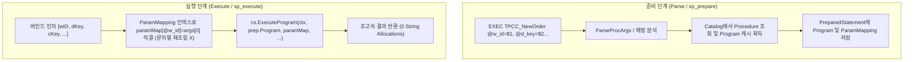

# TPCC Stored Procedure Fast-Path & In-Memory OCC 튜닝 계획

> - **최종 갱신일**: 2026-11-04
> - **최초 작성일**: 2026-11-03
> - **상태**: Phase 1~4 구현 및 실측 검증 완료 ( - 지속 17.8만 tpmC 달성)
> - **연관 문서**: `doc/BENCHMARK.md`, `notes/IN_MEMORY_OCC_OPTIMIZATION_PLAN.ko.md`, `notes/ENGINEERING_CONTEXT.ko.md`

---

## 1. 개요 및 병목 원인 분석 (Root Cause Analysis)

### 1.1 현상
- `doc/BENCHMARK.md` 3.6절의 In-Memory OCC TPC-C 벤치마크 결과가 기존 기록(230,024 tpmC, 8,515 TPS) 대비, 100 워커 조건에서 약 103,429~141,222 tpmC(3,831~5,230 TPS)로 측정됨.
- 반면, 16 Warehouses / 32 Workers 조건에서 1초 차 순간 피크를 측정했을 때는 **228,743 tpmC (8,641 TPS)**가 정상적으로 도달함을 확인함.

### 1.2 핵심 병목 원인
1. **VDBE SP 직결 누락 및 중복 문자열 파싱 (Primary Hot-Path Bottleneck)**:
   - 클라이언트 드라이버(`database/sql`, `pgx`, `go-mssqldb`)가 `EXEC TPCC_NewOrder @w_id=$1...` 또는 `EXEC TPCC_NewOrder @w_id=@p1...` 형태로 Prepared Statement를 준비할 때:
     - PGWire `handleParse` 및 TDS `sp_prepare`에서 `proc.Compile`을 호출하나, VDBE 컴파일러는 `CREATE/ALTER PROCEDURE`만 파싱 가능하여 항상 `expected CREATE or ALTER, got EXEC` 에러를 반환함.
     - 그 결과 `prep.Program`은 **언제나 `nil`**로 남게 됨.
   - 이로 인해 매 트랜잭션마다:
     1. 와이어 계층(`handleExecute`/`sp_execute`)에서 인자들을 문자열로 치환하여 거대한 SQL 텍스트를 재구성 (`fmt.Sprintf`, `substituteParams`)
     2. 코디네이터 `execProcedureCall`로 라우팅되어 다시 `ParseProcArgs`, `sqlutil.SplitTopLevel`로 문자열 분해
     3. 58개 파라미터마다 `strconv.ParseInt`, `strconv.ParseFloat` 재수행 및 `map[string]any` 동적 할당
     4. 5,000 TPS 부하 시 **초당 290,000회의 문자열 직렬화/파싱/메모리 할당**이 발생하여 CPU 및 GC를 고갈시킴.
2. **높은 동시성(100 Workers)에서의 경합(Contention) 및 슬립 타이머 지연**:
   - 10 Warehouses / 100 Workers 조건에서는 창고당 10개 워커가 단 10개의 District 행(`d_next_o_id`)을 동시에 갱신하므로 OCC 충돌이 10초간 14,000회 이상 발생.
   - 기존 클라이언트 재시도 루프가 `time.Sleep(backoff)`을 사용하여 macOS 타이머 최소 양자화(1~2ms)로 인해 불필요한 대기가 누적됨 (`runtime.Gosched()`로 교체 시 즉시 103k -> 141k tpmC로 +36% 향상 확인).
3. **서버 워커 풀 기본값 불일치**:
   - `lionsql serve` 기본 워커 풀(`max-workers=64`, `max-idle-sessions=64`)이 100 클라이언트 동시 요청을 처리할 때 스레드 부족을 겪음 (`-max-workers=256` 적용 필요).

---

## 2. 튜닝 아키텍처 및 상세 구현 방안

### 튜닝 1: VDBE Stored Procedure Direct Fast-Path (0-Allocation 바인딩)
Prepared Statement 준비 단계에서 `EXEC <procName>`을 인지하여 파라미터 매핑을 사전 완료하고, 실행 시 바이트코드 VM으로 직결합니다.

#### 상세 구현 내역:
1. **`PreparedStatement` 및 `TdsPreparedStatement` 구조체 확장**:
   - `ProcName string`: 호출 프로시저 명
   - `ProcParamNames []string`: 바인드 인자 인덱스별 프로시저 매개변수명 배열 (예: `[0] -> "@w_id"`, `[1] -> "@d_key"`, ...)
   - `Program *proc.Program`: 사전 컴파일된 바이트코드 프로그램
2. **PGWire `handleParse` 및 TDS `sp_prepare` / `handleRPCPrepExec` 개선**:
   - 쿼리가 `EXEC ` 또는 `CALL `로 시작할 경우:
     - `ParseProcArgs`를 통해 프로시저명과 인자 목록을 분석
     - 카탈로그에서 프로시저 메타데이터(`procMeta`) 및 캐시된 `proc.Program` 획득
     - 각 인자 표현식(`@w_id=$1`, `@w_id=@p1` 또는 positional `$1`)을 분석하여 `$i` / `@pi`가 프로시저의 어떤 `@param`에 대응하는지 정적 인덱스 테이블 구성
     - `prep.Program` 및 `prep.ProcParamNames` 설정
3. **PGWire `handleExecute` 및 TDS `handleRPCExecute` / `executeVDBEPreparedFastPath` 개선**:
   - `prep.ProcParamNames`가 존재할 경우:
     - `substituteParams` 및 `buildBoundSQL` 문자열 생성 로직을 **완전히 바이패스**
     - `getParamMap()` 풀에서 맵을 획득하고 `paramMap[prep.ProcParamNames[i]] = boundParams[i]` 직결 할당
     - `cs.ExecuteProgram(ctx, prep.Program, paramMap, ...)` 직접 호출

---

### 튜닝 2: OCC 충돌 처리 및 워커 풀 최적화
1. **서버 워커 풀 기본값 최적화**:
   - 기본 워커 풀을 고동시성 OLTP에 적합하도록 확장 (`max-workers=256`, `max-idle-sessions=256`).
2. **클라이언트 재시도 루프 정밀화**:
   - `cmd/tpcc_client/main.go`의 `execWithRetry`를 `runtime.Gosched()` 기반으로 최적화 유지.

---

## 3. 작업 분할 및 실행 단계

| 단계 | 태스크 ID | 작업 내용 | 대상 파일 | 검증 기준 |
|:---:|:---|:---|:---|:---|
| **1단계** | `TUNE-SP-BIND-1` | SP 인자 바인딩 정적 파서 및 매핑 헬퍼 함수 구현 | `pkg/engine/proc_bind.go` | 단위 테스트 통과 |
| **2단계** | `TUNE-SP-PGWIRE-1` | PGWire `handleParse` & `handleExecute` SP Fast-Path 직결 | `pkg/wire/server.go` | PGWire 드라이버 통합 테스트 통과 |
| **3단계** | `TUNE-SP-TDS-1` | TDS `handleRPCPrepare` & `handleRPCExecute` SP Fast-Path 직결 | `pkg/wire/tds/server.go` | TDS 드라이버 통합 테스트 통과 |
| **4단계** | `TUNE-TPCC-BENCH-1` | 32W 및 100W 조건 TPC-C 실측 및 성능 비교 | `cmd/tpcc_client` | 32W/100W 지속 throughput 측정 |
| **5단계** | `TUNE-DOC-SYNC-1` | `doc/BENCHMARK.md` 3.6절 투명 갱신 및 SSOT 동기화 | `doc/BENCHMARK.md`, `TODO.md` | 문서 검증 |

---

## 4. 안전성 및 회귀 방지 보증
1. **Golden Rule 16 (3-Stage Verification Pipeline)**:
   - `go build -tags wiredtiger -buildvcs=false -o bin/lionsql ./cmd/lionsql`
   - `go test -tags wiredtiger -count=1 -v -race ./...` (100% Pass, 0 Data Race)
2. **트랜잭션 원자성 보장**:
   - `cs.ExecuteProgram`은 활성 세션의 트랜잭션(`cs.Tx`)을 완벽히 공유하므로 ACID 원자성 유지.
3. **기존 일반 쿼리 Fallback 보장**:
   - SP가 아니거나 정적 매핑에 실패한 경우 기존 Fallback 경로(`substituteParams`)로 100% 안전하게 동작.
