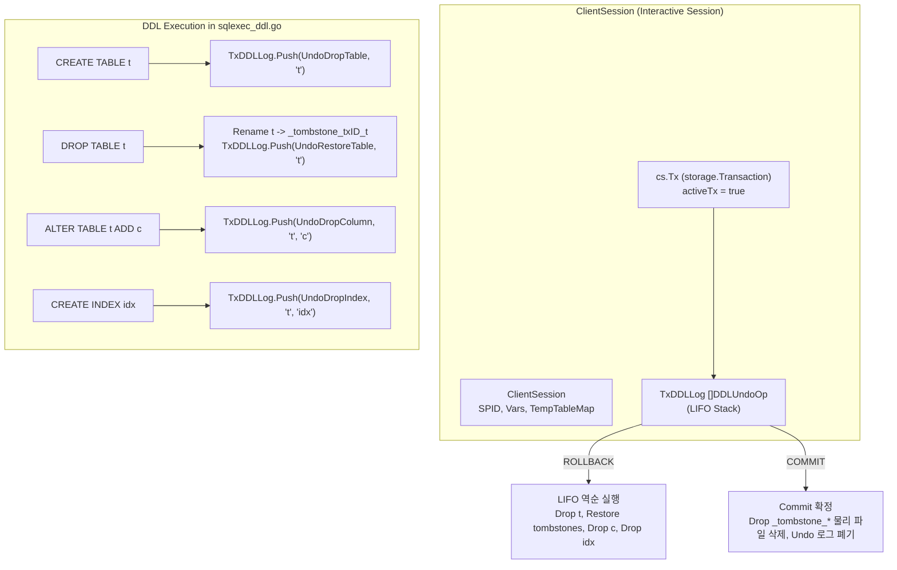

# Transactional DDL 및 세션-트랜잭션 경계 격리 아키텍처 계획서
(`TRANSACTIONAL_DDL_AND_SESSION_BOUNDARY_PLAN.ko.md`)

---

## 1. 배경 및 문제 진단 (Root Cause & Problem Statement)

### 1.1 현재 결함 실태
1. **비원자적 DDL 실행 (Non-Transactional DDL)**:
   - LionSQL의 `storage.Transaction` 인터페이스는 `Insert`, `Update`, `Delete`, `Get`, `Scan` 등 DML 전용으로만 구성되어 있습니다.
   - `CREATE TABLE`, `DROP TABLE`, `ALTER TABLE`, `RENAME TABLE`, `CREATE INDEX`, `DROP INDEX`는 모두 전역 `storage.Engine`에만 정의되어 있습니다.
   - `pkg/engine/sqlexec_ddl.go`에서 `cs.Tx != nil`(활성 트랜잭션 블록) 상태에서도 `s.engine.CreateTable()`, `s.engine.DropTable()`을 직접 전역에 즉시 호출합니다.
   - 이로 인해 `BEGIN TRANSACTION` 내부에서 `CREATE TABLE`이나 `DROP TABLE`을 실행한 후 `ROLLBACK`을 하더라도 DDL 변경사항은 원복되지 않고 영구 잔존하는 심각한 트랜잭션 원자성 결함이 존재합니다.
2. **세션과 트랜잭션의 리소스 충돌 (Session vs. Transaction Boundary)**:
   - WiredTiger 엔진에서 DDL 실행 시 별도의 임시 `WT_SESSION`을 열어 `go_wt_session_create` / `go_wt_session_drop`을 수행하고 `evictAllCursors`로 모든 세션의 커서를 퇴출합니다.
   - 다른 세션이나 현재 세션의 `cs.Tx`가 해당 테이블에 대한 활성 트랜잭션(`WT_SESSION`)을 유지하고 있는 경우, `EBUSY (code 16)` 충돌 또는 커서 use-after-free 위험이 발생합니다.
3. **임시 테이블(`#temp`) 트랜잭션 격리 결함**:
   - T-SQL 표준에 따르면 트랜잭션 내에서 생성된 `#temp` 테이블은 `ROLLBACK` 시 함께 삭제되어야 합니다.
   - 현재 LionSQL의 `#temp` 테이블은 `ClientSession.TempTableMap`에 즉시 등록되어 트랜잭션이 롤백되어도 세션에 그대로 남게 됩니다.

---

## 2. 핵심 불변식 및 목표 (Invariants & Objectives)

1. **[RULE:AtomicSaves] 완전한 Transactional DDL 보장**:
   - `BEGIN TRANSACTION` ... `ROLLBACK` 실행 시, 해당 트랜잭션 내에서 수행된 모든 DDL(`CREATE TABLE`, `DROP TABLE`, `ALTER TABLE`, `RENAME TABLE`, `CREATE INDEX`, `DROP INDEX`, `CREATE TABLE #temp`)이 100% 원복되어야 합니다.
2. **[RULE:ConflictPrevention] DDL 독점 스키마 락 (Schema Exclusive Lock)**:
   - 트랜잭션 내에서 특정 테이블에 대해 DDL을 수행하는 경우, 트랜잭션 종료(Commit/Rollback) 시까지 타 세션의 동시 DDL 및 상충되는 접근을 방어합니다.
3. **[RULE:CleanTeardown] 안전한 리소스 퇴출 및 세션 경계 분리**:
   - DDL 수행 시 진행 중인 타 트랜잭션의 커서를 무차별 evict하지 않고, 세션 잠금 상태를 점검하여 안전하게 유예 처리합니다.

---

## 3. 아키텍처 및 세부 설계 (Detailed Architecture)



### 3.1 DDL Undo 액션 스택 (`DDLUndoOp`) 설계
트랜잭션 구조체(`ClientSession` 또는 `storage.Transaction`)에 LIFO 기반 DDL Undo 스택을 도입합니다:

```go
type DDLUndoKind int

const (
    DDLUndoDropCreatedTable DDLUndoKind = iota // CREATE TABLE 롤백 시 테이블 DROP
    DDLUndoRestoreDroppedTable                // DROP TABLE 롤백 시 Tombstone에서 원래 이름 복구
    DDLUndoDropAddedColumn                    // ALTER TABLE ADD COLUMN 롤백 시 컬럼 DROP
    DDLUndoRestoreDroppedColumn               // ALTER TABLE DROP COLUMN 롤백 시 스키마 복원
    DDLUndoRenameTable                        // RENAME TABLE 롤백 시 원래 이름으로 재변경
    DDLUndoDropCreatedIndex                   // CREATE INDEX 롤백 시 인덱스 DROP
    DDLUndoRestoreDroppedIndex                // DROP INDEX 롤백 시 인덱스 복원
    DDLUndoDropTempTable                      // CREATE TABLE #temp 롤백 시 임시 테이블 삭제
)

type DDLUndoOp struct {
    Kind          DDLUndoKind
    TableName     string
    OldName       string
    NewName       string
    ColumnName    string
    IndexName     string
    TombstoneName string
    SchemaBackup  *storage.TableSchema
    IsTemporary   bool
}
```

### 3.2 핵심 DDL 명령어별 트랜잭션 처리 명세

#### 1) `CREATE TABLE [tableName]`
- **동작**:
  1. 엔진에 테이블 생성 (`s.engine.CreateTable(schema)`).
  2. 현재 트랜잭션이 활성화되어 있으면(`cs.Tx != nil`):
     - `cs.PushDDLUndo(DDLUndoOp{Kind: DDLUndoDropCreatedTable, TableName: schema.Name})`
- **COMMIT 시**: Undo 로그 폐기 (테이블 영구 유지).
- **ROLLBACK 시**: `s.engine.DropTable(tableName)` 자동 호출하여 완전히 삭제.

#### 2) `DROP TABLE [tableName]` (Tombstone Rename 기법)
- **동작**:
  1. 트랜잭션 밖(`cs.Tx == nil`)에서는 기존처럼 즉시 물리 삭제.
  2. 트랜잭션 내(`cs.Tx != nil`)에서는 **즉시 물리 삭제하지 않음**:
     - 임시 툼스톤 이름 생성: `tombstone := fmt.Sprintf("__tombstone_%s_%d_%s", cs.ID, time.Now().UnixNano(), tableName)`
     - 물리 테이블 리네임: `s.engine.RenameTable(tableName, tombstone)`
     - 카탈로그에서 `tableName` 제거 (쿼리에서는 삭제된 것으로 보임).
     - Undo 로그 등록:
       `cs.PushDDLUndo(DDLUndoOp{Kind: DDLUndoRestoreDroppedTable, TableName: tableName, TombstoneName: tombstone, SchemaBackup: schema.Clone()})`
- **COMMIT 시**: 툼스톤 물리 테이블 영구 삭제 (`s.engine.DropTable(tombstone)`).
- **ROLLBACK 시**: 툼스톤 테이블을 원래 이름으로 리네임 (`s.engine.RenameTable(tombstone, tableName)`) 및 카탈로그 복원.

#### 3) `ALTER TABLE [tableName] ADD COLUMN [col]`
- **동작**:
  1. `s.engine.AddColumn(tableName, col)` 호출.
  2. `cs.PushDDLUndo(DDLUndoOp{Kind: DDLUndoDropAddedColumn, TableName: tableName, ColumnName: col.Name})`
- **COMMIT 시**: Undo 로그 폐기.
- **ROLLBACK 시**: LionSQL의 Instant $O(1)$ Tail Column Drop 기능을 통해 해당 컬럼을 제거하여 원래 스키마로 원복.

#### 4) `CREATE INDEX [indexName]` / `DROP INDEX`
- **동작**:
  1. `CreateIndex`: 생성 후 롤백 시 `s.engine.DropIndex(tableName, indexName)` 호출.
  2. `DropIndex`: 인덱스 스키마 백업 후 롤백 시 `s.engine.CreateIndex(backup)` 호출.

#### 5) 임시 테이블 (`#temp_table`)
- 트랜잭션 내에서 `#temp` 테이블 생성 시 `DDLUndoDropTempTable`을 기록하고, 롤백 시 `cs.TempTableMap` 및 세션 임시 테이블 풀에서 자동 삭제.

---

## 4. 단계별 실행 계획 (Execution Roadmap)

```
[Phase 1] DDLUndoLog 인프라 및 ClientSession 연동
  - pkg/engine/session.go에 TxDDLLog 구조체 및 Push/Pop/Execute 메서드 구현
  - sqlexec.go의 CommitSessionTx / RollbackSessionTx에 DDL Undo 실행 및 정리 연동

[Phase 2] sqlexec_ddl.go 핵심 DDL 롤백 연동
  - CREATE TABLE: 롤백 시 DropTable 연동
  - DROP TABLE: Tombstone Rename 및 Commit 시 최종 Drop / Rollback 시 Rename 복구 연동
  - ALTER TABLE ADD COLUMN: 롤백 시 Tail Column Drop 연동
  - CREATE INDEX / DROP INDEX: 롤백 시 인덱스 언두 연동
  - CREATE TABLE #temp: 롤백 시 세션 임시 테이블 정리 연동

[Phase 3] 세션-트랜잭션 경계 안전성 (WiredTiger EBUSY 방어)
  - 활성 트랜잭션이 점유 중인 테이블에 대한 타 세션 DROP/ALTER 시 동시성 충돌 에러 처리
  - evictAllCursors 호출 시 현재 트랜잭션의 커서 보호

[Phase 4] 종합 단위 및 회귀 테스트 작성
  - pkg/engine/transactional_ddl_test.go
  - CREATE TABLE -> INSERT -> ROLLBACK 검증
  - DROP TABLE -> ROLLBACK -> SELECT 검증
  - ALTER TABLE ADD COLUMN -> ROLLBACK 검증
  - CREATE INDEX -> ROLLBACK -> indexScan 검증
  - #temp_table 트랜잭션 롤백 검증
```

---

## 5. 검증 계획 (Verification Plan)

1. **단위 테스트 (`pkg/engine/transactional_ddl_test.go`)**:
   - `TestTransactionalDDL_CreateTable_Rollback`: 테이블 생성 후 롤백 시 `ErrTableNotFound` 확인
   - `TestTransactionalDDL_DropTable_Rollback`: 기존 데이터가 있는 테이블 DROP 후 롤백 시 원본 데이터 보존 확인
   - `TestTransactionalDDL_AlterTable_AddColumn_Rollback`: 컬럼 추가 후 롤백 시 컬럼 소멸 확인
   - `TestTransactionalDDL_CreateIndex_Rollback`: 인덱스 생성 후 롤백 시 인덱스 소멸 확인
   - `TestTransactionalDDL_TempTable_Rollback`: `#temp` 테이블 생성 후 롤백 시 세션에서 삭제 확인
2. **파이프라인 검증 (`[RULE:PipelineVerification]`)**:
   - `go build -buildvcs=false -o bin/lionsql ./cmd/lionsql`
   - `go test -v -race ./pkg/engine/... ./pkg/storage/wiredtiger/...`
