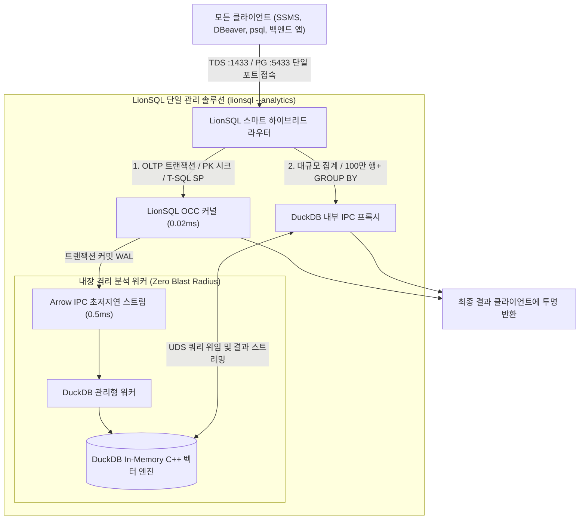
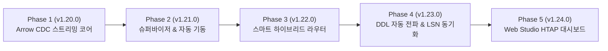

# LionSQL ➔ Post-1.0 올인원 HTAP 솔루션 아키텍처 계획서 (LionSQL + DuckDB Unified Solution)

> **문서 식별자**: `notes/UNIFIED_HTAP_ALL_IN_ONE_SOLUTION_PLAN.ko.md`  
> **타겟 마일스톤**: `Post-1.0` (`v1.20.0` Enterprise HTAP)  
> **우선순위**: P2 | **도메인**: Architecture / HTAP  
> **관련 문서**: [`notes/LION_DUCKDB_ARROW_CDC_STREAMING_PLAN.ko.md`](LION_DUCKDB_ARROW_CDC_STREAMING_PLAN.ko.md), [`doc/CDC_DUCKDB_INTEGRATION.ko.md`](../doc/CDC_DUCKDB_INTEGRATION.ko.md), [`doc/ADR.md`](../doc/ADR.md)  
> **작성일**: 2026-11-25 | **상태**: Draft (승인 대기)

---

## 1. 마일스톤 포지셔닝 및 추진 배경

### 1.1 왜 1.0 GA 이후(Post-1.0)에 진행해야 하는가?
현재 LionSQL의 `v0.95.0 ~ 1.0-GA` 로드맵의 절대적인 최우선 과제는 **"단일 인스턴스 코어 트랜잭션(ACID) 무결성, T-SQL 저장 프로시저 완벽 실행, 그리고 와이어 프로토콜 안정성 완성"**입니다.  
이 기반이 100% 견고하게 안착하기 전에 외부 분석 엔진과의 올인원 패키징을 무리하게 병합하면, 제품의 코어 정체성(초경량 고신뢰성 임베디드 OLTP)이 흐려지고 복잡도가 급증하게 됩니다.

따라서 본 계획은 **1.0 GA 릴리스 완료 이후, 기업용 엔터프라이즈 하이브리드 데이터베이스(HTAP) 시장을 본격 공략하기 위한 `Post-1.0 (v1.20.0)` 마일스톤의 전략 과제**로 정식 편성합니다.

### 1.2 최종 목표 (Vision)
사용자나 개발자가 파이썬 스크립트를 따로 띄우거나 별도의 분석 포트로 접속할 필요 없이, **단 하나의 LionSQL 실행 파일(`lionsql --analytics`)을 실행하는 것만으로 SAP HANA 수준의 초고속 OLTP(218k TPS)와 대규모 컬럼형 빅데이터 분석(초당 1억 행)을 단일 엔드포인트에서 제공하는 완벽한 올인원 RDBMS**를 완성합니다.

---

## 2. 5대 핵심 아키텍처 컴포넌트

### 2.1 [컴포넌트 1] 스마트 하이브리드 쿼리 라우터 (Smart Hybrid Query Router)
- **개념**: 클라이언트는 기존과 동일하게 `:1433`(TDS) 또는 `:5433`(PGWire) 단일 포트로만 접속하며, 쿼리의 성격에 따라 엔진이 실행 주체를 자율 판단.
- **CBO 플래너 분기 규칙**:
  1. **OLTP 패스 (LionSQL OCC 직결)**:
     - 모든 DML (`INSERT`, `UPDATE`, `DELETE`, `MERGE`).
     - 트랜잭션 블록 (`BEGIN TRAN`, `COMMIT`, `SAVEPOINT`).
     - T-SQL 저장 프로시저 및 제어문 (`EXEC`, `IF`, `WHILE`, `TRY...CATCH`).
     - 인덱스 기반 포인트 쿼리 (`WHERE id = ?`, 소규모 범위 스캔).
  2. **OLAP 패스 (DuckDB 위임)**:
     - 10,000행 이상의 대규모 테이블에 대한 비인덱스 집계 (`SELECT category, sum(amount) FROM ... GROUP BY category`).
     - 복합 윈도우 함수 및 다차원 피벗 분석.
  3. **투명한 결과 프록시**: DuckDB의 실행 결과 레코드를 PGWire/TDS 토큰 스트림으로 가로채어 클라이언트에 즉시 응답 (클라이언트는 DuckDB의 존재를 알 필요가 없음).

### 2.2 [컴포넌트 2] DDL 스키마 실시간 자동 전파 (Auto DDL Propagation)
- **개념**: LionSQL에서 스키마가 변경되면 DuckDB 분석 테이블도 즉시 자동 동기화.
- **동작 메커니즘**:
  - `CREATE TABLE`, `ALTER TABLE ADD/DROP COLUMN`, `DROP TABLE` 실행 시, LionSQL CDC 스트림에 DDL 메타 이벤트(`op="DDL"`, `sql="..."`)를 생성하여 방출.
  - DuckDB 워커는 이를 수신하여 자신의 인메모리 테이블 스키마에 동일한 DDL을 즉시 반영하여 컬럼 불일치 원천 차단.

### 2.3 [컴포넌트 3] 무설정 서브시스템 슈퍼바이저 (Zero-Config Subsystem Supervisor)
- **개념**: 외부 의존성(파이썬, 외부 데몬) 없이 LionSQL 단일 실행 파일이 분석 워커의 생명주기를 총괄.
- **동작 메커니즘**:
  - `lionsql --analytics` CLI 플래그 제공.
  - LionSQL 부모 프로세스가 기동될 때, 내장된 C++/Go 경량 DuckDB 워커 바이너리를 자식 프로세스로 자동 스폰(`os/exec`) 및 Unix Domain Socket(`/tmp/lionsql_htap.sock`) 연결 수립.
  - **`[RULE:CleanTeardown]` 엄격 준수**: LionSQL이 종료되면 1.5초 내에 자식 DuckDB 프로세스를 `SIGTERM` ➔ `SIGKILL`로 안전하게 회수하여 고아 프로세스 발생 0건 보장.
  - **`[RULE:StaticBinary]` 유지**: DuckDB C++ 엔진을 LionSQL 코어 바이너리에 직접 CGo 링크하지 않고 독립 자식 프로세스로 분리함으로써, LionSQL 코어의 순수 Go 정적 컴파일 및 크래시 격리(Zero Blast Radius) 완벽 유지.

### 2.4 [컴포넌트 4] LSN 기반 트랜잭션 일관성 스냅샷 (Transaction-Consistent Snapshot)
- **개념**: 0.5ms의 미세한 복제 지연으로 인해 방금 커밋한 데이터가 분석 쿼리에서 누락되는 현상(Read-Your-Own-Writes 위반) 방지.
- **동작 메커니즘**:
  - 클라이언트 세션이 `SET TRANSACTION SNAPSHOT SYNCHRONOUS` 옵션을 켜면, 쿼리 라우터는 LionSQL의 현재 커밋 LSN을 DuckDB 쿼리 헤더에 실어 보냄.
  - DuckDB 워커는 전달받은 LSN까지의 Arrow 배치를 인제스천 완료할 때까지 대기(Wait-for-LSN, 보통 수십 µs 수준)한 직후 분석 쿼리를 수행하여 100% ACID 읽기 일관성 보장.

### 2.5 [컴포넌트 5] 내장 Web Studio 실시간 HTAP 대시보드
- **개념**: LionSQL 내장 웹 관리 도구(`http://localhost:8090/_/`)에서 OLTP 관리와 실시간 빅데이터 시각화를 동시에 제공.
- **기능 명세**:
  - **[HTAP Analytics] 탭 신설**:
    - 실시간 동기화 상태 계측기 (초당 동기화 행 수, LSN Lag, DuckDB 메모리 점유율).
    - 수천만 건의 데이터를 0.1초 만에 집계하여 렌더링하는 내장 Plotly 인터랙티브 차트(시계열 매출 추이, 카테고리별 파이 차트).
    - DuckDB 전용 임의 쿼리 에디터 및 실행 계획(EXPLAIN) 뷰어 내장.

---

## 3. 단계별 실행 로드맵 (Post-1.0 Roadmap)

| 단계 | 마일스톤 | 핵심 개발 과제 | 산출물 |
| :--- | :---: | :--- | :--- |
| **Phase 1** | `v1.20.0` | **Arrow CDC 스트리밍 코어 안착** • `GET /api/cdc/stream?format=arrow` 구현 • DuckDB용 공식 고속 인제스천 파이프라인 수립 | `pkg/cdc/arrow_codec.go` |
| **Phase 2** | `v1.21.0` | **무설정 서브시스템 슈퍼바이저** • `lionsql --analytics` 플래그 지원 • 자식 프로세스 자동 스폰, UDS 연결 및 Clean Teardown | `pkg/analytics/supervisor.go` |
| **Phase 3** | `v1.22.0` | **스마트 하이브리드 라우터 (CBO Planner)** • 대규모 집계 쿼리 DuckDB 내부 투명 위임 • 와이어 프로토콜 단일 포트 프록시 구현 | `pkg/engine/sqlexec_hybrid.go` |
| **Phase 4** | `v1.23.0` | **DDL 전파 및 LSN 정합성 보장** • DDL 메타 이벤트 스트림 동기화 • Wait-for-LSN 동기화 배리어 구현 | `pkg/analytics/sync_barrier.go` |
| **Phase 5** | `v1.24.0` | **Web Studio HTAP 실시간 대시보드** • 내장 웹 스튜디오 내 분석 차트 탭 통합 • 실시간 메트릭 스트리밍 모니터링 UI | `pkg/studio/embed/` |

---

## 4. 아키텍처 불변식 준수 검증 (Guardrails)

1. **`[RULE:StaticBinary]`**: DuckDB C++ 엔진을 LionSQL 코어에 직접 링크하지 않고 분리된 서브프로세스로 구동하여, LionSQL 코어의 순수 Go 정적 컴파일(`CGO_ENABLED=0`)을 100% 영구 보존한다.
2. **`[RULE:CleanTeardown]`**: LionSQL이 예기치 않게 종료되거나 `SIGKILL`을 맞더라도, 자식 프로세스 감시자(Heartbeat/Pipe EOF)를 통해 분석 워커가 백그라운드에 남아 자원을 낭비하지 않도록 강제 종료한다.
3. **`Zero Blast Radius`**: 아무리 거대한 분석 쿼리가 OOM을 유발하더라도, 영향을 받는 것은 격리된 분석 서브프로세스뿐이며, LionSQL 코어의 고객 주문/결제(OLTP)는 0.02ms 지연으로 무중단 서비스된다.
