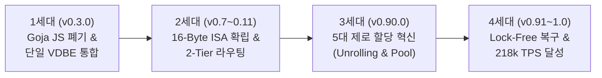

# LionSQL VDBE & Bytecode 아키텍처 마스터 디렉토리 (`VDBE_BYTECODE_DIRECTORY.ko.md`)

> - **작성일**: 2026-11-12
> - **상태**: Single Source of Truth (SSOT) Directory & Map
> - **관련 핵심 패키지**: `pkg/proc/`, `pkg/proc/runtime/`, `pkg/proc/parser/antlr/`

---

## 1. 개요 (Overview)

본 문서는 LionSQL의 핵심 실행 엔진인 **T-SQL VDBE(Virtual Database Engine) 및 16-Byte 바이트코드 가상머신**과 관련된 모든 설계 명세서, 아키텍처 결정 기록(ADR), 4세대에 걸친 성능 튜닝 백서, 컴파일러 Lowering 계획서, 그리고 회귀 검증 스위트를 한눈에 탐색할 수 있도록 구조화한 **마스터 디렉토리(Master Directory)**입니다.

LionSQL에서 VDBE가 왜 탄생했고, 어떻게 16바이트 고정 명령어 구조를 확립했으며, 어떤 최적화를 거쳐 **218,282 TPS (OCC) / 141,472 TPS (WiredTiger)** 및 **TPC-C 75.9만~86.3만 tpmC**에 도달했는지에 대한 전체 서사(Narrative)를 시간순과 주제별로 안내합니다.

---

## 2. VDBE & 바이트코드 4세대 진화 타임라인 (Chronological Narrative)

VDBE 관련 문서를 처음 접하거나 역사적 맥락을 따라가고자 할 때 아래의 **1세대 ➔ 4세대 순서**로 읽으면 앞뒤가 끊기지 않는 일관된 스토리라인을 파악할 수 있습니다.

| 세대 | 버전 / 시기 | 핵심 아키텍처 전환점 | 대표 문서 (읽기 순서) |
|:---:|:---:|---|---|
| **1세대** | `v0.3.0` | **Goja JS 런타임 전면 폐기 및 단일 T-SQL VDBE 통합** • 초기 프로토타입의 JS 인터프리터(`dop251/goja`)가 유발하던 힙 할당 및 타입 변환 병목 제거 • 스토어드 프로시저와 대화형 SQL(`SELECT/DML`)을 단일 VDBE 바이트코드 파이프라인으로 일원화 | 1. [`ENGINEERING_CONTEXT.ko.md` (§1.⑨, §2.①)](ENGINEERING_CONTEXT.ko.md) 2. [`doc/internal/VDBE.md`](../doc/internal/VDBE.md) |
| **2세대** | `v0.7.0` ~ `v0.11.0` | **16-Byte 고정폭 ISA 확립, Fused Jump 및 2-Tier 하이브리드 아키텍처 완성** • L1 캐시 라인(64B)에 정확히 4개씩 정렬되는 **16바이트 `Instruction`** 및 8바이트 압축 영구 기각(`§1.㉜`) • `OpLeJumpFalse` 등 복합 비교-점프 명령어(Superinstruction)와 `OpAddInt` 정수 전용 Fast-Path 도입 • 단순 OLTP는 Tier 1(VDBE), 복합 관계대수(JOIN/Window/CTE)는 Tier 2(Volcano CBO)로 분리 | 3. [`QUERY_EXECUTION_2TIER_ARCHITECTURE.ko.md`](QUERY_EXECUTION_2TIER_ARCHITECTURE.ko.md) 4. [`ARCH_VDBE_ROUTING_1_PLAN.ko.md`](plans/ARCH_VDBE_ROUTING_1_PLAN.ko.md) 5. [`WRITABLE_CTE_BYTECODE_LOWERING_PLAN.ko.md`](plans/WRITABLE_CTE_BYTECODE_LOWERING_PLAN.ko.md) |
| **3세대** | `v0.90.0` | **VDBE 런타임 5대 제로 할당(Zero-Allocation) 극한 튜닝** • ① 4-Way Loop Unrolling ② `vmFrame` `sync.Pool` 풀링 ③ 스키마/인덱스 포인터 컴파일 타임 바인딩(`Aux`) ④ `OpGetRow`/`OpUpdateRow` Fast-Path ⑤ `LocalTable` $O(1)$ 슬라이스 인덱싱 • PGWire(`Parse/Execute`) 및 TDS(`sp_prepexec`) 프리페어드 바이트코드 직결 실행 | 6. [`VDBE_VM_EXTREME_OPTIMIZATION_PLAN.ko.md`](plans/VDBE_VM_EXTREME_OPTIMIZATION_PLAN.ko.md) 7. [`TPCC_STORED_PROCEDURE_FASTPATH_TUNING_PLAN.ko.md`](plans/TPCC_STORED_PROCEDURE_FASTPATH_TUNING_PLAN.ko.md) 8. [`doc/internal/ZERO_ALLOCATION_ARCHITECTURE.md`](../doc/internal/ZERO_ALLOCATION_ARCHITECTURE.md) |
| **4세대** | `v0.91.0` ~ `1.0` | **키 래치/슬립 병목 해체, 218k TPS 돌파 및 CI 성능 회귀 게이트 봉인** • VDBE `KeyLatch` 샤드 뮤텍스 및 OCC 백오프 `time.Sleep(50µs)` 제거로 OS 스케줄러 컨텍스트 스위칭 박멸 • `TransferFunds` **218,282 TPS (OCC) / 141,472 TPS (WT)**, P50 **23.17µs** 달성 및 CI 게이트화 | 9. [`PERF_REGRESSION_RECOVERY_AND_GATE_PLAN.ko.md`](plans/PERF_REGRESSION_RECOVERY_AND_GATE_PLAN.ko.md) 10. [`GROVE_HOTSPOT_POSTMORTEM_AND_ASSETS.ko.md`](GROVE_HOTSPOT_POSTMORTEM_AND_ASSETS.ko.md) 11. [`doc/BENCHMARK.md` (§3.3, §3.5)](../doc/BENCHMARK.md) |

---

## 3. 주제별 문서 디렉토리 (Document Map by Category)

### Category A. 코어 ISA 명세 & 아키텍처 불변식 (Core ISA & Invariants)
VDBE 명령어 포맷(16-Byte), 레지스터 규약, 오프코드(Opcode) 레퍼런스 및 불변 설계 원칙을 다룹니다.

* **[`doc/internal/VDBE.md`](../doc/internal/VDBE.md)** *(English Official Internals)*
  * **역할**: VDBE 아키텍처 공식 인터널 레퍼런스 문서.
  * **핵심 내용**: 레지스터 할당 규약(`R[0]~R[63]`), `Instruction` 16-Byte 레이아웃, 카테고리별 오프코드 명세, 디스어셈블리 예제(`EXPLAIN BYTECODE`), 앰비언트 트랜잭션 연동 및 Dual-Level PlanNode 캐싱(`CachedQueryInfo`, `CachedPlan`).
* **[`doc/internal/ZERO_ALLOCATION_ARCHITECTURE.md`](../doc/internal/ZERO_ALLOCATION_ARCHITECTURE.md)** *(§4 Execution Engine & VDBE Layer)*
  * **역할**: 엔진 전 계층의 Zero-Allocation 설계 백서 중 VDBE 실행 계층 명세.
  * **핵심 내용**: 64-레지스터 슬라이스 `sync.Pool` 재활용, 16-Byte 고정폭 명령어 스트림을 통한 CPU L1 캐시 프리페처 극대화, 컴파일 타임 슬롯 해석(`OpGetSlot`).
* **[`notes/ENGINEERING_CONTEXT.ko.md`](ENGINEERING_CONTEXT.ko.md)** *(§1.⑨, §1.㉜, §2.①)*
  * **역할**: VDBE 관련 영구 불변식 및 기각된 대안(Negative Knowledge) 보존소.
  * **핵심 내용**:
    * `§1.⑨`: 단일 T-SQL VDBE 실행 엔진 불변성 (Goja JS 폐기 및 Dual-Parser 결합).
    * `§1.㉜`: **VDBE 16-Byte 고정폭 명령어 레이아웃 불변성 및 8-Byte 압축 영구 기각(Spec-Out)** — 왜 8바이트(`int16` 축소 또는 `uint64` 비트 패킹)가 대규모 배치 한계(32,767 캡)와 비트 마스킹 ALU 오버헤드를 유발하여 오히려 손해인지에 대한 정량적 분석.
    * `§2.①`: 중복 PL/pgSQL 인터프리터 영구 배제 및 단일 VDBE VM 일원화 원칙.

---

### Category B. 2-Tier 쿼리 라우팅 & 컴파일러 Lowering (Routing & Compiler Lowering)
SQL 쿼리와 T-SQL 구문이 어떤 기준으로 VDBE(Tier 1)와 Volcano CBO(Tier 2)로 나뉘며, 어떻게 바이트코드로 컴파일(Lowering)되는지를 다룹니다.

* **[`notes/QUERY_EXECUTION_2TIER_ARCHITECTURE.ko.md`](QUERY_EXECUTION_2TIER_ARCHITECTURE.ko.md)**
  * **역할**: **Tier 1 (VDBE Bytecode Fast-Path)** 과 **Tier 2 (Volcano CBO Engine)** 의 역할 분담을 정의한 영구 불변 아키텍처 헌장 (`ARCH-2TIER-1`).
  * **핵심 내용**: 왜 모든 복잡 관계대수 쿼리(12-Table JOIN, Window, Recursive CTE)를 억지로 바이트코드로 번역하지 않고 `OpRelQuery` 하이브리드 브릿지를 통해 Volcano CBO와 결합하는가에 대한 공학적 해답.
* **[`notes/plans/ARCH_VDBE_ROUTING_1_PLAN.ko.md`](plans/ARCH_VDBE_ROUTING_1_PLAN.ko.md)**
  * **역할**: 파서 단계의 결정론적 AST 특성 비트마스크(`QueryCharacteristics`) 기반 VDBE 라우팅 정규화 명세 (`ARCH-VDBE-ROUTING-1`).
  * **핵심 내용**: 문자열 휴리스틱을 배제하고 파싱 시점에 단일 테이블 PK Point Lookup/DML 여부를 $O(1)$ 비트마스크로 판별하여 서브마이크로초 VDBE Fast-Path로 직행시키는 파이프라인.
* **[`notes/plans/WRITABLE_CTE_BYTECODE_LOWERING_PLAN.ko.md`](plans/WRITABLE_CTE_BYTECODE_LOWERING_PLAN.ko.md)**
  * **역할**: `WITH ... INSERT/UPDATE/DELETE RETURNING` (Writable CTE) 구문을 에페메랄 테이블 변수와 루프 바이트코드로 직접 컴파일하는 Lowering 설계서 (`ARCH-CTE-VDBE-1`).
  * **핵심 내용**: 비재귀 선형 데이터 수정 CTE를 `OpDeclareTable` ➔ `OpInsertRow` ➔ 커서 루프 바이트코드로 Lowering하여 트랜잭션 원자성과 Zero-Regex 원칙을 동시에 달성한 과정.
* **[`notes/plans/TABLE_VARIABLE_SUPPORT_PLAN.ko.md`](plans/TABLE_VARIABLE_SUPPORT_PLAN.ko.md)**
  * **역할**: T-SQL 테이블 변수(`DECLARE @t TABLE (...)`)의 VDBE 바이트코드 생명주기 명세.
  * **핵심 내용**: `OpDeclareTable` 오프코드와 VM 프레임 내부 에페메랄 스토리지(`localTables`)를 통한 트랜잭션 롤백 무관(Rollback-Immune) 메모리 테이블 구현.

---

### Category C. VDBE 런타임 극한 성능 튜닝 & 회귀 방어 (Performance Tuning & Gates)
VDBE 가상머신의 명령어 디스패치 루프, 레지스터/프레임 풀링, 락 제거, 그리고 최종 실측 벤치마크 지표를 집대성한 백서입니다.

* **[`notes/plans/VDBE_VM_EXTREME_OPTIMIZATION_PLAN.ko.md`](plans/VDBE_VM_EXTREME_OPTIMIZATION_PLAN.ko.md)** *(Core Tuning Whitepaper)*
  * **역할**: **VDBE 바이트코드 VM 아키텍처 진화 및 극한 성능 튜닝 종합 백서 (1세대~4세대 통합본)**.
  * **핵심 내용**:
    * 1세대 Goja 교체부터 2세대 16-Byte ISA & Fused Jump, 3세대 5대 Zero-Alloc 런타임 혁신(4-Way Unrolling, `vmFrame` 풀링, 스키마 포인터 사전 바인딩, `OpGetRow`/`OpUpdateRow`, `LocalTable` 정수 인덱싱), 4세대 Lock-Free 복구까지의 전 과정.
    * **최종 실측 지표**: `cmd/bench` `TransferFunds` 프로시저 **OCC 218,282 TPS (P50 23.17µs)** / **WiredTiger 141,472 TPS (P50 38.75µs)**, `cmd/tpcc_runtime` **759k~863k tpmC**.
    * **§5 심층 분석**: 16-Byte vs 8-Byte 명령어 레이아웃의 L1 캐시/디코딩 트레이드오프 및 16-Byte 영구 채택 사유.
* **[`notes/plans/TPCC_STORED_PROCEDURE_FASTPATH_TUNING_PLAN.ko.md`](plans/TPCC_STORED_PROCEDURE_FASTPATH_TUNING_PLAN.ko.md)**
  * **역할**: PGWire Extended Query 및 TDS RPC에서 저장 프로시저 호출 시 SQL 파서를 우회하고 캐싱된 `*proc.Program` 바이트코드를 직접 실행하는 Fast-Path 튜닝 계획서.
  * **핵심 내용**: `OpGetSlot`/`OpUpdateSlot` 컴파일 타임 칼럼 오프셋 고정과 세션 간 프로시저 바이트코드 공유(`ProcedureProgramCache`)를 통한 실행 시간 63% 단축.
* **[`notes/plans/PERF_REGRESSION_RECOVERY_AND_GATE_PLAN.ko.md`](plans/PERF_REGRESSION_RECOVERY_AND_GATE_PLAN.ko.md)**
  * **역할**: VDBE `KeyLatch` 뮤텍스 및 OCC 백오프 슬립 제거를 통한 성능 회귀 복구 및 CI 성능 방어선 구축 보고서 (`PERF-RECOVERY-1`).
  * **핵심 내용**: `pkg/proc/runtime/perf_regression_gate_test.go`를 통해 VDBE `TransferFunds` 처리량이 회귀하지 않도록 강제하는 자동화 게이트.
* **[`notes/plans/MICRO_HOTPATH_ZERO_ALLOC_TUNING_PLAN.ko.md`](plans/MICRO_HOTPATH_ZERO_ALLOC_TUNING_PLAN.ko.md)**
  * **역할**: VDBE 프레임 슬림 초기화, 포지셔널 파라미터 슬라이스 직결(`PERF-VDBE-FRAME-SLIM-1`), OCC WAL Zero-Alloc, WiredTiger `InsertRow` 맵 우회 등 6대 마이크로 핫패스 제로 할당 튜닝 명세서.
* **[`notes/GROVE_HOTSPOT_POSTMORTEM_AND_ASSETS.ko.md`](GROVE_HOTSPOT_POSTMORTEM_AND_ASSETS.ko.md)**
  * **역할**: 고동시성 핫스팟 벤치마크 과정에서 발굴된 VDBE 슬롯 인덱싱 자산 및 OS 타이머 퀀텀(`time.Sleep`) 병목 분석 포스트모텀.
* **[`doc/BENCHMARK.md`](../doc/BENCHMARK.md)** *(§3.3 `cmd/bench` & §3.5 `cmd/tpcc_runtime`)*
  * **역할**: 공식 벤치마크 리포트 내 VDBE 바이트코드 실행 실측 섹션.

---

### Category D. T-SQL 호환성 매트릭스 & 검증 스위트 (Compatibility & Verification)
T-SQL 저장 프로시저 문법 호환성 범위, Dual-Parser 폴백, 그리고 AWS Babelfish 기반 SLT 검증 스위트를 다룹니다.

* **[`notes/TSQL_COMPATIBILITY_MATRIX.ko.md`](TSQL_COMPATIBILITY_MATRIX.ko.md)**
  * **역할**: T-SQL 프로시저 제어문(`IF...ELSE`, `WHILE`, `TRY...CATCH`, `RETURN`), 커서(`DECLARE/OPEN/FETCH/CLOSE`), 테이블 변수, 내장 함수 및 시스템 변수(`@@ROWCOUNT`, `@@ERROR`, `@@TRANCOUNT`) 전수 호환성 매트릭스.
* **[`notes/plans/BABELFISH_STORED_PROCEDURE_SLT_PLAN.ko.md`](plans/BABELFISH_STORED_PROCEDURE_SLT_PLAN.ko.md)** & **[`notes/reports/BABELFISH_INTEGRATION_REPORT.ko.md`](reports/BABELFISH_INTEGRATION_REPORT.ko.md)**
  * **역할**: AWS Babelfish for Aurora PostgreSQL의 T-SQL 저장 프로시저 테스트를 이식한 9개 SLT 스위트(`test/slt_proc/`) 구축 및 100% 통과 검증 보고서.

---

## 4. 소스 코드 패키지 맵 (Source Code Map)

VDBE 컴파일러와 런타임 가상머신을 구성하는 핵심 Go 소스 파일과 각 파일의 단일 책임(Single Responsibility)입니다.

| 소스 코드 경로 | 핵심 구조체 / 함수 | 역할 및 아키텍처 책임 |
|---|---|---|
| [`pkg/proc/bytecode.go`](file:///Users/maro/Projects/SQLion/pkg/proc/bytecode.go) | `OpCode`, `Instruction` (16B), `Program` | 60+ 오프코드 정의, **16-Byte 고정폭 명령어 구조체(Zero Padding)**, 상수 풀(`Constants`), 보조 메타데이터(`AuxData`), 역어셈블러(`Disassemble`) |
| [`pkg/proc/compiler.go`](file:///Users/maro/Projects/SQLion/pkg/proc/compiler.go) | `Compiler`, `CompileProcedure`, `CompileStatement`, `CompileQuery` | T-SQL AST를 선형 바이트코드로 컴파일, 레지스터 할당, `OpLeJumpFalse` 등 Fused Superinstruction 방출, Writable CTE Lowering |
| [`pkg/proc/characteristics.go`](file:///Users/maro/Projects/SQLion/pkg/proc/characteristics.go) | `QueryCharacteristics` | 파서 단계에서 쿼리 복잡도를 비트마스크로 마킹하여 Tier 1(VDBE Fast-Path) vs Tier 2(Volcano CBO) 라우팅을 $O(1)$ 결정 |
| [`pkg/proc/lexer.go`](file:///Users/maro/Projects/SQLion/pkg/proc/lexer.go) & [`parser.go`](file:///Users/maro/Projects/SQLion/pkg/proc/parser.go) | `Lexer`, `Parser` (Tier 1 Pratt) | 서브마이크로초 제로 할당 Native Pratt 파서 (Tier 1) 및 `ProcedureFallbackParser` SPI를 통한 ANTLR4 폴백(Tier 2) 연동 |
| [`pkg/proc/runtime/vm.go`](file:///Users/maro/Projects/SQLion/pkg/proc/runtime/vm.go) | `Executor`, `vmFrame`, `framePool` | **VDBE 가상머신 코어**: `vmFrame` `sync.Pool` 재활용, 4-Way Unrolled 디스패치 루프, `OpGetRow`/`OpUpdateRow`/`OpGetSlot` 실행, `TRY...CATCH` 예외 언와인딩 |
| [`pkg/proc/runtime/vm_dispatcher.go`](file:///Users/maro/Projects/SQLion/pkg/proc/runtime/vm_dispatcher.go) | `dispatchOpCode`, `OpcodeHandler` | 확장 오프코드 디스패치 테이블 및 모듈형 핸들러 레지스트리 |
| [`pkg/proc/runtime/plancache.go`](file:///Users/maro/Projects/SQLion/pkg/proc/runtime/plancache.go) | `PlanCache` | `OpRelQuery` 실행 시 파싱된 AST(`CachedQueryInfo`)와 최적화된 물리 플랜(`CachedPlan`)을 캐싱하여 재파싱/재플래닝 제거 |
| [`pkg/proc/runtime/regression_test.go`](file:///Users/maro/Projects/SQLion/pkg/proc/runtime/regression_test.go) | `TestDualParserFallback*`, `TestVDBE*` | Tier 1 Pratt 파서와 Tier 2 ANTLR4 폴백 파서의 동일 바이트코드 생성 및 VDBE 런타임 무결성 회귀 테스트 |
| [`pkg/proc/runtime/perf_regression_gate_test.go`](file:///Users/maro/Projects/SQLion/pkg/proc/runtime/perf_regression_gate_test.go) | `TestPerfGate_VDBE_TransferFunds` | VDBE 바이트코드 실행 처리량(TPS) 회귀를 차단하는 자동화 성능 게이트 |
