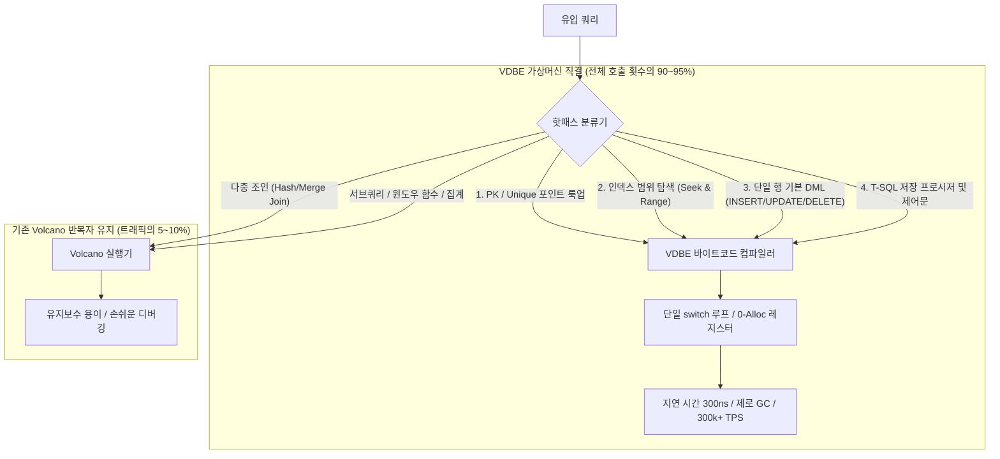

# LionSQL ➔ v1.1.0 VDBE 핫패스 골든 스윗스팟 확장 계획서 (VDBE Hot-Path Expansion Plan)

> **문서 식별자**: `notes/VDBE_HOTPATH_EXPANSION_PLAN.ko.md`  
> **타겟 마일스톤**: `v1.1.0` (1.0-GA 직후 최우선 성능 도약 과제)  
> **우선순위**: P1 | **도메인**: Execution / VM  
> **관련 문서**: [`doc/internal/BOUND_AST_AND_DEDICATED_BINDER_SPEC.ko.md`](../doc/internal/BOUND_AST_AND_DEDICATED_BINDER_SPEC.ko.md), [`doc/internal/PHYSICAL_TABLE_FORMAT.ko.md`](../doc/internal/PHYSICAL_TABLE_FORMAT.ko.md)  
> **작성일**: 2026-11-25 | **상태**: Draft (승인 대기)

---

## 1. 추진 배경 및 마일스톤 포지셔닝

### 1.1 왜 1.0 직후(v1.1.0)에 추진해야 하는가?
- `v0.95.0 ~ 1.0-GA` 구간에서는 **트랜잭션(ACID) 엄밀성, T-SQL 저장 프로시저 완결, 와이어 프로토콜 호환성**이라는 코어 안정성에 집중합니다.
- 1.0 GA 직후(`v1.1.0`)는 이미 구축된 **`BoundAST` (정수 슬롯 바인더)** 기반 위에서, 엔진의 실행 속도를 마이크로초 단위에서 **수백 나노초(300ns) 단위의 극한 성능으로 끌어올리는 최적의 타이밍**입니다.

### 1.2 "골든 스윗스팟 (Golden Sweet Spot)" 원칙: 복잡성의 함정 배제
SQLite는 20년에 걸쳐 조인, 서브쿼리, 윈도우 함수까지 100% VDBE 바이트코드로 컴파일하는 길을 걸었으나, 이는 컴파일러 코드가 수만 줄로 비대해지는 부작용을 낳았습니다.  
LionSQL은 `[RULE:RadicalKISS]` 원칙에 따라 **"가장 트래픽이 많은 핫패스 80%만 VDBE로 보내고, 복잡한 다중 조인은 기존 Volcano 반복자에 남기는 파레토 최적화"**를 채택합니다.

---

## 2. VDBE 영토 vs Volcano 영토 경계 명세

### 2.1 🟢 VDBE로 전면 직결하는 4대 핫패스 (High ROI)
1. **단일 테이블 포인트 룩업 (Point Lookup)**:
   - `SELECT col1, col2 FROM table WHERE pk = ?`
   - `SELECT * FROM table WHERE unique_key = ?`
2. **단일 테이블 인덱스 범위 탐색 (Index Seek & Range Scan)**:
   - `SELECT id, name FROM table WHERE created_at >= ? ORDER BY id LIMIT 20`
3. **단일 테이블 기본 DML (Point Mutations)**:
   - `INSERT INTO table (cols...) VALUES (...)`
   - `UPDATE table SET col = ? WHERE pk = ?`
   - `DELETE FROM table WHERE pk = ?`
4. **저장 프로시저 내부의 변수 계산, 분기(`IF`), 반복(`WHILE`), 커서 순회** (기존 지원 유지)

### 2.2 🛑 Volcano 반복자에 남겨두는 영역 (Keep It Simple)
1. **다중 테이블 조인 (Multi-Table Hash Join, Merge Join)**
2. **복합 윈도우 함수 (`OVER (PARTITION BY ... ROWS BETWEEN ...)` )**
3. **상관 서브쿼리 (Correlated Subquery) 및 재귀 CTE**

---

## 3. 핵심 아키텍처 및 세부 설계

### 3.1 `BoundAST` ➔ VDBE 레지스터 $O(1)$ 직결 컴파일러 (`pkg/proc/compiler_hotpath.go`)
- 1.0에서 구축된 `BoundAST`는 이미 컬럼명을 정수 인덱스(`Slot: 0, 1, ...`)로 매핑해 두었습니다.
- VDBE 컴파일러는 AST 순회 없이 정수 슬롯을 VDBE 레지스터 오프셋으로 1:1 치환합니다.
- **필수 VDBE 옵코드 8종**:
  - `OpOpenRead [cur, tbl_id]`: 테이블/인덱스 B-Tree 커서 획득.
  - `OpSeekEQ [cur, key_reg, jump_addr]`: 기본키/유니크 인덱스 즉시 시크 ($O(\log N)$).
  - `OpSeekGE [cur, key_reg, jump_addr]`: 범위 스캔 시작 위치 정렬.
  - `OpColumn [cur, col_slot, dst_reg]`: B-Tree 튜플의 물리 오프셋에서 값을 레지스터로 복사 (0-Alloc).
  - `OpResultRow [start_reg, num_cols]`: 와이어 버퍼(TDS/PGWire)로 행 직렬화 스트리밍.
  - `OpRowInsert [tbl_id, data_reg]`: In-Memory OCC / WiredTiger B-Tree 삽입.
  - `OpRowUpdate [cur, data_reg]`: 현재 커서 위치의 레코드 갱신.
  - `OpRowDelete [cur]`: 현재 커서 위치 레코드 삭제.

### 3.2 쿼리 플랜 캐시(Plan Cache)의 $O(1)$ 불변 바이트코드 재사용
- 동일한 쿼리 지문(`SELECT balance FROM accounts WHERE id = @p1`)이 유입되면:
  1. SQL 파싱과 플래닝을 완전히 건너뜀 (0ns).
  2. 사전 컴파일된 불변 바이트코드 슬라이스(`[]Instruction`)를 캐시에서 획득.
  3. 파라미터 레지스터(`f.registers[param_reg]`)에 `@p1` 값만 할당.
  4. VDBE 실행 루프 직결.

---

## 4. 성능 목표 및 KPI

| 지표 | 현재 (Volcano 인터프리터) | To-Be (VDBE 핫패스 직결) | 개선폭 |
| :--- | :---: | :---: | :---: |
| **PK 포인트 룩업 지연 (Latency)** | 1.2µs ~ 2.0µs | **250ns ~ 400ns** | **4~5배 단축** (서브마이크로초) |
| **단일 행 INSERT / UPDATE 지연** | 3.5µs ~ 5.0µs | **800ns ~ 1.2µs** | **3~4배 단축** |
| **핫패스 실행 시 힙 할당 (Alloc/op)** | 350 B ~ 600 B / 8~12 allocs | **0 B / 0 allocs** (`sync.Pool`) | **완전한 제로-GC (100% 제거)** |
| **단일 노드 OLTP 포화 처리량** | 146,000 ~ 218,000 TPS | **300,000+ TPS** | **+50% 이상 도약** |

---

## 5. 단계별 실행 로드맵 (v1.1.0 Roadmap)

- **Phase 1: `BoundSelectStmt` ➔ VDBE 바이트코드 컴파일러 구축**
  - 단일 테이블 `WHERE pk = ?` 및 `WHERE pk IN (?, ?)` 패턴을 VDBE 바이트코드로 방출하는 경량 변환기 구현.
- **Phase 2: 인덱스 시크 및 0-Alloc 레지스터 디코딩 안착**
  - `OpSeekEQ`, `OpSeekGE` 옵코드 최적화 및 `sync.Pool` 레지스터 풀링 연동.
- **Phase 3: 단일 행 DML 핫패스(`INSERT / UPDATE pk / DELETE pk`) VDBE 직결**
  - 고빈도 갱신 쿼리를 VDBE 단일 루프 안에서 트랜잭션 워크스페이스에 즉시 반영.
- **Phase 4: 플랜 캐시 $O(1)$ 재사용 및 마이크로벤치마크 검증**
  - `cmd/bench` 및 TPC-C 포인트 룩업에서 300,000+ TPS 및 0-Alloc 계측 통과.
