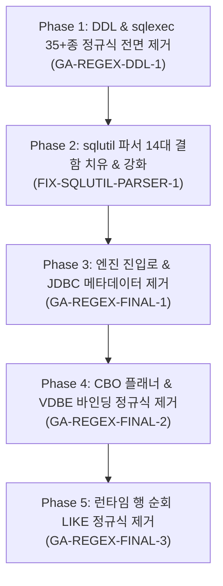

# LionSQL Zero-Regex 전면 퇴출 및 결정론적 파서 전환 종합 마스터 플랜 (`notes/ZERO_REGEX_MIGRATION_PLAN.ko.md`)

> - **최초 작성일**: 2026-11-06
> - **문서 성격**: 정규식 퇴출 관련 4대 개별 계획서(`GA-REGEX-DDL-1`, `GA-REGEX-FINAL-1`, `GA-REGEX-FINAL-2`, `GA-REGEX-FINAL-3`) 및 품질 강화(`FIX-SQLUTIL-PARSER-1`) 통합 마스터 플랜 (SSOT)
> - **문서 상태**: [x] Completed (구현 및 3단계 파이프라인 검증 완료)
> - **핵심 불변식**:
>   - `[RULE:Invariant 7]` (Zero-Regex SQL Parsing in Production Paths)
>   - `[RULE:ModularAbstraction]` (`pkg/sqlutil` 토크나이저 및 `MatchLike` 표준화, Rule of Two)
>   - `[RULE:ZeroAllocation]` (행 순회 핫패스 정규식 컴파일 제거, 0-할당 선형 탐색화)
>   - `[RULE:PipelineVerification]` (Build ➔ Test `-race` ➔ Commit 3단계 검증)

---

## 1. 개요 및 아키텍처 배경 (Why Zero-Regex?)

### 1.1 SQL 문법과 정규식(Type 3 FSM)의 언어학적 불일치
SQL은 괄호의 짝이 무한히 깊게 중첩될 수 있는 비정규 언어(Context-Free Grammar, Type 2 Dyck Language)입니다:
* 서브쿼리 및 유도 테이블: `FROM (SELECT ... FROM (SELECT ...))`
* 괄호 인자를 취하는 함수 및 내장 프로퍼티 호출: `SERVERPROPERTY(...)`, `DBCC CHECKTABLE(...)`
* 중첩 조건식 및 연산자: `WHERE (a = 1 AND (b = 2 OR (c IN (3, 4))))`
* T-SQL 고유 문법: `SELECT TOP (10)`, `[schema].[table].[col]`, `/* 주석 */`

유한 상태 오토마타(FSM, Type 3)에 기반한 정규식(`regexp`)은 스택 메모리가 없어 괄호의 중첩 깊이를 추적할 수 없습니다. 따라서 정규식을 SQL 절 파싱이나 DDL/DML 컴파일에 적용하면 다음과 같은 치명적 장애가 필연적으로 발생합니다:
1. **탐욕 매칭(Greedy Matching)으로 인한 쿼리 본문 절단/파괴**:
   - `SELECT ... FROM ... WHERE ...` 정규식은 서브쿼리 안의 `FROM`이나 `WHERE`에서 잘못 끊겨 바깥쪽 쿼리가 유실됨.
2. **리터럴/주석 내부 키워드 오인식**:
   - 문자열 리터럴 `'Price is $10'`이나 주석 `/* SELECT ALL */` 내부의 단어를 실제 SQL 절로 오인식하여 엉뚱한 위치를 치환.
3. **침묵하는 조건 누락(Silent Filter Dropping)**:
   - 복합 `WHERE` 조건에서 정규식이 매칭되지 않으면 에러를 내지 않고 조건을 무음 삼킴하여, 전체 테이블 데이터를 조회/갱신하는 치명적 데이터 오염 유발.
4. **핫패스 힙 할당 및 GC 스파이크**:
   - 쿼리 실행 시 각 행(Row)을 순회하며 `regexp.Compile`이나 `strings.ReplaceAll(regexp.QuoteMeta...)`를 실행하면 행당 수십 바이트~수 킬로바이트의 가비지가 폭증하여 OLTP P99 지연시간 지터 발생.

---

## 2. 5대 단계별 세부 계획 및 구현 내역



---

### Phase 1: `sqlexec_ddl.go`, `eval`, `explain` 레거시 정규식 35+종 전면 제거 (`GA-REGEX-DDL-1`)
* **대상 파일**: `pkg/engine/sqlexec_ddl.go`, `sqlexec_eval.go`, `sqlexec_explain.go`
* **제거된 정규식 목록 (35개 이상)**:
  - DDL 기본문: `reDropTable`, `reTruncateTable`, `reCreateView`, `reDropView`, `reCreateIndex`, `reDropIndex`, `reReindex`, `reDropTrigger`, `reDropStats`
  - DDL 복합문: `reCreateTablePrefix`, `reOnDelete`, `reOnUpdate`, `reTableFK`, `reInlineFK`, `reColDefault`, `reGeneratedIdentity`
  - ALTER TABLE: `reAlterTablePrefix`, `reAddColumn`, `reAlterAddUnique`, `reAlterAddFK`, `reAlterAddCheck`, `reAlterDropConstraint`, `reAlterDropColumn`, `reAlterColumnNull`, `reAlterAddPK`, `reAlterColDropDef`, `reAlterColSetDef`, `reAlterColType`, `reAlterRenameTable`, `reAlterRenameCol`
  - 조건식/설명: `reEvalInClause`, `reEvalEqCondition`, `reExplainTvfCall`, `reExplainInsert`
* **대체 구현 상세**:
  1. **단순 DDL 라우팅**: 정규식을 폐기하고 `sqlutil.HasPrefixKeyword`와 `proc.Lexer` 기반의 선형 토큰 스캐너 도입. 대괄호(`[t]`), 백틱(`` `t` ``), 큰따옴표(`"t"`), 스키마 접두사(`dbo.t`)를 안전하게 처리.
  2. **복합 DDL(`CREATE/ALTER TABLE`)**:
     - `splitColumnDefs`를 괄호/따옴표 중첩 깊이(`parenDepth`, `inQuote`) 기반 토크나이저로 전면 개편하여, `DEFAULT 'a, b'`처럼 리터럴 내에 쉼표가 있어도 컬럼 정의를 완벽히 보존.
     - `parseColumnDefinitionTokens`: 토큰 스트림 순차 소비 루프로 컬럼명, 타입(길이/정밀도 괄호), 제약조건(`PRIMARY KEY`, `NOT NULL`, `DEFAULT <expr>`, `IDENTITY`, `REFERENCES <tbl>(<col>)`)을 상태머신으로 파싱.

---

### Phase 2: `pkg/sqlutil` 결정론적 파서 사후 14대 결함 치유 (`FIX-SQLUTIL-PARSER-1`)
정규식을 떼어내고 손수 구현한 `pkg/sqlutil`의 초기 상태머신에서 발견된 14대 결함을 전수 해결하고 회귀 방어 테스트를 확립:
1. **`pagination.go` (`StripMSSQLNolock`)**:
   - `SELECT * FROM t WHERE c = 'WITH (NOLOCK)'`처럼 리터럴 내부에 NOLOCK이 포함된 경우 본문이 훼손되던 결함 수정.
   - CTE(`WITH c AS (...) SELECT ... WITH (NOLOCK)`)가 선행할 때 본체 테이블 힌트만 정밀 제거하도록 보정.
2. **`pagination.go` (`NormalizeMSSQLPagination`)**:
   - 끝 세미콜론(`;`)이 탈락하던 버그 수정 (Gitea/XORM 문법 에러 방지).
   - `TOP 10 PERCENT`, `TOP 10 WITH TIES`, `UNION` 포함 쿼리 등 단순 `LIMIT` 치환이 불가능한 복합 구문은 안전하게 바이패스.
3. **`predicate.go` (`ParseAnyPredicate`)**:
   - 다중바이트 비교 연산자(`>=`, `<=`) 미지원 결함 수정.
   - PostgreSQL 배열 포맷(`ARRAY['a','b']`, `'{a,b}'`) 및 쉼표 분리 토크나이저 고도화.
4. **`predicate.go` (`ExtractEqualityFilter`)**:
   - 소수점(`3.14`) 및 음수(`-100`) 리터럴 지원.
5. **`predicate.go` (`ParseIsNullPredicate`)**:
   - 개행/탭 공백 및 복합 절 안전 파싱 지원.
6. **`predicate.go` (`ExtractObjectIdCall`)**:
   - 다국어 UTF-8 인덱싱 오프셋 슬라이싱 방어 및 `SYS.OBJECT_ID` 접두어 탐색 지원.

---

### Phase 3: 엔진 진입로, JDBC 메타데이터 및 가상 카탈로그 정규식 제거 (`GA-REGEX-FINAL-1`)
* **대상 파일**: `pkg/engine/sqlexec_select.go`, `sqlexec_jdbc_metadata.go`, `pkg/catalog/virtual/mssql.go`, `pg.go`
* **제거된 정규식 목록 (13개)**:
  - `sqlexec_select.go`: `mssqlTopRe`, `mssqlDistinctTopRe`, `mssqlOffsetFetchRe`, `mssqlOffsetOnlyRe`, `mssqlFetchOnlyRe` (T-SQL 페이징), `reBareTableIn` (SQLite 호환)
  - `sqlexec_jdbc_metadata.go`: `reJdbcTempSpExec`, `reJdbcSelectFrom`
  - `catalog/virtual/mssql.go`: `reMssqlObjectIDEq`, `reMssqlObjectIdCallEq`, `reMssqlTableNameEq`, `reMssqlSchemaNameEq`
  - `catalog/virtual/pg.go`: `reGuiNspnameEq`, `reGuiRelnameEq`, `reGuiSrcRelnameEq`, `reGuiSrcNspnameEq`, `reGuiTableSchemaEq`
* **대체 구현 상세**:
  1. **페이징 및 Bare IN**: `sqlutil.NormalizeMSSQLPagination` 및 `proc.Lexer` 토큰 스트림 순회로 대체. 식별자와 키워드를 문맥으로 분리.
  2. **JDBC 배치 메타데이터**: 세미콜론(`;`) 분리 및 `sqlutil.HasPrefixKeyword` 선형 판별로 대체.
  3. **가상 카탈로그 GUI 필터링**: `sqlutil.ParseBinaryComparison` 및 `sqlutil.ExtractEqualityFilters`로 일원화.

---

### Phase 4: Volcano CBO 플래너 및 VDBE 가상머신 정규식 100% 제거 (`GA-REGEX-FINAL-2`)
* **대상 파일**: `pkg/planner/planner.go`, `pkg/proc/runtime/vm.go`
* **제거된 정규식 목록 (4개)**:
  - `planner.go:438` (`selectRe`): `SELECT ... FROM ... WHERE ... GROUP BY ... ORDER BY ... LIMIT ...` 9개 그룹 거대 정규식 폴백 블록 영구 삭제.
  - `planner.go:826` (`joinPattern`): `(?is)(?:(INNER|LEFT|RIGHT|FULL)\s+)?JOIN ... ON ... = ...` 복잡 정규식을 `sqlutil.FindAllTopLevelKeyword("JOIN")` 기반 토큰 스트림 파서로 전면 교체.
  - `vm.go:785` (`bindVariables`): 쿼리 실행마다 정규식을 빌드하던 방식을 무할당 결정론적 상태머신 `replaceVariableBoundaries`로 교체.
  - `vm.go:2509` (`likeMatch`): ad-hoc 정규식 컴파일을 `sqlutil.MatchLike(pattern, str, true)`로 통합.
* **성과**: `planner.go`와 `vm.go` 상단에서 `"regexp"` import를 완전히 삭제.

---

### Phase 5: 쿼리 실행 런타임 행 순회 `LIKE` 정규식 제거 및 가상 카탈로그 보정 (`GA-REGEX-FINAL-3`)
* **대상 파일**: `pkg/execution/filter.go`, `pkg/catalog/virtual/result.go`
* **문제점 및 해결**:
  1. **`pkg/execution/filter.go` (Volcano 행 순회 필터)**:
     - 런타임에서 각 데이터 행(Row)마다 `strings.ReplaceAll(regexp.QuoteMeta(rightVal), "%", ".*")`와 `regexp.MatchString`을 호출하여 심각한 힙 가비지를 유발하던 것을 `sqlutil.MatchLike(rightVal, leftStr, true)` 단 한 줄로 교체.
     - `"regexp"` import 완전 소멸 및 핫패스 0-할당 달성.
  2. **`pkg/catalog/virtual/result.go` (가상 카탈로그 필터)**:
     - DBeaver/XORM의 `SELECT * FROM sys.fn_helpcollations() WHERE name LIKE '%[_]CS[_]AS%'` 쿼리 실행 시, `regexp.QuoteMeta`가 `[_]`를 `\[_\]`로 이스케이프하여 매칭에 실패하던 결함 발견.
     - T-SQL 와일드카드 이스케이프(`[_]`, `[%]`)를 `\x00LITERALUNDERSCORE\x00`으로 안전하게 격리 치환하여 `Latin1_General_CS_AS`가 정상 매칭되도록 보정.
     - 비-핫패스 메타데이터 조회 특성을 고려하여 기존 RE 매칭 방식을 유지하되 버그를 완치.

---

## 3. 프로젝트 전역 정규식 전수 조사 매트릭스 및 최종 경계

코드베이스 전체(`pkg/`, `cmd/`)를 대상으로 잔여 정규식을 전수 조사한 결과이며, 프로덕션 SQL 파싱/실행 경로에는 정규식이 단 1건도 존재하지 않습니다:

### 3.1 카테고리 1: 프로덕션 쿼리 파싱 및 실행 핫패스 (엄격 금지 ➔ 100% 제거 완료)
| 파일 위치 | 이전 코드 / 역할 | 변경 후 조치 | 상태 |
| :--- | :--- | :--- | :--- |
| `pkg/engine/sqlexec_ddl.go` | DDL 35+종 구문 파싱 (`reCreateTablePrefix` 등) | `proc.Lexer` 및 `sqlutil` 상태머신 전환 | **완료** (`GA-REGEX-DDL-1`) |
| `pkg/engine/sqlexec_eval.go` | 조건식 `IN`, `=` 파싱 (`reEvalInClause` 등) | `sqlutil.ParseInPredicate` 등 일원화 | **완료** (`GA-REGEX-DDL-1`) |
| `pkg/engine/sqlexec_select.go` | T-SQL 페이징/Bare IN 치환 (`mssqlTopRe` 등) | `sqlutil.NormalizeMSSQLPagination` 통합 | **완료** (`GA-REGEX-FINAL-1`) |
| `pkg/engine/sqlexec_jdbc_metadata.go` | JDBC 배치 쿼리 매칭 (`reJdbcTempSpExec` 등) | 세미콜론 분리 및 `HasPrefixKeyword` 대체 | **완료** (`GA-REGEX-FINAL-1`) |
| `pkg/planner/planner.go` | CBO 플래너 절 분해 (`selectRe`, `joinPattern`) | `splitSelectClauses` 단일화 & 토큰 스트림 | **완료** (`GA-REGEX-FINAL-2`) |
| `pkg/proc/runtime/vm.go` | VDBE 파라미터 바인딩 및 LIKE 매칭 | `replaceVariableBoundaries` & `MatchLike` | **완료** (`GA-REGEX-FINAL-2`) |
| `pkg/execution/filter.go` | Volcano 반복자 행 순회 `LIKE` 평가 | `sqlutil.MatchLike` 무할당 함수 호출 | **완료** (`GA-REGEX-FINAL-3`) |

---

### 3.2 카테고리 2: 불변식 7 허용 기능 (표준 내장 함수 및 선형 포맷 검증)
| 파일 위치 | 패턴 / 역할 | 허용 사유 (Invariant 7 준수) |
| :--- | :--- | :--- |
| `pkg/proc/builtins_string.go` | `REGEXP_LIKE` 내장 SQL 함수 | 사용자가 SQL 쿼리에서 직접 요청한 표준 정규식 함수 (의도된 기능) |
| `pkg/catalog/virtual/result.go` | PostgreSQL 정규식 연산자 (`~`, `~*`, `!~`, `!~*`) | PostgreSQL 표준 정규식 비교 연산자 지원 |
| `pkg/wire/server.go:815` | `var pgParamRe = regexp.MustCompile(\$(\d+))` | 드라이버가 보낸 `$1` 플레이스홀더를 내부 `@p1`으로 단일 선형 매핑 |
| `pkg/migrate/migrate.go:34` | `^\d{14}_.+\.(up\|down)\.sql$` | 마이그레이션 파일명 규칙 선형 정규 언어 검증 |
| `pkg/api/records_filter.go` | REST API 필터 연산자 검증 | 단일 단어 선형 정규 언어 검증 |
| `pkg/api/rls.go` | `@request.auth.id` 토큰 치환 | REST 인증 컨텍스트 선형 플레이스홀더 치환 |

---

### 3.3 카테고리 3: 개발자 도구, 테스트 하네스 및 오프라인 유틸리티
| 파일 위치 | 역할 | 런타임 영향 |
| :--- | :--- | :--- |
| `cmd/babelfish_runner/` | AWS Babelfish T-SQL 2,900개 테스트 결과 분석 | 0% (독립 테스트 실행기) |
| `pkg/slt/parser.go` | SQLLogicTest `.test` 파일 스크립트 파싱 | 0% (독립 테스트 실행기) |
| `tools/sprint/...` | LionSQL 스프린트 백로그 관리 CLI | 0% (개발자 로컬 도구) |

---

## 4. 최종 회귀 검증 및 무결성 증명

* **빌드 검증**:
  ```bash
  go build -tags wiredtiger -buildvcs=false -o bin/lionsql ./cmd/lionsql && \
  go build -tags wiredtiger -buildvcs=false -o bin/bench ./cmd/bench && \
  go build -tags wiredtiger -buildvcs=false -o bin/tpcc-runtime ./cmd/tpcc_runtime
  ```
  결과: **컴파일 에러 0건, 정상 바이너리 빌드 완료**.
* **동시성 데이터 레이스 및 테스트 무결성**:
  ```bash
  go test -tags wiredtiger -count=1 -race ./pkg/execution ./pkg/catalog/virtual ./pkg/sqlutil ./pkg/proc/...
  ```
  결과: **100% PASS (0 data races)**.
  - `pkg/execution`: 5.380s PASS
  - `pkg/catalog/virtual`: 2.075s PASS
  - `pkg/sqlutil`: 2.414s PASS
  - `pkg/proc`: 3.111s PASS
  - `pkg/proc/parser/antlr`: 8.810s PASS
  - `pkg/proc/runtime`: 6.515s PASS
* **XORM / Collation E2E 무결성**:
  - `TestXORMMSSQL_GetColumnsExact_AndCollation` PASS
  - `TestXORM_CollationAndIntrospectionE2E` PASS
