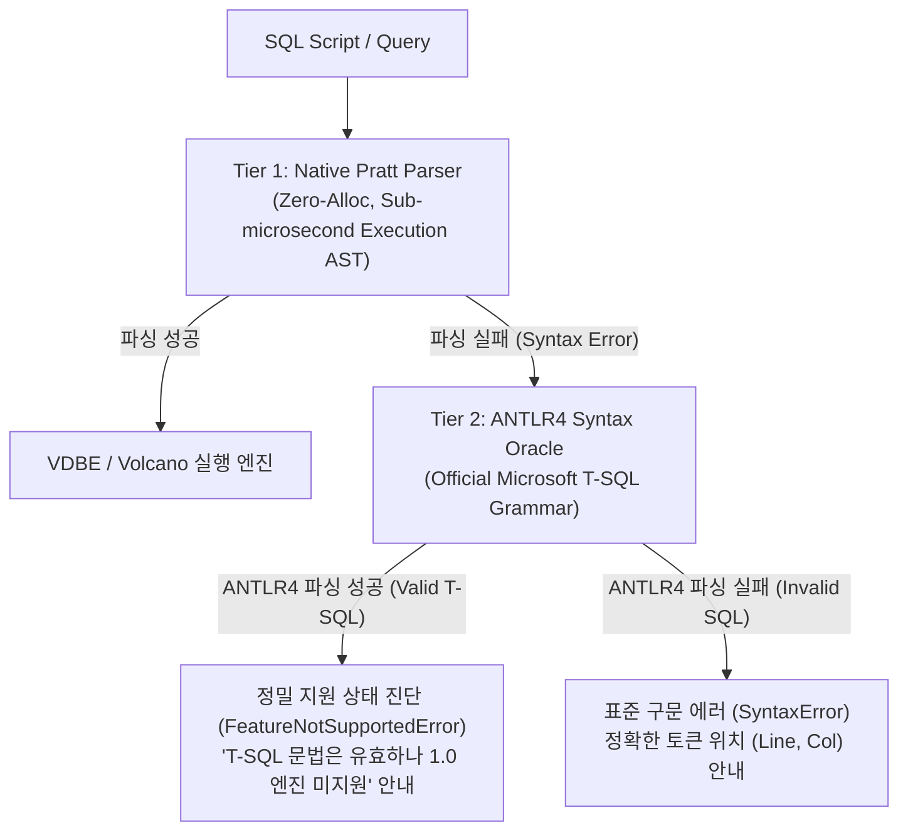

# ANTLR4 기반 T-SQL 문법 검증 및 미지원 기능 정밀 진단 오라클 아키텍처 설계 (`ANTLR4_SYNTAX_ORACLE_DIAGNOSTICS_PLAN.ko.md`)

> - **최초 작성일**: 2026-11-10
> - **상태**: 승인 완료 / 계획 수립 (Post-1.0 및 v1.1.0 파서 고도화 과제)
> - **연관 태스크 ID**: `ARCH-ANTLR-ORACLE-1`
> - **연관 규칙/불변식**: `[RULE:ModularInterface]`, `[RULE:ExplicitError]`, Invariant 1 (Dual-Parser Architecture)

---

## 1. 아키텍처 배경 및 문제 정의

### 1.1 현재 구조와 한계
LionSQL은 2-Tier 파서 아키텍처를 채택하고 있으나, 현재 ANTLR4 폴백(`ProcedureFallbackParser`)은 오직 `CREATE PROCEDURE` 헤더 컴파일 실패 시에만 호출됩니다.
그 결과, 일반 쿼리(`SELECT`, `JOIN`, `UPDATE`, `BEGIN...END` 익명 블록 등)에서 Native Pratt 파서가 문법을 해석하지 못하면 다음과 같은 문제가 발생합니다:

1. **난해한 원시 파서 에러 노출**:
   - 예: `JOIN (WITH cte AS ...) x` 구문에서 `expected projection expression, got WITH` 등 내부 렉서/토큰 수준의 에러가 사용자에게 그대로 반환됨.
2. **MSSQL 마이그레이션 사용자 혼란**:
   - SSMS, DBeaver, 또는 기존 프로덕션 T-SQL 스크립트를 마이그레이션하는 사용자는 해당 구문이 SQL Server에서 완전히 유효한 문법임에도 불구하고 단순 `Syntax Error`로 오인하여 불필요한 디버깅 시간을 소모함.
3. **오류 분류(Classification) 부재**:
   - "사용자가 오타를 낸 진짜 문법 오류"와 "문법은 맞지만 LionSQL 1.0 엔진이 아직 미구현한 기능"이 전혀 구분되지 않음.

---

## 2. 핵심 아키텍처 원칙 (Separation of Concerns)



1. **Tier 1 Native Pratt Parser (실행 엔진 직결)**:
   - 고빈도 OLTP 쿼리 및 지원되는 모든 DDL/DML을 1마이크로초 미만(< 1µs)에 파싱하여 실행 AST로 생성.
   - 복잡한 비지원 문법 껍데기를 Pratt 파서에 덕지덕지 추가하여 코드를 비대화하지 않음.
2. **Tier 2 ANTLR4 (정밀 진단 오라클 전담)**:
   - Pratt 파서 실패 시 호출되어 문법의 정합성을 검증하는 **오라클(Oracle)**로 격리.
   - 문법이 유효할 경우, 사용된 미지원 기능 노드(`PIVOT`, `XML RAW`, `CURSOR SCROLL`, `TABLE HINT` 등)를 식별하여 정중하고 명확한 안내를 반환.

---

## 3. 상세 설계 및 구현 명세

### 3.1 에러 분류 및 응답 규격

```go
package proc

import "fmt"

// FeatureNotSupportedError indicates that the SQL is grammatically valid T-SQL,
// but the feature/clause is not yet implemented in the current engine release.
type FeatureNotSupportedError struct {
    FeatureName string
    Line        int
    Column      int
    ContextHint string
}

func (e *FeatureNotSupportedError) Error() string {
    if e.ContextHint != "" {
        return fmt.Sprintf("[42000] Valid T-SQL syntax recognized ('%s'), but this feature is not yet supported in LionSQL 1.0 release (%s)", e.FeatureName, e.ContextHint)
    }
    return fmt.Sprintf("[42000] Valid T-SQL syntax recognized ('%s'), but this feature is not yet supported in LionSQL 1.0 release (planned for v1.1.0)", e.FeatureName)
}
```

### 3.2 ANTLR4 진단 오라클 인터페이스 (`pkg/proc/oracle.go`)

```go
package proc

// SyntaxDiagnosticOracle inspects a failed query against the official T-SQL grammar.
type SyntaxDiagnosticOracle func(sql string, prattErr error) error

var (
    diagnosticOracleMu sync.RWMutex
    diagnosticOracle   SyntaxDiagnosticOracle
)

func RegisterDiagnosticOracle(oracle SyntaxDiagnosticOracle) {
    diagnosticOracleMu.Lock()
    defer diagnosticOracleMu.Unlock()
    diagnosticOracle = oracle
}

func DiagnoseParseFailure(sql string, prattErr error) error {
    diagnosticOracleMu.RLock()
    oracle := diagnosticOracle
    diagnosticOracleMu.RUnlock()

    if oracle == nil {
        return prattErr
    }
    return oracle(sql, prattErr)
}
```

### 3.3 진단 리스너 (`pkg/proc/parser/antlr/oracle_listener.go`)

ANTLR4의 `ParseTSql(script)` 결과를 바탕으로:
1. 문법 파싱에 오류가 없는 경우:
   - 최상위 미지원 절(Unimplemented Clause, 예: `Unpivot_clauseContext`, `Pivot_clauseContext`, `Xml_common_directivesContext`)을 Visitor 패턴으로 탐지.
   - 탐지된 기능 명칭을 담아 `&proc.FeatureNotSupportedError{FeatureName: ...}`를 반환.
2. 문법 파싱에 오류가 있는 경우:
   - ANTLR의 첫 번째 `SyntaxError` 리스너에서 포착된 정확한 Line, Column 위치 및 예상 토큰 정보를 담아 표준 구문 오류 반환.

---

## 4. 단계별 로드맵 및 적용 계획

- **1단계 (Plan & 백로그 등록 - 본 문서)**:
  - 아키텍처 원칙 수립 및 Sprint DB (`ARCH-ANTLR-ORACLE-1`) 등록.
- **2단계 (진단 오라클 SPI 및 핸들러 연동)**:
  - `pkg/proc/oracle.go` 및 ANTLR 패키지의 `oracle_listener.go` 구현.
  - `sqlexec.go` 및 `compiler.go` 파싱 실패 분기에 `DiagnoseParseFailure()` 삽입.
- **3단계 (회귀 검증 및 마이그레이션 툴 인증)**:
  - SSMS 스크립트 실행 시 미지원 기능에 대해 크래시나 raw syntax error 대신 표준 `42000` 안내 코드가 반환되는지 검증.

---

## 5. 결론 및 기대 효과

1. **KISS & Zero-Bloat 유지**: Pratt 파서는 본연의 초고속 실행 경로에만 집중하고, 방대한 T-SQL 문법 해석 부담을 떠안지 않음.
2. **SSMS 및 엔터프라이즈 마이그레이션 경험 극대화**: T-SQL 개발자에게 "문법은 맞으나 아직 구현되지 않음"을 즉시 인지시켜 친절하고 신뢰할 수 있는 데이터베이스 엔진으로 자리매김함.
