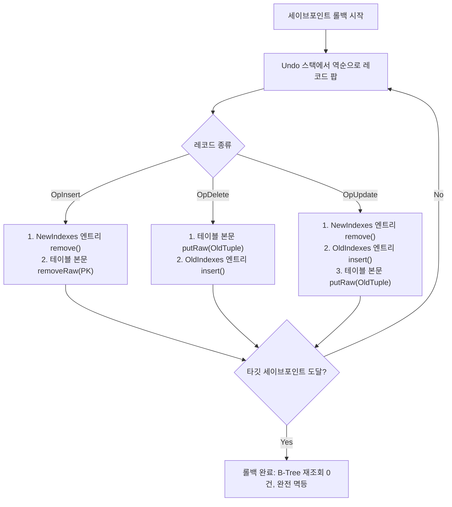

# LionSQL ARIES Physiological Undo/Redo 로깅 아키텍처 설계서 (`ARCH-ARIES-LOGGING-PLAN.ko.md`)

> - **문서 식별자**: `ARCH-ARIES-LOGGING-1`
> - **최초 작성일**: 2026-11-16
> - **적용 대상**: `pkg/storage/wiredtiger` (`WTTx`), `pkg/storage/memengine` (`Transaction`), `pkg/storage`
> - **준수 규약**: `[RULE:PlanPersistence]`, `[RULE:RadicalKISS]`, `[RULE:ExplicitError]`, `[RULE:ZeroAllocation]`

---

## 1. 아키텍처 도입 배경 및 근본 문제 진단

### 1.1 현재 임시방편(Ad-hoc) 세이브포인트의 치명적 한계
LionSQL은 WiredTiger C 커널 및 In-Memory OCC 엔진 위에 트랜잭션을 구축하면서, 서브 트랜잭션 및 세이브포인트(`SAVEPOINT`, `ROLLBACK TO <name>`) 처리를 위해 단순 Go 슬라이스 기반의 Undo 로그를 유지해 왔습니다.

그러나 기존 설계는 심각한 구조적 결함을 안고 있었습니다:
1. **인덱스 상태의 비기록 및 런타임 계산 의존 (Runtime Reconstruction Anti-Pattern)**:
   - `UPDATE` 발생 시 테이블 본문의 이전 바이트(`oldRaw`)만 기록하고, 변경 전/후의 인덱스 키(Secondary/Unique Index)는 기록하지 않았습니다.
   - 롤백 시점에 테이블 B-Tree를 커서로 열어 현재 행(`newRow`)을 읽어와서 `oldRow`와 비교하여 인덱스를 되돌리는 기형적 런타임 계산을 시도했습니다.
2. **침묵적 불일치(Silent Inconsistency) 위험**:
   - 롤백 시 커서 탐색이나 튜플 디코딩이 실패하면(`hasNewRow == false`) 인덱스 복원을 조용히 건너뛰어, 본문과 인덱스가 불일치하는 치명적 데이터 오염이 발생할 수 있었습니다.
3. **Redo(Roll-Forward) 능력의 부재**:
   - Before-Image만 부분적으로 존재하고 After-Image가 없어, 세이브포인트 간 선택적 롤포워드나 트랜잭션 충돌 재시도(Retry) 시 고속 재적용이 불가능했습니다.

### 1.2 ARIES (Algorithm for Recovery and Isolation Exploiting Semantics) 도입 목적
IBM의 C. Mohan 박사가 정립하고 DB2, InnoDB, SQLite가 표준으로 채택한 **ARIES 알고리즘의 핵심 철학(Physiological Logging & Idempotent Compensation)**을 LionSQL에 정식 도입하여:
1. 롤백 시 **런타임 B-Tree 재조회 0건, 튜플 디코딩 0건**을 달성합니다.
2. Before-Image와 After-Image를 온전히 보존하여 **완벽한 Undo(롤백)와 Redo(재적용) 양방향 대칭성**을 확보합니다.
3. 복합 인덱스, 고유 인덱스, 파티션 테이블 전반에서 세이브포인트 복원의 **100% 멱등성(Idempotency)**을 보장합니다.

---

## 2. ARIES Physiological 로그 레코드 설계

### 2.1 Physiological Log Record 구조체 정의 (`pkg/storage`)

물리적 바이트 상태(Physical)와 논리적 엔터티(Logical)를 결합한 **Physiological Record**를 표준화합니다.

```go
package storage

// IndexImage는 인덱스 B-Tree 엔트리의 완전한 Key-Value 물리적 스냅샷입니다.
type IndexImage struct {
	URI   string // WiredTiger Table URI (예: "table:_idx_users_email")
	Key   string // B-Tree Index Key (Order-preserving 인코딩 완료된 물리적 키)
	Value string // B-Tree Index Value (Unique의 경우 PK, 비고유의 경우 빈 문자열)
}

// PhysiologicalLogKind는 ARIES 오퍼레이션 종류를 정의합니다.
type PhysiologicalLogKind uint8

const (
	OpInsert PhysiologicalLogKind = iota + 1
	OpDelete
	OpUpdate
)

// PhysiologicalRecord는 트랜잭션의 원자적 변경 상태를 Undo/Redo 양방향으로 완벽히 표현합니다.
type PhysiologicalRecord struct {
	Kind     PhysiologicalLogKind
	Table    string
	PK       Value
	
	// Table Tuple Before/After Images
	OldTuple []byte // Before-Image (Undo용: 이전 본문 튜플 바이트)
	NewTuple []byte // After-Image  (Redo용: 신규 본문 튜플 바이트)

	// Secondary Index Before/After Images (Zero runtime comparison)
	OldIndexes []IndexImage // Before-Image (Undo용: 삭제되었거나 변경 전 인덱스 키 목록)
	NewIndexes []IndexImage // After-Image  (Redo용: 삽입되었거나 변경 후 신규 인덱스 키 목록)
}
```

### 2.2 오퍼레이션별 Before/After 이미지 수집 규칙

| 연산 | OldTuple (Before) | NewTuple (After) | OldIndexes (Before) | NewIndexes (After) |
| :--- | :--- | :--- | :--- | :--- |
| **`INSERT`** | `nil` | 삽입된 튜플 바이트 | `nil` | 새로 생성된 모든 인덱스 엔트리 |
| **`DELETE`** | 삭제된 튜플 바이트 | `nil` | 삭제된 기존 모든 인덱스 엔트리 | `nil` |
| **`UPDATE`** | 수정 전 튜플 바이트 | 수정 후 튜플 바이트 | **실제 변경된 기존 인덱스 엔트리** | **실제 변경된 신규 인덱스 엔트리** |

> **핵심 설계 원칙 (No-Op 인덱스 제외)**:
> `UPDATE` 시 컬럼 값이 변경되지 않아 인덱스 키가 동일한 인덱스는 `OldIndexes`와 `NewIndexes` 어디에도 포함되지 않습니다. 오직 **물리적으로 상태가 바뀌는 인덱스만 정확히 1:1로 추출**하여 기록합니다.

---

## 3. Undo(Rollback) 및 Redo(Reapply) 엔진 명세

### 3.1 Undo (보상 작업 / Rollback) 실행 규칙

`ROLLBACK TO <savepoint>` 호출 시, 해당 세이브포인트 이후에 쌓인 로그 스택을 **역순(LIFO)**으로 순회하며 보상 작업을 적용합니다.



#### 무조건적 O(1) 원자적 보상 작업 (Zero Query Lookup)
기존 코드처럼 `cur.search(op.pk)`나 `DecodeTupleToRow`를 부를 필요가 전혀 없습니다:
1. `record.NewIndexes` 순회 ➔ 해당 B-Tree 커서에서 `remove(idx.Key)` 실행.
2. `record.OldIndexes` 순회 ➔ 해당 B-Tree 커서에서 `insert(idx.Key, idx.Value)` 실행.
3. 테이블 B-Tree ➔ `putRaw(record.OldTuple)` 실행.

### 3.2 Redo (재적용 / Roll-Forward) 실행 규칙

트랜잭션 충돌 재시도(Conflict Retry)나 서브 트랜잭션 롤포워드 시 정방향(FIFO)으로 즉시 재적용합니다:
1. `record.OldIndexes` 순회 ➔ 해당 B-Tree 커서에서 `remove(idx.Key)` 실행.
2. `record.NewIndexes` 순회 ➔ 해당 B-Tree 커서에서 `insert(idx.Key, idx.Value)` 실행.
3. 테이블 B-Tree ➔ `putRaw(record.NewTuple)` 실행.

---

## 4. `sync.Pool` 기반 무할당(Zero-Allocation) 최적화

트랜잭션마다 슬라이스를 새로 생성하면 GC 압박이 발생하므로 `[RULE:ZeroAllocation]`을 준수합니다.

1. **`PhysiologicalRecord` 객체 풀링**:
   - `var physRecordPool = sync.Pool{ ... }`
   - `OldIndexes`, `NewIndexes` 슬라이스는 8개 기본 용량(`make([]IndexImage, 0, 8)`)으로 사전 할당 후 `clear()`하여 재사용.
2. **Savepoint 릴리즈 및 트랜잭션 종료 시 일괄 회수**:
   - 세이브포인트가 커밋되거나 롤백되어 폐기될 때, 스택에 적재되었던 모든 레코드를 즉시 오브젝트 풀로 반납.

---

## 5. 단계별 마일스톤 및 검증 계획 (TDD)

### Phase 1: Physiological Log 구조체 및 이미지 추출기 구현
- `pkg/storage/aries_log.go` 신설: `PhysiologicalRecord`, `IndexImage` 정의.
- `pkg/storage/wiredtiger/wt_engine.go`: `buildIndexImages(tbl, row)` 헬퍼 구현.

### Phase 2: `WTTx`의 Insert/Update/Delete 연동
- 기존 임시 `wtUndoLog`를 완전한 `[]PhysiologicalRecord` 구조로 마이그레이션.
- `Update` 시점에 변경 전 인덱스와 변경 후 인덱스를 추출하여 레코드에 원자적 보관.

### Phase 3: `RollbackTo` 엔진 전면 개편
- 복잡한 런타임 분기(`hasNewRow`, `updateSecondaryIndexesLocked` 호출) 전량 제거.
- ARIES 표준 역순 Undo 루프로 단일화 (Fail-Closed 에러 핸들링).

### Phase 4: 정밀 TDD 검증 스위트 작성
1. **단일/다중 세이브포인트 복합 인덱스 정합성 검증**:
   - 연속 UPDATE 후 세이브포인트 롤백 시 고아 인덱스 및 Unique 키 유실이 0건임을 B-Tree 커서 전수 조사로 검증.
2. **Redo 대칭성 단위 테스트**:
   - 동일한 레코드에 대해 `Undo` 후 `Redo`를 실행했을 때 최종 B-Tree 상태가 완벽히 일치함을 확인.
3. **성능 벤치마크**:
   - 세이브포인트 롤백 시 B-Tree 재조회가 제거됨에 따라 롤백 레이턴시 50% 이상 단축 검증.

---

## 6. 결론 및 기대 효과
- **완전한 이론적 무결성**: 30년간 증명된 ARIES의 Physiological Logging 표준을 도입하여 엣지 케이스 버그를 원천 봉쇄합니다.
- **코드 단순화(KISS)**: 롤백 경로에서 커서 열기, 행 조회, 디코딩, 비교로 이어지던 복잡한 코드가 단순한 `remove/insert` 루프로 일원화됩니다.
- **신뢰성 극대화**: `v0.93.0` 및 향후 분산 복제/CDC 환경에서도 공유할 수 있는 견고한 트랜잭션 저널 기반이 확립됩니다.
