# Bound AST 기반 전용 바인더(Dedicated Binder) 진화 아키텍처 플랜 (`notes/plans/BOUND_AST_AND_DEDICATED_BINDER_EVOLUTION_PLAN.ko.md`)

> **문서 상태**: 설계 확정 및 마일스톤 반영 (Drafting ➔ Approved)  
> **관련 마일스톤**: `v0.95.0`, `v0.96.0`, `v0.97.0`  
> **핵심 주제**: 파서(Parser) ➔ 바인더(Binder) ➔ 바운드 AST(Bound AST) ➔ 최적화기(CBO) ➔ 실행기(Volcano/VDBE) 5단계 파이프라인 정립  
> **불변식 원칙**: `[RULE:PlanPersistence]`, `[RULE:RadicalKISS]`, `[RULE:ModularAbstraction]`, `[RULE:ExplicitError]`, `[RULE:StyleIntegrity]`

---

## 1. 개요 및 코드 리뷰 피드백 총괄

최근 커밋(`dc7e5d64`, `982c9ddd` 등)을 통해 산발적인 유효성 검사를 `pkg/planner/validator.go`와 `pkg/engine/dml_validator.go`로 모으는 1차 통합 작업이 이루어졌다.
그러나 최신 코드 리뷰에서 지적된 바와 같이, 현재 상태는 진정한 의미의 **"전용 바인더(Dedicated Binder)"**가 아니라 기존 실행 구조에 **"의미 검증기(Semantic Validator)를 덧붙인 과도기적 단계"**에 머물러 있다.

### 1.1 리뷰에서 식별된 5대 핵심 결함
1. **DML 검증기(`ValidateDMLContract`)의 실행 경로 미연결 및 검증 누락**:
   - `ValidateDMLContract` 함수가 선언되었으나 실제 `execInsert`, `execUpdate`, `execDelete` 실행 경로에서 호출되지 않음.
   - 기본값 없는 `NOT NULL` 컬럼 누락 검증, `UPDATE SET` 좌변 대상 컬럼 존재 검증, `UPDATE SET` 우변 표현식의 유령 컬럼 검증이 누락됨.
2. **AST 순회기(`WalkAST`)의 표현식 포괄성 결여**:
   - `WithinGroupExpr`, `QuantifiedComparisonExpr` (`ANY`/`ALL`), `ArrayExpr` 등 확장 AST 노드가 누락되어 검증 방어선을 우회할 위험 상존.
3. **JOIN ON 절의 컬럼 바인딩 및 모호성 검증 누락**:
   - `SELECT * FROM t1 JOIN t2 ON id = id;`와 같이 양쪽 테이블에 존재하는 un-qualified 컬럼이 ON 절에 올 때 `SQLSTATE 42702` 모호성 에러를 차단하지 못함.
4. **한정자 컬럼(`Qualified Column`, `table.col`)의 검증 불완전**:
   - `ValidateAmbiguousExpr`에서 `strings.Contains(colName, ".")`인 경우 무조건 `return nil`로 건너뛰어, `t1.ghost_col`이나 존재하지 않는 테이블 별칭(`wrong_alias.id`)이 검증을 우회함.
5. **HAVING 절 집계 표현식 경계 추적 모호성**:
   - `SELECT SUM(amount) + department FROM employees HAVING SUM(amount) > 100;`와 같은 복합 표현식에서 집계 함수 내부 컬럼과 외부 비집계 컬럼의 경계를 명확한 AST 스택/깊이 기반으로 추적하지 않고 단순 플래그로 검사함.

### 1.2 근본적인 구조적 병목: "Bound AST의 부재"
- 현재 파이프라인:
  `Parser` ➔ `GeneralSelectStmt (Raw AST)` ➔ `ValidateQueryAST (스키마 전달 없이 nil로 호출)` ➔ `QueryInfo (문자열 기반 절 추출)` ➔ `ValidateSelectScope (문자열/토큰 기반 ad-hoc 검증)` ➔ `실행기 (문자열 재분석 및 컬럼 검색 반복)`
- 목표 파이프라인:
  `Parser` ➔ `Raw AST` ➔ **`Dedicated Binder` (카탈로그, 스코프, 별칭, 타입, 식별자 완전 확정)** ➔ **`Bound AST`** ➔ `CBO / VDBE / Volcano` (검증된 메타데이터 계약 기반 무검증 고속 실행)

---

## 2. 현행 과도기 구조 vs 목표 Bound AST 아키텍처

```mermaid
flowchart TD
    subgraph Current [현행 과도기 구조: 문자열과 AST의 이중 검증]
        P1[Parser] --> AST1[Raw AST: GeneralSelectStmt]
        AST1 --> V1["ValidateQueryAST(stmt, nil)<br/>(스키마 없이 문법/함수 위치만 검사)"]
        V1 --> QI["QueryInfo 생성<br/>(Projections, Where 문자열 파싱)"]
        QI --> V2["ValidateSelectScope<br/>(실행 직전 문자열/토큰 스코프 검증)"]
        V2 --> Exec1["실행 엔진 (Volcano / VDBE)<br/>(컬럼 위치/타입 매번 재조회)"]
    end

    subgraph Target [목표 아키텍처: 카탈로그 바인딩 및 Bound AST 단일화]
        P2[Parser] --> AST2[Raw AST: GeneralSelectStmt]
        AST2 --> Binder["Dedicated Binder Pass<br/>(Catalog + Scope + Alias + Type Resolver)"]
        Catalog[(Catalog Schemas)] --> Binder
        Binder --> BoundAST["Bound AST (타입/컬럼ID/스코프 확정 객체)<br/>BoundSelectStmt / BoundExpr"]
        BoundAST --> Planner["CBO 최적화 플래너"]
        Planner --> Exec2["실행 엔진 (Volcano / VDBE)<br/>(Zero-Search, Direct Offset 인덱싱)"]
    end
```



---

## 3. 7단계 점진적 진화 로드맵 (Incremental Evolution Roadmap)

기존 동작을 깨뜨리지 않고 Strangler Fig 패턴으로 검증 계약을 완벽히 구축한 뒤 다운스트림의 중복을 제거한다.

### Phase 1: `WalkAST` 전수 순회 및 표현식 경계 추적 완전성 확보 (`pkg/planner/validator.go`)
- **목표**: AST 내의 단 하나의 표현식도 검증을 우회하지 못하도록 전수 커버리지 달성.
- **세부 작업**:
  1. `WalkAST`에 누락된 모든 AST 노드 추가:
     - `*proc.WithinGroupExpr`: `OrderBy` 식별자 순회
     - `*proc.QuantifiedComparisonExpr`: `Left`, `Right` 서브쿼리 경계 순회
     - `*proc.ArrayExpr`, `*proc.ArrayAccessExpr`: 요소 및 인덱스 순회
  2. **집계 표현식 경계 추적기 (`AggregateContextTracker`) 도입**:
     - `inAggregate int` 카운터를 유지하여 집계 함수(`SUM`, `COUNT` 등) 내부로 진입할 때 `+1`, 빠져나올 때 `-1`.
     - `SUM(amount) + department`에서 `department` 방문 시 `inAggregate == 0`이므로 즉시 불법 비집계 컬럼 에러 반환.
  3. `CheckDisallowedExprs`에 `ScopeJoinOn` 내 윈도우 함수(`HasOver`) 금지 불변식 추가 (`SQLSTATE 42803`).

### Phase 2: Identifier & Qualified Column Binding 완성 (`pkg/planner/validator.go`)
- **목표**: `table.col`, `alias.col`, un-qualified 컬럼의 카탈로그 실체 검증.
- **세부 작업**:
  1. `ValidateAmbiguousExpr` 전면 개편 ➔ `ResolveColumnRef(col *proc.ColumnRefExpr, schemas map[string]*storage.TableSchema)`:
     - **Qualified Column (`t.col`)**:
       - `t`가 현재 쿼리의 FROM/JOIN 테이블명 또는 별칭(Alias)에 존재하는지 검사 (미존재 시 `missing FROM-clause entry for table "t"` `SQLSTATE 42P01`).
       - 해당 테이블의 스키마에 `col`이 실존하는지 검사 (미존재 시 `column t.col does not exist` `SQLSTATE 42703`).
     - **Unqualified Column (`col`)**:
       - 모든 가시적(in-scope) 테이블 스키마에서 `col` 검색.
       - 일치하는 스키마가 0개: `column "col" does not exist` (`SQLSTATE 42703`).
       - 일치하는 스키마가 2개 이상: `column reference "col" is ambiguous` (`SQLSTATE 42702`).
  2. 스키마 맵 중복 카운트 방어:
     - 테이블명과 별칭이 동일한 포인터(`*storage.TableSchema`)를 가리킬 때 중복 집계되지 않도록 `map[*storage.TableSchema]bool`로 고유 인스턴스 기준 카운트.

### Phase 3: JOIN ON 절 및 별칭 스코프 바인딩 (`pkg/planner/validator.go`)
- **목표**: JOIN ON 조건의 모호성 및 테이블 가시성 검증 완결.
- **세부 작업**:
  1. `ValidateQueryAST`의 2단계 JOIN ON 검증 루프 확장:
     - `j.On`에 대해 `CheckDisallowedExprs(j.On, ScopeJoinOn)` 실행 (집계 및 윈도우 함수 차단).
     - `j.On`에 대해 현재까지 조인된 모든 테이블 스키마(`joinedSchemas`)를 대상으로 `ResolveColumnRef` 및 모호성 검증 실행.
  2. `SELECT * FROM t1 JOIN t2 ON id = id;` ➔ `id`가 `t1`, `t2` 양쪽에 존재하므로 즉시 `column reference "id" is ambiguous` 에러 발생 보장.
  3. `SELECT * FROM t1 JOIN t2 ON t3.id = t2.id;` ➔ `t3`는 FROM/JOIN 스코프에 없으므로 `missing FROM-clause entry for table "t3"` 에러 발생 보장.

### Phase 4: DML Contract 실제 실행 경로 직결 및 쓰기 계약 완성 (`pkg/engine/dml_validator.go`, `sqlexec_dml.go`)
- **목표**: INSERT / UPDATE / DELETE 실행 전 완벽한 스키마 무결성 방어벽 확립.
- **세부 작업**:
  1. `pkg/planner/validator.go`의 `ValidateDMLContract`와 `pkg/engine/dml_validator.go`를 단일 모듈로 통합.
  2. `execInsert` 진입부:
     - 기본값(`col.Default == ""`)이 없고, `NULL` 허용 안 됨(`!col.Nullable`), `IDENTITY`가 아닌 컬럼이 `INSERT` 컬럼 목록에서 누락된 경우 정적 차단 (`null value in column %q violates not-null constraint` `SQLSTATE 23502`).
     - `VALUES` 우변의 모든 수식 내 컬럼 참조 차단 (`ValidateInsertValueExpr`).
  3. `execUpdate` 진입부:
     - `UPDATE t SET col = expr`에서 `col`이 테이블 스키마에 존재하는지 정적 검사 (미존재 시 `column %q of relation %q does not exist` `SQLSTATE 42703`).
     - 우변 `expr` 내의 컬럼이 테이블(및 `UPDATE ... FROM` 조인 테이블) 스코프에 존재하는지 검사.
  4. `execDelete` 진입부:
     - `WHERE` 조건 및 `RETURNING` 절의 컬럼 실존성 사전 검증.

### Phase 5: 서브쿼리 및 상관 서브쿼리 스코프 계층 바인딩 (`pkg/planner/validator.go`)
- **목표**: 외부 쿼리(Outer Scope)와 내부 쿼리(Inner Scope)의 엄격한 컬럼 해석 분리.
- **세부 작업**:
  1. `ScopeContext` 구조체 도입:
     ```go
     type ScopeContext struct {
         Parent    *ScopeContext
         Schemas   map[string]*storage.TableSchema
         Aliases   map[string]string // alias -> tableName
         IsSubquery bool
     }
     ```
  2. 내부 쿼리에서 컬럼을 찾을 때:
     - 1차: 자신의 `Schemas`에서 검색.
     - 2차: 발견되지 않고 `Parent != nil`인 경우 `Parent.ResolveColumn()`으로 상관 서브쿼리(Correlated Reference) 바인딩.
     - 3차: 어디에도 없으면 `SQLSTATE 42703` 반환.

### Phase 6: Bound AST 객체 설계 및 CBO / 실행기 연동
- **목표**: 검증된 메타데이터를 AST 노드에 영구 바인딩하여 런타임 문자열 파싱 제거.
- **세부 작업**:
  1. `BoundExpr` 인터페이스 및 노드 정의:
     ```go
     type BoundColumnRef struct {
         TableID   int
         ColumnIdx int
         Type      storage.DataType
         Original  string
     }
     ```
  2. 바인더가 성공하면 `BoundSelectStmt`를 산출하여 `planner.PlanQuery`로 직접 전달.
  3. Volcano 실행기 및 VDBE가 컬럼 이름을 문자열로 맵에서 찾는 대신 `ColumnIdx`로 $O(1)$ 즉시 인덱싱.

### Phase 7: 4대 실행 경로 동등성 검증 및 다운스트림 방어 코드 안전 제거
- **목표**: 바인더 단일 관문 안착 확인 후 다운스트림의 중복 코드 정리 (`[RULE:RadicalKISS]`).
- **세부 작업**:
  1. VDBE, Volcano, Index Scan, Prepared Statement 등 모든 경로가 동일한 바인더를 거치는지 단일 진입점 검증.
  2. 다운스트림(`sqlexec_select.go`, `sqlexec_eval.go`)에 남아있는 임시방편 `if` 문 및 중복 에러 검사 삭제.

---

## 4. 4대 회귀 및 불변성 테스트 매트릭스 설계

`pkg/engine/meta_validator_gatekeeper_test.go`에 다음 4대 테스트 스위트를 확충한다.

### Suite A: Identifier & Qualified Column Binding
- `SELECT ghost_col FROM employees;` ➔ `SQLSTATE 42703` (미존재 비한정 컬럼)
- `SELECT e.ghost_col FROM employees e;` ➔ `SQLSTATE 42703` (미존재 한정 컬럼)
- `SELECT x.id FROM employees e;` ➔ `SQLSTATE 42P01` (미존재 테이블 별칭 `x`)
- `SELECT e.id FROM employees;` ➔ `SQLSTATE 42P01` (별칭을 지정하지 않고 별칭으로 참조)

### Suite B: JOIN Scope & Ambiguity
- `SELECT * FROM t1 JOIN t2 ON id = id;` ➔ `SQLSTATE 42702` (ON 절 비한정 모호성 에러)
- `SELECT * FROM t1 JOIN t2 ON t3.id = t2.id;` ➔ `SQLSTATE 42P01` (ON 절 미존재 별칭 `t3`)
- `SELECT t1.id, t2.id FROM t1 JOIN t2 ON t1.id = t2.id;` ➔ PASS (정상 한정 참조)

### Suite C: Aggregate & Window Boundary
- `SELECT SUM(amount) + department FROM employees HAVING SUM(amount) > 100;` ➔ `SQLSTATE 42803` (`department` 비집계 컬럼 누락 에러)
- `SELECT * FROM employees JOIN departments ON ROW_NUMBER() OVER () = 1;` ➔ `SQLSTATE 42803` (JOIN ON 절 윈도우 함수 사용 차단)

### Suite D: Multi-Engine Execution Equivalence (실행 경로 동등성)
- 동일한 Negative 쿼리 10종에 대해 다음 실행 경로가 100% 동일한 `SQLSTATE`와 에러 메시지를 반환하는지 대조 검증:
  1. Standard Volcano Query
  2. VDBE Stored Procedure / Batch
  3. Prepared Statement (`EXECUTE`)
  4. PGWire Extended Protocol (`Parse` / `Bind`)
  5. TDS Remote Batch (`0x01` / `0x03`)

---

## 5. 백로그 태스크 및 단계별 실행 매핑

| 순서 | 태스크 ID | 도메인 | 마일스톤 | 작업 내용 |
| :---: | :--- | :---: | :---: | :--- |
| 1 | `BINDER-EVOL-PHASE-1` | Architecture | **v0.95.0** | `WalkAST` 전수 순회 완료 및 집계 경계 추적기 (`AggregateContextTracker`) 구현 |
| 2 | `BINDER-EVOL-PHASE-2` | Architecture | **v0.95.0** | Qualified Column 및 미존재 테이블 별칭(`t3.id`) 사전 검증 통합 |
| 3 | `BINDER-EVOL-PHASE-3` | Architecture | **v0.95.0** | JOIN ON 절 비한정 컬럼 모호성(`id = id`) 검증 및 스코프 확립 |
| 4 | `BINDER-EVOL-PHASE-4` | Architecture | **v0.95.0** | DML Contract 실제 실행 경로 직결 (`NOT NULL`, `UPDATE SET` 대상/우변 검증) |
| 5 | `BINDER-EVOL-PHASE-5` | Architecture | **v0.96.0** | 서브쿼리 및 상관 서브쿼리 계층적 스코프 바인딩 (`ScopeContext`) |
| 6 | `BINDER-EVOL-PHASE-6` | Architecture | **v0.97.0** | `BoundAST` (`BoundSelectStmt`, `BoundExpr`) 아키텍처 공식 도입 |
| 7 | `BINDER-EVOL-PHASE-7` | Architecture | **v0.97.0** | 4대 실행 경로 동등성 검증 완료 및 다운스트림 중복 코드 전면 정리 |

---

## 6. 완료 기준 (Definition of Done)
1. `meta_validator_gatekeeper_test.go` 내 4대 신규 테스트 스위트 100% PASS (0 race).
2. `ValidateDMLContract`가 `execInsert`, `execUpdate`, `execDelete`의 최전방에서 모든 비정상 쓰기를 차단.
3. 3단계 파이프라인(`Build ➔ Test -race ➔ Commit`) 통과 및 오라클 무결성(`verify_no_slt_mutation.sh`) 검증 완료.
