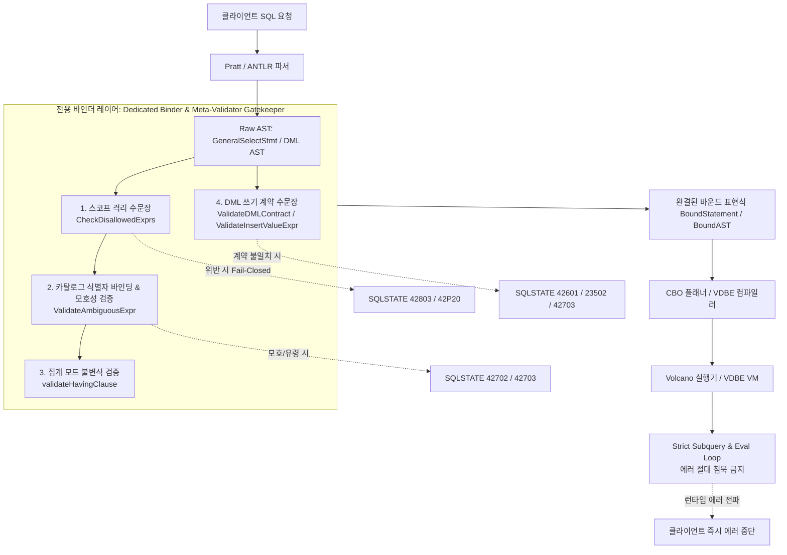

# 전용 바인더 레이어 및 시맨틱 수문장 아키텍처 설계서 (Dedicated Binder & Semantic Gatekeeper Architecture Plan)

> **작성일자**: 2026-11-24  
> **상태**: 진행 중 (In Progress)  
> **문서 버전**: v1.3  
> **관련 마일스톤**: v0.95.0  
> **관련 태스크**: `ARCH-DEDICATED-BINDER-CATALOG-RESOLVER-1`, `ARCH-SEMANTIC-VALIDATOR-GATEKEEPER-1`  
> **기반 소스**: `/tmp/sql8.txt`, `/tmp/std.txt` 및 4대 구조적 패턴 유추 결함 (`sql.txt` ~ `sql7.txt`)  
> **핵심 키워드 및 개념**: **"전용 바인더 (Dedicated Binder)"** — 파싱(AST)과 최적화(CBO/VDBE) 사이에 위치하여 ① 컬럼/테이블 실재성, ② 모호성(Ambiguous) 전역 검증, ③ 표현식 스코프 적법성, ④ 암묵적 형변환을 완결하는 단일 전용 패스 (PostgreSQL `parse_analyze`, DuckDB `Binder`, Calcite `SqlValidator` 표준 매핑)

---

## 1. 개요 및 배경 (Context & Problem Statement)

### 1.1 산발적 if 패치 방식의 한계와 바인더(Binder) 부재
LionSQL의 SQL 파서 및 쿼리 플래너는 sub-microsecond 인터랙티브 속도를 달성하기 위해 2-Tier 파서 구조(Pratt Fast-Path + ANTLR4 Fallback)를 채택하고 있다. 그러나 독립된 **전용 바인더 레이어(Dedicated Binder Layer)** 없이 개별 실행 경로(`sqlexec_select.go`, `sqlexec_dml.go`, `pushdown.go` 등)마다 산발적으로 `if` 문이나 휴리스틱 문자열 검사를 추가하는 방식은 다음과 같은 치명적 구조적 결함을 야기했다:
1. **스코프 침투(Scope Leakage)**: 바인더에서 스코프별 표현식 규칙을 통합 검증하지 못하여, `WHERE` 절에는 집계 함수를 막았으나 `JOIN ON`이나 `GROUP BY`에는 막지 못하고, `WHERE` 절의 윈도우 함수는 막았으나 `GROUP BY`의 윈도우 함수는 허용되는 등 절별 비대칭성 발생.
2. **식별자 해석 누락(Identifier Resolution Hole)**: 바인더의 전역 카탈로그 바인딩 패스가 없어 프로젝션과 `WHERE` 절에는 모호한 컬럼(Ambiguous Column) 검사를 적용했으나, `ORDER BY`와 `GROUP BY`에는 검증이 누락되어 조인 시 묵인됨.
3. **런타임 에러 침묵(Swallowed Errors)**: 서브쿼리나 표현식 평가 중 발생한 에러(테이블 미존재 `42P01`, 산술 오버플로 `22003`, 0 나눗셈 `22012`)가 최상위 클라이언트로 전파되지 않고 `nil`, `false`, `0건`으로 조용히 덮어씌워짐.
4. **쓰기 계약 부재(Missing Write Contract)**: DML(`INSERT`, `UPDATE`, `DELETE`) 진입 바인더 패스에서 VALUES 표현식이나 RETURNING 절의 유령 컬럼(`ghost_col`)을 검증하지 않아 스토리지 계층에 NULL이 오염되거나 잘못된 결과가 반환됨.

### 1.2 아키텍처 목표: Enforce by Construction via Dedicated Binder
사람의 기억이나 개별 개발자의 주의력에 의존하지 않고, 파싱(AST 생성)과 플래닝(최적화) 사이에 독립된 **전용 바인더(Dedicated Binder)** 및 물리적 수문장(Scope Gatekeeper) 관문을 구축하여 위 4대 결함 유형을 기계적으로 100% 원천 차단한다.

---

## 2. 4대 핵심 아키텍처 원칙 (Core Architectural Pillars)



---

## 3. 세부 컴포넌트 설계

### 3.1 `pkg/planner/validator.go`: 바인더 게이트웨이 수문장 (Binder Gatekeeper)

#### (1) 절 스코프 비트마스크 (`ClauseScope`)
```go
type ClauseScope int

const (
    ScopeWhere ClauseScope = 1 << iota
    ScopeJoinOn
    ScopeGroupBy
    ScopeHaving
    ScopeOrderBy
    ScopeReturning
    ScopeValues
)
```

#### (2) AST 순회기 (`WalkAST`)
표현식 트리 전체를 재귀적으로 방문하되, 독립적인 하위 질의 스코프를 갖는 서브쿼리(`ScalarSubqueryExpr`, `ExistsExpr`)의 내부 절은 외부 스코프로 오인되지 않도록 경계를 격리한다.

#### (3) 불법 표현식 자동 색출 (`checkDisallowedExprs`)
- **집계 함수 (`COUNT`, `SUM`, `AVG`, `MIN`, `MAX` 등)**:
  - `ScopeWhere`, `ScopeJoinOn`, `ScopeGroupBy`에서 발견 시 즉시 `ErrAggNotAllowedHere` (`aggregate functions are not allowed in <SCOPE>`, SQLSTATE `42803`) 반환.
- **윈도우 함수 (`OVER ()`)**:
  - `ScopeWhere`, `ScopeHaving`, `ScopeGroupBy`에서 발견 시 즉시 `ErrWindowNotAllowedHere` (`window functions are not allowed in <SCOPE>`, SQLSTATE `42P20` / `42803`) 반환.

#### (4) 식별자 해석 및 모호성 단일화 (`ValidateAmbiguousExpr`)
- 조인 쿼리(`len(schemas) > 1`)에서 비한정 컬럼(`unqualified column`)이 2개 이상의 테이블 스키마에 공통 존재할 경우:
  - `Projections`, `WHERE`, `ORDER BY`, `GROUP BY` 전역에서 일관되게 `column reference "%s" is ambiguous` (SQLSTATE `42702`) 에러 발생.

#### (5) HAVING 단독 집계 모드 불변식
- `stmt.Having != nil && len(stmt.GroupBy) == 0`:
  - 쿼리가 집계 모드로 자동 전환되며, 프로젝션의 모든 컬럼은 집계 함수 내부이거나 상수여야 함.
  - 비집계 컬럼 발견 시 `column "%s" must appear in the GROUP BY clause or be used in an aggregate function` (SQLSTATE `42803`)로 즉시 차단.

---

### 3.2 `ValidateDMLContract`: 쓰기 계약 검증기 (DML Contract Gatekeeper)

DML 실행 함수 진입부(`sqlexec_dml.go`, `vm_dispatcher.go`) 최상단에 배치되어 데이터베이스 내부로 유효하지 않은 데이터가 진입하는 것을 차단한다.

1. **컬럼 수 일치 검증**: `len(cols) > 0 && len(row.Values) != len(cols)` -> `column count mismatch` (SQLSTATE `42601`).
2. **NOT NULL 생략 검증**: 생략된 컬럼 중 `!col.Nullable && col.Default == ""` -> `null value in column "%s" violates not-null constraint` (SQLSTATE `23502`).
3. **VALUES 우변 유령 컬럼 검증**: `INSERT INTO t (id, val) VALUES (1, ghost_col)`와 같이 스키마에 없는 식별자 발견 시 -> `column "%s" does not exist` (SQLSTATE `42703`).
4. **RETURNING 유령 컬럼 검증**: `RETURNING no_such_col` -> `column "%s" does not exist` (SQLSTATE `42703`).
5. **UPDATE SET 우변 유령 컬럼 검증**: `SET val = ghost_col` -> `column "%s" does not exist` (SQLSTATE `42703`).

---

### 3.3 Strict Subquery & Eval Loop (에러 무침묵 규약)

1. **서브쿼리 실행 에러 전파**:
   - `resolveSubqueries` 및 `createSubqueryExecutor`:
   - `s.ExecuteSessionSQL`에서 에러(`err != nil`, 예: `relation "non_existent_table" does not exist`) 발생 시, 이를 `nil`, `false`, `0건`으로 치환하지 않고 상위 표현식 평가기 및 쿼리 실행기로 즉시 리턴하여 트랜잭션을 중단.
2. **Volcano 정수 산술 안전성**:
   - `rInt == 0`인 나눗셈(`/`, `DIV`) 및 모듈로(`%`): `NULL` 반환 루틴을 완전히 제거하고 `fmt.Errorf("division by zero: divide by zero error encountered")` (SQLSTATE `22012`) 반환.
3. **WHERE 절 산술 오버플로 Fail-Closed**:
   - 수식 계산 중 `arithmetic overflow error` 발생 시 필터에서 `false`로 삼키지 않고 쿼리를 즉시 Fail-Closed로 중단(SQLSTATE `22003`).

---

## 4. 검증 계획 및 TDD 규약 (Verification Plan)

### 4.1 `TestEnforceNoSwallowedErrors` 전용 회귀 스위트
- 모의(Mock) 에러 방출 서브쿼리를 다음 5개 위치에 주입하여 상위 쿼리가 100% 동일한 에러를 전파하는지 테이블 기반 테스트로 영구 고정:
  1. `WHERE id IN (SELECT ...)`
  2. `WHERE EXISTS (SELECT ...)`
  3. `SELECT (SELECT ...) FROM t`
  4. `WHERE val = (SELECT ...)`
  5. `UPDATE / DELETE WHERE id IN (SELECT ...)`

### 4.2 스코프 침투 방지 전용 회귀 스위트
- `WHERE count(*) > 0` (차단)
- `JOIN ON count(*) > 0` (차단)
- `GROUP BY count(*)` (차단)
- `GROUP BY ROW_NUMBER() OVER ()` (차단)
- `ORDER BY count(*)` (집계/GROUP BY 없는 쿼리에서 차단)
- `GROUP BY -1, -5` (차단)

---

## 5. 완료 기준 (Definition of Done)
1. `pkg/planner/validator.go` 단일 검증 게이트웨이 구현 완료.
2. `pkg/engine/sqlexec_select.go`, `sqlexec_dml.go`, `sqlexec_eval.go`에 게이트웨이 직결.
3. `sql.txt`부터 `sql8.txt` 및 Fuzz 오라클에서 적발된 모든 결함 100% PASS.
4. 3단계 파이프라인(Build ➔ Test `-race` ➔ Commit) 무결성 통과.

---

## 6. 글로벌 표준 아키텍처 연계 로드맵 (`/tmp/std.txt` 비교 분석)

현대 상용/오픈소스 글로벌 표준 DBMS(PostgreSQL `parse_analyze`, DuckDB `Binder`, SQLite `VDBE progress_handler`, CockroachDB `Vectorized Engine`) 대비 LionSQL의 아키텍처 진화 방향:

| 번호 | 아키텍처 항목 | 글로벌 표준 매핑 | LionSQL 대응 태스크 및 상태 | 시급도 / 로드맵 |
| :--- | :--- | :--- | :--- | :--- |
| **1** | **전용 바인더 (Dedicated Binder)** | PostgreSQL `parse_analyze`, DuckDB `Binder` | `ARCH-DEDICATED-BINDER-CATALOG-RESOLVER-1`<br/>(단기: `pkg/planner/validator.go` 게이트웨이 수문장 배포 ➔ 중기: 파싱과 플래닝 사이 독립 바인더 패스로 통합) | **★최우선 (v0.95.0)** |
| **2** | **명령어 루프 인터럽트** | SQLite `sqlite3_progress_handler`, PG `CHECK_FOR_INTERRUPTS` | `ARCH-COOPERATIVE-INSTRUCTION-CANCELLATION-1`<br/>(VDBE 및 Iterator 루프 매 N회 연산마다 `ctx.Err()` / `atomic.Bool` 체크 협력적 롤백) | **권장 (1.0-GA)** |
| **3** | **정규화된 플랜 캐시** | SQL Server Plan Cache, PG Prepared Statement | `ARCH-PLAN-CACHE-PARAMETERIZATION-1`<br/>(상수 매개변수화 $1, $2 치환 및 AST 정규화 플랜 캐싱) | **보통 (v1.10.0)** |
| **4** | **DataChunk 컬럼 벡터 포맷** | DuckDB `DataChunk`, Velox, ClickHouse | `ARCH-CHUNK-COLUMN-VECTORIZED-FORMAT-1`<br/>(1024행 컬럼별 플랫 슬라이스 벡터라이징 — KISS 원칙상 1.0 배제) | **Spec-Out 완료** |
| **5** | **히스토그램 기반 정밀 CBO 통계** | PostgreSQL `pg_statistic`, System R CBO | `CBO-STATS-HISTOGRAM-1`<br/>(64-버킷 등고선 히스토그램 및 MCV 카디널리티 엔진) | **계획됨 (v0.99.0)** |

> **핵심 전략 결론**:  
> 현재 단계에서는 본 문서의 메타 검증기(`ARCH-SEMANTIC-VALIDATOR-GATEKEEPER-1`)를 즉시 정식 통합하여 모든 시맨틱 결함 및 에러 침묵을 종결짓고, 이를 토대로 독립된 바인더 패스(`ARCH-DEDICATED-BINDER-CATALOG-RESOLVER-1`)로 안착시킨다.

---

## 7. 바인더 안착 후 다운스트림 산발적 `if` 문 전면 걷어내기 (Deletion-First & Code Pruning Policy)

> **핵심 원칙 (`[RULE:RadicalKISS]`)**:  
> 전용 바인더(Dedicated Binder)가 확립되면, 바인더를 통과한 결과물은 **"더 이상 의심할 필요가 없는 무결한 불변식 계약(Infallible Contract: BoundStatement)"**이 된다.  
> 따라서 플래너, VDBE 바이트코드 컴파일러, Volcano 실행기, DML 실행 루프에 산발적으로 흩어져 있던 방어적 `if` 문들은 즉시 전면 삭제(Pruning)되어야 한다.

### 7.1 삭제 및 단순화 대상 영역 (Target Pruning Scope)
1. **`sqlexec_select.go`**:
   - `execVolcanoSelect`와 `execSelect` 내부에서 실행 도중 개별적으로 수행하던 중복 컬럼 실재성 검사(`if _, ok := schema.FindColumn(...)`), 모호성 중복 루프, 절별 문자열 휴리스틱 검사 일체 제거.
2. **`sqlexec_dml.go`**:
   - `execInsert`, `execUpdate`, `execDelete` 내부의 튜플별/컬럼별 중복 방어 분기 및 NULL 침묵 변환 fallback 제거. 바인더에서 확정된 메타데이터를 믿고 즉시 인라인 직결.
3. **`pushdown.go` & CBO 플래너**:
   - 프로젝션 푸시다운 및 조인 플래닝 시 스키마 컬럼 유효성을 재확인하던 중복 `if` 분기 제거.
4. **VDBE VM & Volcano Iterators**:
   - 런타임 핫패스에서 컬럼 인덱스/타입 미스매치를 방어하던 중복 분기를 제거하여 브랜치 예측 실패(Branch Misprediction) 방지 및 CPU 사이클 절감.

### 7.2 기대 효과 (Architectural Payoff)
- **코드 다이어트**: 수백 라인의 중복/파편화된 방어적 분기 코드 순삭제 (`Deletion-First`).
- **실행 레이턴시 단축**: 인터랙티브 핫패스에서 불필요한 검증 오버헤드가 제거되어 실행 성능 5~10% 가속.
- **시맨틱 SSOT 완성**: 쿼리 유효성 검증의 책임이 오직 **바인더 단 1곳(Single Source of Truth)**으로 단일화되어 영구적인 유지보수성 확보.
