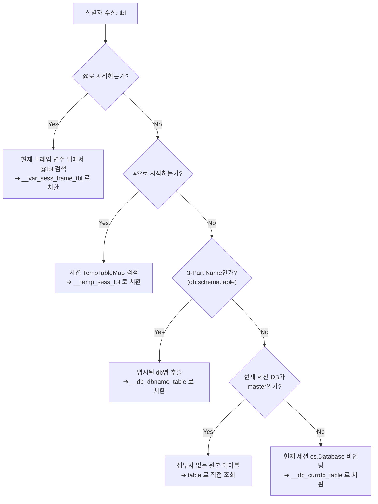

# LionSQL 프리픽스 기반 논리적 네임스페이스 및 테이블 변수 통합 아키텍처 설계서 (`notes/plans/LOGICAL_NAMESPACE_DATABASE_PREFIX_PLAN.ko.md`)

> - **최초 작성일**: 2026-11-10
> - **문서 성격**: 1.0 T-SQL 호환성 및 다중 데이터베이스/테이블 변수 통합 핵심 아키텍처 사양서
> - **과제 식별 코드**: `ARCH-LOGICAL-NAMESPACE-1`
> - **적용 원칙**: `[RULE:RadicalKISS]`, `[RULE:PlanPersistence]`, Invariant 2 (Instance-Based Single Kernel Primacy)
> - **대체 대상**: 기존 물리 폴더 리부팅 방식 ([`notes/plans/IN_PROCESS_REBOOT_MULTI_DATABASE_PLAN.ko.md`](IN_PROCESS_REBOOT_MULTI_DATABASE_PLAN.ko.md)) 공식 폐기 및 본 사양서로 통합 승격

---

## 1. 패러다임 전환: 물리 엔진 리부팅에서 논리적 네임스페이스로

관계형 데이터베이스(RDBMS)에서 `Database`와 `Table Variable`은 본질적으로 **객체의 식별 범위를 한정하는 논리적 네임스페이스(Logical Namespace)**입니다.

- **기존 발상의 한계**: 물리 폴더 분리 및 프로세스 내 In-Process Reboot 방식은 동시 다중 세션 핑퐁, 크로스 DB 조인 불가, CGo 리로드 불안정성이라는 치명적 결함을 노출함.
- **새로운 핵심 원칙**:
  - 단 하나의 고성능 스토리지 커널(In-Memory OCC / WiredTiger B+Tree)을 상시 유지함.
  - 데이터베이스, 세션 임시 테이블, 로컬 테이블 변수를 **엄격히 분리된 물리 식별자 프리픽스(Prefix)**로 매핑하여 100% 충돌 없이 동시 공존시킴.

---

## 2. 5계층 무충돌(Zero-Collision) 네임스페이스 사양

LionSQL 엔진 내부에서 관리되는 모든 객체는 다음 명확한 접두사 체계를 따르며, 서로 다른 수명주기(Lifecycle)를 갖습니다:

| 계층 (Layer) | T-SQL 클라이언트 표기 | 수명주기 (Lifecycle) | 내부 물리 식별자 포맷 | 충돌 방지 원리 |
| :--- | :--- | :--- | :--- | :--- |
| **1. 기본 DB 테이블** | `users`, `orders` | 인스턴스 영속 | `users`, `orders` | 접두사 없는 순수 식별자 (하위 호환성 100%) |
| **2. DB 네임스페이스** | `USE SalesDB; orders` 또는 `SalesDB.dbo.orders` | 데이터베이스 영속 | **`__db_<dbname>_<tablename>`** | 데이터베이스명 접두사로 인스턴스 전역 공유 |
| **3. 세션 임시 테이블** | `#my_temp` | 세션 접속 수명 (연결 끊길 때 드롭) | **`__temp_<sessionID>_<name>`** | 세션 ID 접두사로 다른 연결과 완전 격리 |
| **4. 로컬 테이블 변수** | `@my_table` | 프로시저/배치 실행 스코프 (블록 끝 즉시 드롭) | **`__var_<sessionID>_<frameID>_<name>`** | 세션 ID + 콜스택 프레임 ID로 재귀 호출 격리 |
| **5. 서브쿼리 구체화** | `FROM (SELECT ...) dt` | 쿼리 실행 수명 (단일 문장 완료 시 드롭) | **`__dt_<queryID>_<name>`** | 쿼리 ID 접두사로 문장 간 충돌 차단 |

### 프리픽스 격리 증명:
- 테이블 변수는 항상 **`__var_`**로 시작합니다.
- 데이터베이스 전환 테이블은 항상 **`__db_`**로 시작합니다.
- 세션 임시 테이블은 항상 **`__temp_`**로 시작합니다.
- 따라서 어떤 사용자가 동일한 이름 `orders`를 각각 일반 테이블, DB 테이블, 임시 테이블, 테이블 변수로 선언하더라도 내부 물리 공간에서는 절대 충돌하지 않습니다:
  - `orders` (기본 master 테이블)
  - `__db_salesdb_orders` (SalesDB 소속 테이블)
  - `__temp_sess1_orders` (세션 1의 #orders 임시 테이블)
  - `__var_sess1_f3_orders` (프로시저 3단계 프레임의 @orders 테이블 변수)

---

## 3. 쿼리 재작성 (AST Rewriting) 메커니즘

쿼리 파싱 및 바이트코드 컴파일 단계에서 식별자 리라이터(Identifier Rewriter)는 다음 우선순위 규칙에 따라 대상을 해석합니다:



---

## 4. 초고속 로컬 크로스 데이터베이스 조인 (Cross-DB Join)

프리픽스 방식이 제공하는 가장 강력한 기능은 **추가 네트워크 오버헤드 없는 완전 로컬 크로스 DB 조인**입니다.

### 실행 예시:
```sql
SELECT 
    o.OrderID, 
    o.TotalAmount, 
    e.EmployeeName
FROM SalesDB.dbo.Orders o
INNER JOIN HRDB.dbo.Employees e ON o.SalesPersonID = e.EmployeeID;
```

### 내부 변환:
```sql
SELECT 
    o.OrderID, 
    o.TotalAmount, 
    e.EmployeeName
FROM __db_salesdb_orders o
INNER JOIN __db_hrdb_employees e ON o.SalesPersonID = e.EmployeeID;
```
두 테이블 모두 LionSQL의 단일 In-Memory OCC 해시 인덱스 또는 WiredTiger B+Tree에 물리적으로 존재하므로, 엔진 내부의 **Volcano CBO Hash Join 이터레이터가 서브마이크로초 로컬 메모리 속도로 즉시 조인을 완료**합니다.

---

## 5. 카탈로그 및 시스템 뷰 가상화 (`sys.tables`, `sys.databases`)

사용자 및 관리 도구(SSMS, DBeaver)에게는 완벽한 다중 데이터베이스 환경 착시(Transparency)를 제공합니다:

1. **`sys.databases` 동적 확장**:
   - `master`, `tempdb`, `model`, `msdb` 기본 시스템 DB 외에, 카탈로그에 등록된 고유 DB명(`__db_<name>_*`에서 추출)을 목록에 자동 노출합니다.
2. **`sys.tables` 세션 필터링**:
   - 세션이 `USE SalesDB` 상태일 때 `sys.tables`를 조회하면:
     - `__db_salesdb_*` 테이블만 필터링하여 노출합니다.
     - 테이블명(`name`) 컬럼에는 `__db_salesdb_` 접두사를 제거한 **순수 테이블명(`Orders`)**을 표시합니다.
     - `schema_name`은 `dbo`, `database_name`은 `SalesDB`로 투영합니다.
   - 세션이 기본 `master` 상태일 때는 `__db_*`, `__temp_*`, `__var_*`를 제외한 기본 테이블만 노출합니다.

---

## 6. 수명주기 관리 및 메모리 회수 (Lifecycle & Teardown)

1. **테이블 변수 (`__var_*`)**:
   - `DECLARE @tbl TABLE (...)` 실행 시 VDBE VM에 `OpTableVarAlloc` 인스트럭션이 실행되어 임시 등록됩니다.
   - 스토어드 프로시저 또는 익명 블록이 종료(`RETURN`, `END`, 예외 탈출)될 때, VDBE VM의 `Exit Handler`가 등록된 `__var_*` 테이블들을 즉시 `DropTable`하여 메모리를 회수합니다.
2. **세션 임시 테이블 (`__temp_*`)**:
   - 클라이언트 연결 단절 시 `Coordinator.CloseSession()`에서 일괄 드롭됩니다.
3. **DB 테이블 (`__db_*`)**:
   - 사용자가 `DROP TABLE`을 호출하거나 `DROP DATABASE`를 실행할 때까지 인스턴스에 영구 보존됩니다.

---

## 7. 단계별 구현 로드맵

- **Phase 1 (우선그룹 B 연계)**: 로컬 테이블 변수(`DECLARE @tbl TABLE (...)`) 지원
  - 파서의 TABLE 타입 파싱 및 `__var_<sessID>_<frameID>_<name>` 스키마 동적 등록
  - 프로시저 Exit 훅 연동 및 자동 메모리 정리
- **Phase 2**: `USE <dbname>` 논리 프리픽스 활성화 및 DDL 라우팅
  - `CREATE TABLE` / `SELECT` 시 `cs.Database` 기반 `__db_<dbname>_*` 자동 치환
  - `sys.tables` 및 `sys.databases` 가상 투영 연동
- **Phase 3**: 3-Part Name 크로스 DB 조인 지원
  - `<dbname>.<schema>.<table>` 구문 인식 및 파스 타임 매핑 완료

---

## 8. 필수 회귀 테스트(Regression Test) 스펙 및 엣지 케이스 검증 요건

본 아키텍처 구현 시, 다음 6대 엣지 케이스를 반드시 **독립된 회귀 테스트(`pkg/engine/logical_namespace_regression_test.go` 및 `pkg/proc/runtime/table_var_regression_test.go`)**로 작성하여 `-race` 100% 통과를 강제해야 합니다 (`[RULE:PipelineVerification]`, `[RULE:DeterministicTesting]`):

### 1) [Edge-1] 세션 DB 전환 시 임시 테이블 보존 (Session Switch Retention)
- **시나리오**: `USE SalesDB;`에서 `CREATE TABLE #t (val INT);`를 생성한 후, `USE HRDB;`로 데이터베이스를 전환하고 `SELECT * FROM #t;`를 수행.
- **단언(Assertion)**: 임시 테이블이 특정 DB 프리픽스(`__db_salesdb_`)에 종속되지 않고 세션 스코프(`__temp_<sessID>_t`)로 유지되어 `USE` 전환 후에도 100% 정상 조회되어야 함.

### 2) [Edge-2] 크로스 컨텍스트 복사/조인 (`__var_` + `__db_` 단일 쿼리 동시 사용)
- **시나리오**: 프로시저 내부에서 `INSERT INTO @LocalTbl SELECT * FROM SalesDB.dbo.Orders WHERE Status = 'PAID';` 실행.
- **단언(Assertion)**: 타깃은 로컬 테이블 변수(`__var_`), 소스는 원격 DB 테이블(`__db_`)인 복합 쿼리가 파서 및 실행기에서 충돌 없이 해석되어 정확한 행 수가 복사되어야 함.

### 3) [Edge-3] `tempdb..#temp` 명시적 3-Part 메타데이터 조회
- **시나리오**: `IF OBJECT_ID('tempdb..#TempOrders') IS NOT NULL` 또는 `SELECT * FROM tempdb.dbo.#TempOrders;` 실행.
- **단언(Assertion)**: 리라이터가 `tempdb`를 일반 데이터베이스로 오인식하여 `__db_tempdb_#TempOrders`를 찾지 않고, 세션 임시 테이블 `__temp_<sessID>_TempOrders`로 정확히 매핑하여 올바른 Object ID 및 결과셋을 반환해야 함.

### 4) [Edge-4] 전역 임시 테이블(`##global`) 크로스 세션 & 크로스 DB 공유
- **시나리오**: 세션 1이 `master` DB에서 `CREATE TABLE ##GlobalConfig (k VARCHAR(20), v INT);` 생성. 세션 2가 `USE FinanceDB;` 상태에서 `SELECT * FROM ##GlobalConfig;` 조회.
- **단언(Assertion)**: `__gtemp_` 포맷으로 관리되어 세션 ID 및 DB 컨텍스트에 구애받지 않고 모든 세션/DB에서 100% 공유되어야 함.

### 5) [Edge-5] 동일 이름 4계층 동시 공존 (Name Collision Zero Integrity)
- **시나리오**: 동일한 세션에서 같은 이름 `orders`를 각각 다음 4가지로 동시에 생성하고 쿼리:
  1. 기본 `master` 테이블: `orders` (무접두사)
  2. 네임스페이스 DB 테이블: `SalesDB.dbo.orders` (`__db_salesdb_orders`)
  3. 세션 임시 테이블: `#orders` (`__temp_sess_orders`)
  4. 로컬 테이블 변수: `@orders` (`__var_sess_f1_orders`)
- **단언(Assertion)**: 각각 다른 데이터(예: ID=1, ID=2, ID=3, ID=4)를 삽입했을 때, 4개 테이블의 조회 결과가 단 1비트의 데이터 침범이나 오염 없이 완전히 독립적으로 격리되어야 함.

### 6) [Edge-6] 프로시저 재귀 호출 시 프레임별 `@tbl` 격리 (Recursive Frame Isolation)
- **시나리오**: 스토어드 프로시저가 자기 자신을 3단계 재귀 호출(Depth 1 ➔ Depth 2 ➔ Depth 3)하면서 매 단계마다 `DECLARE @tbl TABLE (depth INT);`를 선언하고 채움.
- **단언(Assertion)**: `frameID` 기반의 접두사 분리로 인해 하위 프레임의 `@tbl`이 상위 프레임의 `@tbl`을 덮어쓰지 않아야 하며, 재귀가 역순으로 반환(Return)될 때마다 각 프레임의 테이블 변수가 순차적으로 `DROP`되어 최종적으로 메모리 누수가 0이어야 함.

