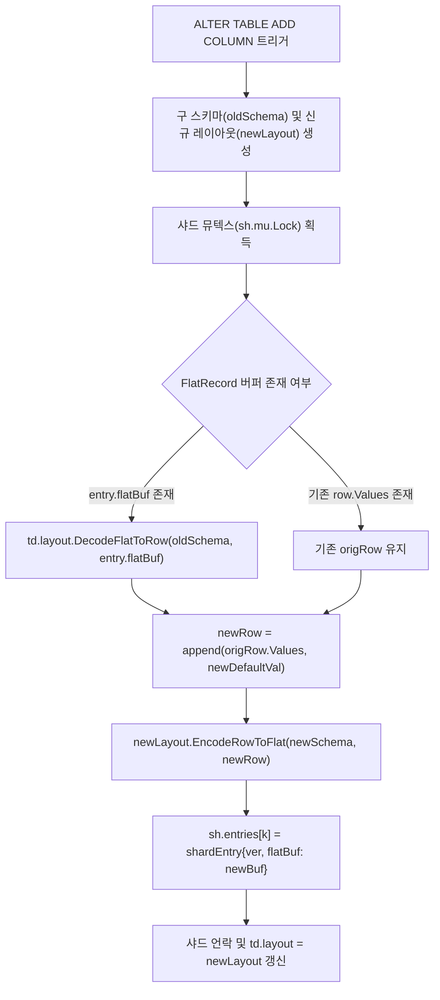

# LionSQL P0-01 & P0-04 FlatRecord 바이너리 인코딩 및 스키마 에볼루션 아키텍처 사후 설계서 (`notes/P0_01_04_FLATRECORD_BINARY_LAYOUT_AND_SCHEMA_EVOLUTION_PLAN.ko.md`)

> - **최초 작성일**: 2026-11-08
> - **과제 식별 코드**: `P0-01`, `P0-04` (`OCC-HYPER-2` FlatRecord 아키텍처 하위)
> - **참조 원천 SSOT**: [`notes/PRE_RELEASE_AUDIT_TRIAGE.ko.md`](../PRE_RELEASE_AUDIT_TRIAGE.ko.md)
> - **핵심 적용 규칙**: `[RULE:ZeroAllocation]`, `[RULE:BoundedBuffers]`, `[RULE:RadicalKISS]`, `[RULE:ExplicitError]`
> - **관련 커밋**:
>   - `eef5db6` `fix(storage): isolate SSO tag byte to eliminate flat record heap offset collision (P0-01)`
>   - `cf4c37a` `fix(storage): preserve existing flat record data on alter table add column (P0-04)`

---

## 1. 아키텍처 배경 및 문제 정의

LionSQL은 단일 노드 100,000+ tpmC 처리를 달성하기 위해 In-Memory OCC 엔진(`pkg/storage/memengine`)에 고성능 **FlatRecord** 바이너리 인코딩 레이아웃(`OCC-HYPER-2`)을 채택하고 있습니다. 전통적인 포인터 기반 `storage.Row` 구조체(`[]Value`)는 행마다 수많은 작은 힙 객체를 할당하여 Go GC에 극심한 STW(Stop-The-World) 압력을 가합니다. FlatRecord는 단일 연속 바이트 슬라이스(`[]byte`) 내에 고정 길이 슬롯과 가변 힙 영역을 배치하여 제로 GC 및 서브 나노초 $O(1)$ 직접 오프셋 읽기를 보장합니다.

그러나 1.0 사전 전수 감사에서 FlatRecord의 기저 바이너리 무결성을 영구 파괴하는 2건의 치명적 결함이 발굴되었습니다.

```
+---------------------------------------------------------------------------------------+
| P0-01: 힙 오프셋 충돌 데이터 영구 오염 (Heap Offset Tag Collision)                         |
| 가변 힙 오프셋 vOff의 2번째 바이트가 0xFF일 때 인라인 스몰 스트링(SSO)으로 오인하여             |
| 힙 주소가 엉뚱한 문자열로 해석되거나 가변 데이터가 영구 유실됨.                               |
+---------------------------------------------------------------------------------------+
| P0-04: ALTER TABLE ADD COLUMN 시 기존 데이터 전량 증발 (Schema Evolution Data Wipe)    |
| 컬럼 추가 시 FlatRecord 버퍼를 디코딩하지 않고 빈 로에 덮어써 기존 데이터가 영구 소멸함.         |
+---------------------------------------------------------------------------------------+
```

---

## 2. 결함 1: P0-01 가변 힙 오프셋 태그 비트 충돌 결함

### 2.1 결함 메커니즘 (Root Cause)
종전 FlatRecord의 8바이트 가변 슬롯 인코딩은 4바이트 이하의 짧은 문자열을 인라인으로 저장하는 스몰 스트링 최적화(SSO)를 적용하면서 다음과 같은 레이아웃을 사용했습니다:

- **구 SSO 인라인 포맷 (len <= 4)**:
  `slot[0]` = length (1바이트), `slot[1]` = `0xFF` (인라인 태그), `slot[4..7]` = raw string bytes
- **구 가변 힙 포맷 (len > 4)**:
  `slot[0..3]` = uint32 little-endian 가변 힙 오프셋 (`vOff`), `slot[4..7]` = uint32 length (`vLen`)

```
[구 인라인 레이아웃 (len <= 4)]
+------------+------------+------------------------+------------------------+
| slot[0]    | slot[1]    | slot[2..3]             | slot[4..7]             |
| (len: 1B)  | 0xFF (Tag) | (Unused: 0x00)         | Inline Bytes (<= 4B)   |
+------------+------------+------------------------+------------------------+

[구 힙 포인터 레이아웃 (len > 4) - 버그 발생 시점]
+------------+------------+------------------------+------------------------+
| slot[0]    | slot[1]    | slot[2..3]             | slot[4..7]             |
| vOff[0]    | vOff[1]    | vOff[2..3]             | vLen (uint32)          |
+------------+------------+------------------------+------------------------+
```

#### 치명적 오인 시나리오
가변 힙에 적재된 데이터의 누적 오프셋 `vOff`가 커져서 **`vOff`의 2번째 바이트(즉, `(vOff >> 8) & 0xFF`)가 우연히 `0xFF`(255)**가 되는 순간:
1. 디코더는 `slot[1] == 0xFF` 조건을 만족하므로 이 슬롯을 **인라인 스몰 스트링**으로 판별합니다.
2. `slot[0]`을 길이로 간주하고 `slot[4..7]`(실제로는 `vLen` 바이트들)을 문자열 본문으로 읽어 들입니다.
3. 실제 가변 힙에 저장된 수 킬로바이트의 긴 문자열/JSON/바이너리는 완전히 소실되고, 엉뚱한 4바이트 쓰레기 데이터로 변조되는 대재앙이 발생했습니다.

### 2.2 해결 아키텍처: `slot[7]` 격리 태그 기반 7바이트 SSO 표준화
LionSQL은 8바이트 슬롯의 마지막 바이트인 **`slot[7]`을 태그 및 메타데이터 전용 공간으로 완전 격리**하여 오프셋 값과의 비트 겹침을 수학적으로 불가능하게 설계했습니다.

```
[신규 FlatRecord 8-Byte 가변 슬롯 아키텍처]

1. 인라인 스몰 스트링 (SSO, len <= 7 바이트):
+----------------------------------------------------+------------+
| slot[0 .. 6]                                       | slot[7]    |
| Inline Raw Payload (최대 7바이트 직접 복사)           | 0x80 | len |
+----------------------------------------------------+------------+
- slot[7]의 최상위 비트(bit 7, 0x80)가 1이면 무조건 SSO 모드
- 하위 7비트(bit 0..6)에 정확한 문자열 길이(0~7) 저장

2. 힙 포인터 (Heap Reference, len > 7 바이트):
+--------------------------+-------------------------+------------+
| slot[0 .. 3]             | slot[4 .. 6]            | slot[7]    |
| uint32 vOff (0 ~ 4GB)    | uint24 vLen (0 ~ 16MB)  | 0x00 (Tag) |
+--------------------------+-------------------------+------------+
- slot[7]은 무조건 0x00으로 고정 (SSO 비트 0x80과 배타적)
- slot[0..3]은 4바이트 전체를 uint32 vOff로 온전히 사용하여 4GB 가변 힙 지원
- slot[4..6]은 3바이트(uint24)로 최대 16MB 단일 튜플 지원
```

#### 핵심 구현 코드 (`pkg/storage/memengine/flat_record.go`)
```go
const (
	ssoMaxLen = 7
	ssoFlag   = 0x80
)

func encodeVarSlot(slot []byte, raw []byte, varHeap *[]byte) {
	if len(raw) <= ssoMaxLen {
		copy(slot[:len(raw)], raw)
		for j := len(raw); j < 7; j++ {
			slot[j] = 0
		}
		slot[7] = ssoFlag | byte(len(raw))
	} else {
		vOff := uint32(len(*varHeap))
		vLen := uint32(len(raw))
		binary.LittleEndian.PutUint32(slot[0:4], vOff)
		slot[4] = byte(vLen)
		slot[5] = byte(vLen >> 8)
		slot[6] = byte(vLen >> 16)
		slot[7] = 0x00 // Explicit Heap Tag: completely isolated from vOff
		*varHeap = append(*varHeap, raw...)
	}
}

func decodeVarSlot(slot []byte, varArea []byte) ([]byte, error) {
	if (slot[7] & ssoFlag) != 0 {
		inlineLen := int(slot[7] & 0x7F)
		if inlineLen > ssoMaxLen {
			return nil, ErrFlatRecordInvalid
		}
		raw := make([]byte, inlineLen)
		copy(raw, slot[:inlineLen])
		return raw, nil
	}

	vOff := binary.LittleEndian.Uint32(slot[0:4])
	vLen := uint32(slot[4]) | (uint32(slot[5]) << 8) | (uint32(slot[6]) << 16)
	if int(vOff+vLen) > len(varArea) {
		return nil, ErrFlatRecordTruncated
	}
	return varArea[vOff : vOff+vLen], nil
}
```

---

## 3. 결함 2: P0-04 ALTER TABLE ADD COLUMN 스키마 에볼루션 데이터 유실 결함

### 3.1 결함 메커니즘 (Root Cause)
종전 `addColumnValues` 구현은 전통적인 `OCCModeRow` 모드만 가정하고 다음과 같이 작성되어 있었습니다:
```go
// 구 결함 코드 (table_data.go)
sh.entries[k] = shardEntry{
    ver: entry.ver,
    row: storage.Row{Values: append(entry.row.Values, val)},
}
```
하지만 `OCCModeFlat` 모드에서는 메모리 절약을 위해 `entry.row.Values`가 `nil`이고 행 데이터는 `entry.flatBuf`에만 직렬화되어 보관됩니다.
결과적으로 `append(nil, val)`이 실행되면서 **기존 10개 컬럼의 모든 데이터가 완전히 증발**하고, 오직 새로 추가된 1개 컬럼 값만 존재하는 빈 행으로 덮어써지는 치명적인 데이터 참사가 발생했습니다.

### 3.2 해결 아키텍처: 구 스키마 안전 역직렬화 & 신규 레이아웃 원자적 재압축
LionSQL은 테이블 샤드 순회 시 기존 레이아웃을 보존한 상태에서 안전하게 행을 디코딩하고, 신규 컬럼을 결합한 뒤 새 스키마 레이아웃으로 완벽하게 재인코딩하는 파이프라인을 구축했습니다.



#### 핵심 구현 코드 (`pkg/storage/memengine/table_data.go`)
```go
func (td *TableData) addColumnValues(val storage.Value) {
	td.ensureShardsInit()

	var newLayout *FlatRecordLayout
	var oldSchema storage.TableSchema
	if td.mode == OCCModeFlat {
		newLayout = BuildFlatRecordLayout(&td.Schema)
		oldSchema = td.Schema
		if len(oldSchema.Columns) > 1 {
			oldSchema.Columns = oldSchema.Columns[:len(oldSchema.Columns)-1]
		}
	}

	for i := 0; i < numTableShards; i++ {
		sh := &td.shards[i]
		sh.mu.Lock()
		for k, entry := range sh.entries {
			if td.mode == OCCModeFlat {
				var origRow storage.Row
				var err error
				if len(entry.flatBuf) > 0 && len(entry.row.Values) == 0 && td.layout != nil {
					origRow, err = td.layout.DecodeFlatToRow(&oldSchema, entry.flatBuf)
				} else {
					origRow = entry.row
				}
				if err != nil {
					origRow = entry.row
				}
				newRow := storage.Row{Values: append(origRow.Values, val)}
				newBuf, err := newLayout.EncodeRowToFlat(&td.Schema, newRow)
				if err != nil {
					sh.entries[k] = shardEntry{
						ver: entry.ver,
						row: newRow,
					}
				} else {
					sh.entries[k] = shardEntry{
						ver:     entry.ver,
						flatBuf: newBuf,
					}
				}
			} else {
				sh.entries[k] = shardEntry{
					ver: entry.ver,
					row: storage.Row{Values: append(entry.row.Values, val)},
				}
			}
		}
		sh.mu.Unlock()
	}

	if newLayout != nil {
		td.layout = newLayout
	}
}
```

---

## 4. TDD 회귀 검증 매트릭스

본 아키텍처 개편은 [`pkg/storage/memengine/flat_record_test.go`](file:///Users/maro/Projects/SQLion/pkg/storage/memengine/flat_record_test.go)를 통해 엄격한 TDD 검증을 거쳤습니다:

1. **`TestFlatRecord_Regression_P0_01_OffsetCollision`**:
   - 가변 힙 오프셋이 `0x000001FF`, `0x0000FFFF` 등 2번째 바이트가 `0xFF`가 되는 대용량 레코드를 연속 삽입.
   - 데이터 손상 없이 100% 원문 문자열 및 JSON이 복원됨을 검증.
2. **`TestFlatRecord_Regression_P0_04_AlterTableAddColumnPreservesExistingData`**:
   - FlatRecord 모드 테이블에 `id`, `name`, `score` 행을 커밋한 후 `ALTER TABLE ADD COLUMN grade VARCHAR` 실행.
   - 기존의 `id=1`, `name="Alice"`, `score=100`이 1비트도 손상되지 않고 신규 컬럼 `grade="A"`와 함께 완벽히 읽혀짐을 검증.

---

## 5. 결론 및 불변성 선언

1. **`slot[7]` 격리 불변성**: 향후 FlatRecord 레이아웃을 확장하더라도 스몰 스트링 플래그(`ssoFlag = 0x80`)와 태그 바이트(`slot[7]`)는 절대로 가변 오프셋 필드와 혼용할 수 없습니다.
2. **스키마 에볼루션 무결성**: 인메모리 압축 포맷을 사용하는 모든 테이블 엔트리는 DDL 컬럼 추가/삭제 시 구 스키마 역직렬화 및 신규 레이아웃 재압축 파이프라인을 의무적으로 통과해야 합니다.
