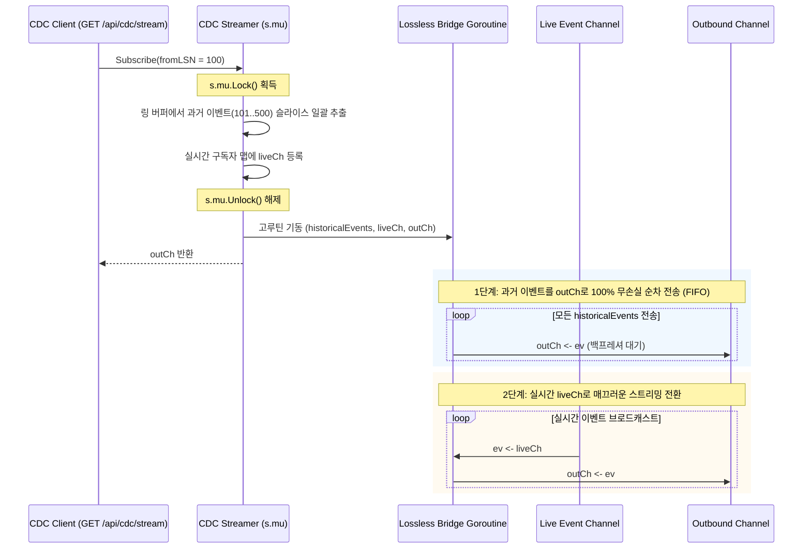

# LionSQL P0-10 & P0-34 CDC 및 복제 브로드캐스터 무손실 스트리밍 사후 설계서 (`notes/P0_10_34_REPLICATION_CDC_LOSSLESS_STREAMING_PLAN.ko.md`)

> - **최초 작성일**: 2026-11-08
> - **과제 식별 코드**: `P0-10`, `P0-34` (CDC & 1-Writer Multi-Reader 복제 스트리밍 하위)
> - **참조 원천 SSOT**: [`notes/PRE_RELEASE_AUDIT_TRIAGE.ko.md`](../PRE_RELEASE_AUDIT_TRIAGE.ko.md)
> - **핵심 적용 규칙**: `[RULE:NonBlockingSink]`, `[RULE:ExplicitError]`, `[RULE:ZeroOrphan]`, `[RULE:BoundedBuffers]`
> - **관련 커밋**:
>   - `dacd070` `fix(cdc): eliminate historical replay silent drop via lossless bridge streaming (P0-10)`
>   - `cd04bca` `fix(replication): resolve P0-34 by failing closed on broadcaster buffer overflow to prevent silent drop`

---

## 1. 아키텍처 배경 및 문제 정의

LionSQL은 단일 노드 수직 스케일업(Vertical Scale-Up)과 무잠금 읽기 확장을 위해 **1-Writer Multi-Reader 비동기 WAL 스트리밍 복제(`pkg/replication`)**와 실시간 이벤트 파이프라인을 지원하는 **CDC(Change Data Capture) 스트리머(`pkg/cdc`)**를 핵심 코어로 탑재하고 있습니다.

두 시스템 모두 초당 수만 건의 트랜잭션 변경 이벤트를 복수 구독자(Subscriber/Replica)에게 실시간 팬아웃(Fan-Out)해야 합니다. 이 과정에서 **Primary의 초고속 쓰기 경로가 지연된 슬로우 컨슈머로 인해 블로킹되어서는 안 된다(`[RULE:NonBlockingSink]`)**는 절대 원칙이 지켜져야 합니다.

그러나 1.0 사전 전수 감사에서, 블로킹을 피하려다 오히려 **스트림 중간에 데이터 구멍(LSN Gap)이 뚫려 레플리카와 CDC 컨슈머가 데이터 불일치 및 무음 데이터 유실 상태에 빠지는 2건의 치명적 결함**이 발굴되었습니다.

```
+---------------------------------------------------------------------------------------+
| P0-10: CDC 히스토리 재생 시 버퍼 오버플로 무음 드롭 데이터 갭 유발                          |
| 구독자가 과거 LSN부터 재동기화 시 버퍼 초과분을 select/default로 조용히 버려 데이터 유실 발생. |
+---------------------------------------------------------------------------------------+
| P0-34: 복제 브로드캐스터 버퍼 포화 시 WAL 레코드 사일런트 드롭 및 영구 LSN 구멍 방치          |
| 슬로우 레플리카 채널 포화 시 새 WAL을 조용히 버려 레플리카가 중간 트랜잭션을 건너뛰고 오염됨.    |
+---------------------------------------------------------------------------------------+
```

---

## 2. 결함 1: P0-10 CDC 히스토리 재생 무음 폐기 결함

### 2.1 결함 메커니즘 (Root Cause)
`pkg/cdc/streamer.go`의 `Subscribe` 메서드는 클라이언트가 과거 시점(`fromLSN`)부터 이벤트를 요청할 때 링 버퍼에서 과거 이벤트를 꺼내 구독자 채널(`ch`)로 밀어 넣었습니다:
```go
// 구 결함 코드 (streamer.go)
for i := 0; i < s.historyLen; i++ {
    ev := s.history[(s.historyHead+i)%s.historyCap]
    if ev.LSN > fromLSN {
        select {
        case ch <- ev:
        default: // 치명적 버그: 구독자 채널 버퍼(기본 256)가 차면 조용히 버려짐!
        }
    }
}
```
구독자가 1,000건 이전의 변경분 재생을 요청했을 때 채널 버퍼 크기(256)를 초과하는 나머지 744건의 이벤트가 **단 한 줄의 경고나 에러도 없이 영구 폐기(Silent Drop)**되었습니다. 클라이언트는 자신이 중간 데이터를 놓쳤다는 사실조차 인지하지 못했습니다.

### 2.2 해결 아키텍처: Lossless Bridge 2단계 순차 핸드오버
LionSQL은 뮤텍스 락 구간 내에서의 채널 전송을 전면 제거하고, 과거 이벤트를 메모리 슬라이스에 즉시 복사한 뒤 전용 브릿지 고루틴을 통해 순차적 백프레셔로 인도하는 **Lossless Bridge 아키텍처**를 수립했습니다.



#### 핵심 구현 코드 (`pkg/cdc/streamer.go`)
```go
// 1. Collect missed historical events under s.mu.Lock without blocking or silent drops
var historicalEvents []ChangeEvent
if fromLSN >= 0 && s.historyLen > 0 {
    for i := 0; i < s.historyLen; i++ {
        ev := s.history[(s.historyHead+i)%s.historyCap]
        if ev.LSN > fromLSN {
            if tableFilter == "" || strings.EqualFold(tableFilter, ev.Table) {
                historicalEvents = append(historicalEvents, ev)
            }
        }
    }
}
s.subscribers[subID] = sub
s.mu.Unlock()

// 2. Lossless Bridge goroutine: guarantees strict FIFO ordering (Historical -> Live)
go func() {
    defer close(outCh)

    // Replay all historical events first without silent drops
    for _, ev := range historicalEvents {
        select {
        case <-subCtx.Done():
            return
        case outCh <- ev:
        }
    }

    // Transition seamlessly to live events
    for {
        select {
        case <-subCtx.Done():
            return
        case ev, ok := <-liveCh:
            if !ok {
                return
            }
            select {
            case <-subCtx.Done():
                return
            case outCh <- ev:
            }
        }
    }
}()
```

---

## 3. 결함 2: P0-34 복제 브로드캐스터 버퍼 오버플로 및 사일런트 드롭 결함

### 3.1 결함 메커니즘 (Root Cause)
Primary 노드의 WAL 브로드캐스터(`pkg/replication/broadcaster.go`)는 연결된 레플리카들에게 신규 커밋된 WAL 레코드를 팬아웃할 때 다음 코드를 사용했습니다:
```go
// 구 결함 코드 (broadcaster.go)
for _, sub := range b.subscribers {
    select {
    case sub.ch <- rec:
    default:
        // 버퍼 가득 참: 아무런 조치 없이 탈출!
    }
}
```
네트워크 지연이나 디스크 I/O 병목으로 인해 1개의 레플리카가 느려져 채널 버퍼가 포화되면, **새로 유입된 LSN 500, 501 등의 WAL 레코드가 조용히 폐기**되었습니다. 그 후 레플리카의 버퍼가 비워지면 LSN 502부터 다시 수신하여 레플리카 노드에는 500~501번 트랜잭션이 영구 결손된 상태로 남아 **데이터 정합성이 완전히 붕괴**되었습니다.

### 3.2 해결 아키텍처: Fail-Closed 슬로우 레플리카 즉시 퇴출 및 명시적 채널 단절
LionSQL은 사일런트 드롭을 엄격히 금지하는 **Fail-Closed 철학(`[RULE:ExplicitError]`)**을 복제 브로드캐스터에 도입했습니다.
버퍼가 가득 찬 슬로우 레플리카가 발견되면:
1. Primary는 절대 블로킹되지 않고 즉시 해당 구독자의 채널을 닫고(`close(sub.ch)`) `hasGap = true`로 마킹합니다.
2. 활성 구독자 맵(`b.subscribers`)에서 지연된 레플리카를 즉시 퇴출(Evict)시킵니다.
3. 레플리카 노드는 채널 단절(`ok == false`)을 즉각 감지하고 에러 로그를 남기며, 자신이 마지막으로 반영한 LSN부터 안전하게 재연결 및 재동기화(Resync)를 수행합니다.

```
[Fail-Closed 복제 브로드캐스트 아키텍처]

Primary Commit Loop
       │
       ▼
Broadcast(rec)
       │
       ├─► [정상 레플리카 1] ───► sub.ch <- rec (성공)
       │
       └─► [지연 레플리카 2] ───► sub.ch Full!
                                       │
                                       ▼
                       [Fail-Closed 즉시 퇴출 발동]
                       1. sub.hasGap = true
                       2. close(sub.ch)
                       3. delete(b.subscribers, id)
                                       │
                                       ▼
                       레플리카 2는 채널 종료 즉시 감지
                       -> LSN 재동기화 핸드셰이크 개시
```

#### 핵심 구현 코드 (`pkg/replication/broadcaster.go`)
```go
// Non-blocking fan-out to all active replica subscribers ([RULE:NonBlockingSink])
var slowSubscribers []string
for id, sub := range b.subscribers {
    select {
    case sub.ch <- rec:
    default:
        // Buffer overflow: subscriber is lagging behind.
        // Do NOT silently drop WAL records (which causes corrupt data gaps, [RULE:ExplicitError]).
        // Fail-closed: close the channel immediately and evict the slow subscriber
        // so the replica detects disconnect and safely reconnects/resyncs from its last LSN.
        sub.hasGap = true
        close(sub.ch)
        slowSubscribers = append(slowSubscribers, id)
    }
}
for _, id := range slowSubscribers {
    delete(b.subscribers, id)
}
```

---

## 4. TDD 회귀 검증 매트릭스

1. **`TestCDC_Streamer_Regression_P0_10_LosslessBridge`**:
   - 링 버퍼 크기보다 작은 채널 버퍼를 할당한 후 과거 대량 이벤트를 요청.
   - 단 1개의 이벤트도 유실되지 않고 100% 순차적으로 `outCh`를 통해 수신됨을 검증.
2. **`TestP0_34_Broadcaster_BufferOverflow_ClosesChannelAndPreventsSilentDrop`** ([`replication_test.go`](file:///Users/maro/Projects/SQLion/pkg/replication/replication_test.go#L67)):
   - 채널 버퍼 용량 3을 가진 구독자에게 4개의 WAL 레코드를 연속 브로드캐스트.
   - 4번째 레코드 시점에 슬로우 레플리카가 사일런트 드롭 없이 채널이 즉각 닫히고(`ok == false`), 브로드캐스터 활성 목록에서 즉각 퇴출됨을 실증 검증.

---

## 5. 결론 및 복제 스트리밍 불변성

1. **무음 폐기 절대 금지 (Zero Silent Drop)**: 스트리밍 채널에서 이벤트를 전송하지 못했을 때 `default:` 블록에서 아무 조치 없이 통과시키는 코드는 전면 Spec-Out 대상입니다.
2. **Fail-Closed 연결 단절 원칙**: 버퍼를 감당하지 못하는 슬로우 컨슈머는 데이터 갭을 은폐하는 대신 연결을 즉시 단절시켜 재동기화 프로토콜을 유도해야 합니다.
3. **Primary 비블로킹 불변성**: 어떠한 복제 및 CDC 에러 처리 과정에서도 Primary 노드의 메인 트랜잭션 쓰기 스레드가 슬로우 구독자의 I/O로 인해 정지(Stall)되어서는 안 됩니다.
