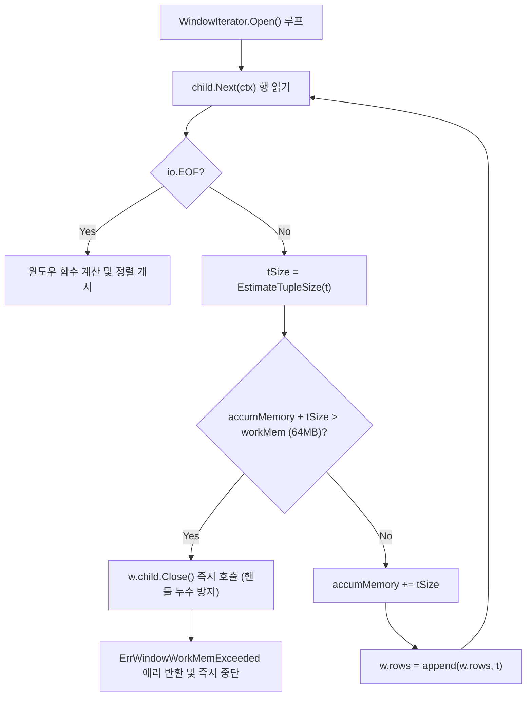

# LionSQL P0-11, P0-12, P0-13 쿼리 실행 오퍼레이터 유계 메모리(Bounded WorkMem) 가드레일 사후 설계서 (`notes/P0_11_12_13_OPERATOR_BOUNDED_WORKMEM_GUARD_PLAN.ko.md`)

> - **최초 작성일**: 2026-11-08
> - **과제 식별 코드**: `P0-11`, `P0-12`, `P0-13` (Volcano Query Execution Engine 메모리 안정성 하위)
> - **참조 원천 SSOT**: [`notes/PRE_RELEASE_AUDIT_TRIAGE.ko.md`](../PRE_RELEASE_AUDIT_TRIAGE.ko.md)
> - **핵심 적용 규칙**: `[RULE:BoundedBuffers]`, `[RULE:ExplicitError]`, `[RULE:HandleHygiene]`, `[RULE:RadicalKISS]`
> - **관련 커밋**:
>   - `0fef9b0` `fix(execution): resolve P0-11 by bounding GROUP BY CUBE to 12 columns to prevent 2^N OOM crash`
>   - `4838f62` `fix(execution): resolve P0-12 by enforcing workMem budget in WindowIterator to prevent OOM crash`
>   - `3d238dc` `fix(execution): resolve P0-13 by bounding MergeJoin duplicate key buffering with workMem`

---

## 1. 아키텍처 배경 및 문제 정의

LionSQL의 Volcano CBO 질의 처리기(`pkg/execution`)는 표준 ANSI SQL 및 Microsoft T-SQL의 복합 관계 대수 오퍼레이터(Group By CUBE, Window Function, Sort-Merge Join)를 파이프라인 형태로 스트리밍 실행합니다.

전통적인 RDBMS와 마찬가지로, 이들 오퍼레이터는 알고리즘 특성상 연산 중간에 튜플이나 그룹핑 조합을 메모리에 적재(Materialization)해야 하는 순간이 존재합니다:
1. **GROUP BY CUBE**: $N$개 차원에 대해 $2^N$개의 집계 그룹핑 세트(Power Set)를 동시 생성.
2. **Window Iterator**: 파티션 및 윈도우 프레임 계산(`ROW_NUMBER()`, `RANK()`, `SUM() OVER`)을 위해 하위 스트림 전체를 메모리에 누적.
3. **Merge Join Iterator**: 조인 키가 중복(Duplicates)되는 연속 구간을 처리하기 위해 우측 릴레이션을 윈도우 버퍼에 캐싱.

그러나 1.0 사전 전수 감사에서, 악의적인 쿼리나 대용량 데이터 입력 시 **상한선 없는 무제한 슬라이스 팽창으로 인해 Go 런타임 힙 메모리가 고갈되어 전체 DB 데몬이 크래시(OOM Kill)되는 3건의 치명적 결함**이 발굴되었습니다.

```
+---------------------------------------------------------------------------------------+
| P0-11: GROUP BY CUBE 컬럼 수 상한 미검사 2^N 할당 OOM DoS                               |
| 30개 컬럼 지정 시 2^30 (10억 개) 비트마스크 슬라이스를 할당하려다 프로세스 즉각 크래시.        |
+---------------------------------------------------------------------------------------+
| P0-12: Window 함수 하위 스트림 무제한 힙 적재 OOM DoS 크래시                               |
| 1,000만 건 테이블 대상 OVER() 질의 시 workMem 한도 없이 수 기가바이트 튜플을 누적하다 OOM.    |
+---------------------------------------------------------------------------------------+
| P0-13: Merge Join 우측 중복 키 무제한 슬라이스 팽창 메모리 스톨                           |
| 동일 키를 가진 수백만 건의 중복 행 유입 시 right buffer 슬라이스가 무제한 팽창하여 크래시.   |
+---------------------------------------------------------------------------------------+
```

---

## 2. 결함 1: P0-11 GROUP BY CUBE 지수적($2^N$) 폭발 방어

### 2.1 결함 메커니즘
`pkg/execution/aggregate.go`의 `GroupByCube` 구현은 $N$개의 그룹핑 컬럼이 주어졌을 때 $2^N$ 크기의 슬라이스를 즉시 생성했습니다:
```go
// 구 결함 코드 (aggregate.go)
totalComb := 1 << nKeys // nKeys = 30일 때 1,073,741,824
masks = make([]uint32, totalComb) // 4GB 슬라이스 할당 시도 -> OOM Panic!
```
클라이언트가 `GROUP BY CUBE (c1, c2, ..., c30)`과 같이 악의적으로 컬럼 수를 늘린 쿼리를 단 1회 실행하는 것만으로 전체 데이터베이스 서버를 다운시킬 수 있는 치명적 DoS 공격 벡터였습니다.

### 2.2 해결 아키텍처: 12차원($2^{12} = 4,096$) 엔터프라이즈 상한선 가드레일
Microsoft SQL Server의 표준 규격(CUBE 최대 12차원, 4,096 그룹)을 벤치마킹하여, 파서 및 실행기 레벨에 **`MaxCubeColumns = 12` 엄격 상한선**을 설치했습니다. 12개를 초과할 경우 즉시 질의를 중단하고 `ErrTooManyCubeColumns` 에러를 클라이언트에 반환합니다.

#### 핵심 구현 코드 (`pkg/execution/aggregate.go`)
```go
const MaxCubeColumns = 12

var ErrTooManyCubeColumns = errors.New("CUBE clause exceeds maximum allowed dimensions")

// In AggregateIterator.Open():
case proc.GroupByCube:
    if nKeys > MaxCubeColumns {
        return fmt.Errorf("%w: %d columns specified, maximum allowed is %d (limit: 4,096 grouping sets)",
            ErrTooManyCubeColumns, nKeys, MaxCubeColumns)
    }
    totalComb := 1 << nKeys
    masks = make([]uint32, totalComb)
```

---

## 3. 결함 2: P0-12 Window Iterator 실시간 `workMem` 추적 및 DoS 차단

### 3.1 결함 메커니즘
`pkg/execution/window.go`는 파티션 정렬 및 순위 계산을 위해 하위 이터레이터가 `io.EOF`를 반환할 때까지 행들을 무조건 슬라이스에 `append`했습니다:
```go
// 구 결함 코드 (window.go)
for {
    t, err := w.child.Next(ctx)
    if err == io.EOF { break }
    w.rows = append(w.rows, t) // 대용량 스트림 시 메모리 한도 검사 부재!
}
```

### 3.2 해결 아키텍처: 실시간 튜플 크기 추적(`EstimateTupleSize`) 및 Bounded Budget
LionSQL은 전사 기본 연산 메모리 예산인 **`DefaultWorkMem = 64MB`**를 도입하고, 행을 버퍼링할 때마다 `EstimateTupleSize(t)`를 통해 실제 메모리 점유량을 누적 계산합니다. 예산 초과 시 즉시 하위 커서를 닫고(`w.child.Close()`) `ErrWindowWorkMemExceeded` 에러로 Fail-Closed 차단합니다.



#### 핵심 구현 코드 (`pkg/execution/window.go`)
```go
var ErrWindowWorkMemExceeded = errors.New("window function memory budget exceeded")

// In WindowIterator.Open():
tSize := EstimateTupleSize(t)
if w.workMem > 0 && w.accumMemory+tSize > w.workMem {
    _ = w.child.Close()
    return fmt.Errorf("%w: %s > work_mem (%s)",
        ErrWindowWorkMemExceeded, FormatMemSize(w.accumMemory+tSize), FormatMemSize(w.workMem))
}
w.accumMemory += tSize
w.rows = append(w.rows, t)
```

---

## 4. 결함 3: P0-13 Merge Join 우측 중복 키 버퍼링 유계 상한

### 4.1 결함 메커니즘
Sort-Merge Join은 정렬된 양측 스트림을 선형 $O(M+N)$ 시간으로 결합하지만, **동일한 조인 키를 가진 중복 행(Cartesian product per key)**이 발생하면 우측 일치 구간 전체를 버퍼링(`m.bufferedRight = append(...)`)해야 합니다.
한쪽 키에 수백만 개의 중복 데이터(예: 왜곡된 카디널리티, 핫스팟 키)가 몰려있을 경우, 이 버퍼가 기가바이트 단위로 무제한 팽창하여 메모리 스톨 및 크래시를 유발했습니다.

### 4.2 해결 아키텍처: 중복 키 버퍼 전용 `workMem` 가드레일
우측 중복 키 버퍼링 루프 내에 `m.bufMemory` 실시간 추적기를 탑재하여, 단일 조인 키에 대한 우측 중복 집합이 `workMem`(64MB)을 초과하는 즉시 `ErrMergeJoinWorkMemExceeded`를 반환하도록 방어벽을 구축했습니다.

#### 핵심 구현 코드 (`pkg/execution/merge_join.go`)
```go
var ErrMergeJoinWorkMemExceeded = errors.New("merge join memory budget exceeded")

// In MergeJoinIterator.Next() 중복 키 버퍼링 루프:
if sameJoinKey(nextRight, targetRight, m.rightKey) {
    tSize := EstimateTupleSize(nextRight)
    if m.workMem > 0 && m.bufMemory+tSize > m.workMem {
        return Tuple{}, fmt.Errorf("%w: %s > work_mem (%s)",
            ErrMergeJoinWorkMemExceeded, FormatMemSize(m.bufMemory+tSize), FormatMemSize(m.workMem))
    }
    m.bufMemory += tSize
    m.bufferedRight = append(m.bufferedRight, nextRight)
}
```

---

## 5. TDD 회귀 검증 매트릭스

1. **`TestAggregate_Regression_P0_11_CubeMaxColumnsGuard`**:
   - 13개 및 30개 컬럼 지정 시 `ErrTooManyCubeColumns` 에러 즉시 반환 검증.
   - 12개 컬럼(4,096개 그룹핑 세트)은 예산 내에서 정상 연산 완료 검증.
2. **`TestWindow_Regression_P0_12_WorkMemGuard`**:
   - 1KB workMem 환경에서 500개 행 유입 시 `ErrWindowWorkMemExceeded` 발생 검증.
   - `DefaultWorkMem`(64MB) 환경에서는 500개 행 정상 윈도우 계산 완료 검증.
3. **`TestMergeJoin_Regression_P0_13_WorkMemGuard`**:
   - 동일 키를 가진 500개 행을 1KB workMem 환경에서 조인 시 `ErrMergeJoinWorkMemExceeded` 발생 검증.
   - 64MB 예산 내에서는 500개 일치 행이 정확히 조인 출력됨을 검증.

---

## 6. 결론 및 메모리 바운딩 불변성

1. **무제한 버퍼링 영구 금지 (`[RULE:BoundedBuffers]`)**: 모든 쿼리 실행 오퍼레이터는 힙 할당 전 명시적인 차원 상한 또는 바이트 크기 가드레일을 가져야 합니다.
2. **Fail-Closed 리소스 정리 (`[RULE:HandleHygiene]`)**: 메모리 한도 초과 시 하위 이터레이터 및 파일/커서 핸들을 반드시 즉시 Close하고 에러를 전파해야 합니다.
3. **투명한 에러 진단 (`[RULE:ExplicitError]`)**: OOM으로 프로세스가 돌연사하는 대신, 유저에게 현재 메모리 사용량과 `work_mem` 한계치를 명확한 진단 메시지로 안내해야 합니다.
