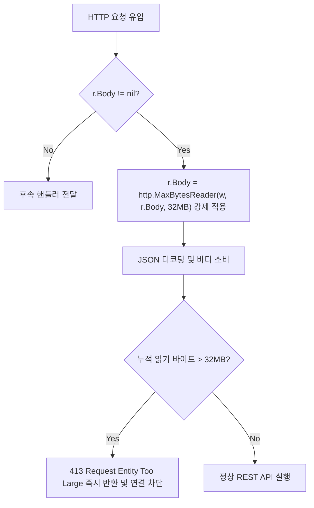

# LionSQL P0-27 & P0-35 와이어 프로토콜 및 HTTP 유계 페이로드 DoS 방어벽 사후 설계서 (`notes/P0_27_35_WIRE_AND_HTTP_BOUNDED_PAYLOAD_LIMIT_PLAN.ko.md`)

> - **최초 작성일**: 2026-11-08
> - **과제 식별 코드**: `P0-27`, `P0-35` (Network Wire Protocol & HTTP API Security 하위)
> - **참조 원천 SSOT**: [`notes/PRE_RELEASE_AUDIT_TRIAGE.ko.md`](../PRE_RELEASE_AUDIT_TRIAGE.ko.md)
> - **핵심 적용 규칙**: `[RULE:BoundedBuffers]`, `[RULE:ExplicitError]`, `[RULE:RadicalKISS]`
> - **관련 커밋**:
>   - `cbab713` `fix(wire): resolve P0-27 by enforcing bounded payload frame limits on TDS and PGWire`
>   - `0b6abab` `fix(api): resolve P0-35 by enforcing 32MB request body limit on chunked transfer encoding`

---

## 1. 아키텍처 배경 및 문제 정의

LionSQL은 외부 클라이언트와 통신하기 위해 3대 네트워크 게이트웨이를 자체 내장하고 있습니다:
1. **Microsoft SQL Server TDS 7.x/8.0 프로토콜** (기본 TCP `:1433`)
2. **PostgreSQL Wire Protocol v3 (PGWire)** (기본 TCP `:5433`)
3. **HTTP REST API & Web Studio 엔진** (기본 TCP `:8090`)

공용 인터넷이나 악의적인 내부망에 노출된 데이터베이스 포트는 언제든지 비정상적으로 거대한 패킷이나 무제한 스트리밍 공격에 직면할 수 있습니다.
따라서 네트워크 수신 계층은 **유효성 검증되지 않은 패킷 헤더의 길이를 맹신하여 대용량 힙 메모리를 미리 할당해서는 안 되며(`[RULE:BoundedBuffers]`), 스트리밍 요청에 엄격한 상한선 가드레일을 강제**해야 합니다.

그러나 1.0 사전 전수 감사에서, 악의적인 단 1건의 TCP/HTTP 요청만으로 엔진 힙 메모리를 고갈시켜 OOM 크래시를 유발할 수 있는 2건의 심각한 P0 결함이 발굴되었습니다.

```
+---------------------------------------------------------------------------------------+
| P0-27: TDS & PGWire 패킷 길이 헤더 무검증 2GB 힙 할당 OOM DoS                              |
| 클라이언트가 보낸 4바이트 길이 헤더(0x7FFFFFFF = 2GB)를 신뢰하여 make([]byte) 시도 후 OOM 패닉.|
+---------------------------------------------------------------------------------------+
| P0-35: REST API chunked 전송 요청 시 바디 크기 제한 전면 우회 OOM DoS                     |
| r.ContentLength > 0 가드로 인해 Chunked 스트림(ContentLength == -1)이 보호 없이 무제한 수신됨. |
+---------------------------------------------------------------------------------------+
```

---

## 2. 결함 1: P0-27 TDS 및 PGWire 패킷 헤더 맹신 OOM DoS 방어

### 2.1 결함 메커니즘 (Root Cause)
TDS와 PGWire는 패킷 헤더에 전체 메시지 길이를 바이트 수로 명시합니다:
- **TDS 패킷 헤더**: 8바이트 (2바이트 길이 필드: `hdr[2..3]`)
- **PGWire 메시지 헤더**: 5바이트 (1바이트 타입 + 4바이트 BigEndian 길이 필드: `hdr[1..5]`)

종전 수신 코드는 클라이언트가 보낸 길이 헤더를 최소한의 하한선(`length < 8` 또는 `msgLen < 4`)만 검사하고 상한선 없이 그대로 `make([]byte, payloadLen)`에 대입했습니다:
```go
// 구 결함 코드 (wire/server.go)
msgLen := binary.BigEndian.Uint32(msgHeader[1:5])
if msgLen < 4 { return }
payload := make([]byte, msgLen-4) // msgLen이 2GB(0x7FFFFFFF)이면 즉각 OOM 패닉 크래시!
```
공격자가 임의의 TCP 소켓을 열고 `'Q'` 타입 뒤에 `0x7FFFFFFF`를 전송하면, Go 런타임이 즉시 2GB 메모리 할당을 시도하다 패닉에 빠져 서버가 즉각 종료되는 치명적인 취약점이었습니다.

### 2.2 해결 아키텍처: 다계층 물리 패킷 및 조립 메시지 상한선 규격화
LionSQL은 프로토콜 표준 규격과 실무 OLTP 최대 패킷 크기를 기반으로 엄격한 4대 상한선 상수를 제정하고 헤더 디코딩 즉시 엄격 검증하도록 방어벽을 구축했습니다:

```
[LionSQL 와이어 프로토콜 유계 버퍼 매트릭스]
1. PGWire 계층 (Port :5433):
   - MaxPGStartupSize  = 64 KB        (접속 시 파라미터/인증 초기 패킷 상한)
   - MaxPGPasswordSize = 8 KB         (비밀번호 인증 메시지 상한)
   - MaxPGMessageSize  = 64 MB        (일반 쿼리, BIND, COPY 페이로드 상한)
2. TDS 7.x/8.0 계층 (Port :1433):
   - MaxTDSPacketSize  = 32 KB        (TDS 스펙상 단일 물리 패킷 프레임 최대 상한)
   - MaxTDSMessageSize = 64 MB        (청크 조립 후 완성된 논리 메시지 최대 상한)
```

#### 핵심 구현 코드 (`pkg/wire/server.go`, `pkg/wire/tds/packet.go`)
```go
// PGWire 수신 루프 (wire/server.go)
if msgLen < 4 || msgLen > MaxPGMessageSize {
    _ = WriteErrorWithCode(conn, "message length exceeds maximum limit", "54000")
    return
}

// TDS 패킷 수신 루프 (wire/tds/packet.go)
if length < HeaderSize || length > MaxTDSPacketSize {
    return nil, fmt.Errorf("invalid TDS packet length: %d (must be between %d and %d)",
        length, HeaderSize, MaxTDSPacketSize)
}
if len(fullPayload)+payloadLen > MaxTDSMessageSize {
    return nil, fmt.Errorf("TDS message size exceeds maximum limit (%d > %d)",
        len(fullPayload)+payloadLen, MaxTDSMessageSize)
}
```

---

## 3. 결함 2: P0-35 HTTP `Transfer-Encoding: chunked` 요청 바디 제한 우회 방어

### 3.1 결함 메커니즘 (Root Cause)
HTTP REST API 미들웨어(`pkg/api/middleware.go`)는 클라이언트 요청 바디의 크기를 32MB(`MaxBodySize`)로 제한하기 위해 `http.MaxBytesReader`를 사용하고 있었습니다.
그러나 이를 감싸는 조건문이 문제였습니다:
```go
// 구 결함 코드 (api/middleware.go)
if r.ContentLength > 0 {
    r.Body = http.MaxBytesReader(w, r.Body, MaxBodySize)
}
```
HTTP/1.1 규격상 `Transfer-Encoding: chunked` 스트리밍 전송 시 클라이언트는 사전 길이를 알 수 없으므로 `Content-Length` 헤더를 보내지 않으며, Go의 `http.Request.ContentLength`는 `-1`로 설정됩니다.
결과적으로 `r.ContentLength > 0` 조건이 거짓이 되어 **Chunked 전송 요청은 `MaxBytesReader` 보호를 완전히 우회(Bypass)**하여 무제한 기가바이트 스트림을 수신하고 OOM 크래시를 유발할 수 있었습니다.

### 3.2 해결 아키텍처: 바디 존재(`r.Body != nil`) 기반 무조건 래핑
전송 인코딩 방식과 무관하게, 바디 스트림이 존재하는 모든 요청(`r.Body != nil`)에 대해 예외 없이 `http.MaxBytesReader`를 적용하도록 단일화했습니다. 32MB를 초과하는 Chunked 스트림은 미들웨어 레벨에서 `http.StatusRequestEntityTooLarge (413)`로 즉시 차단됩니다.



#### 핵심 구현 코드 (`pkg/api/middleware.go`)
```go
// Enforce max request body size to protect against unbounded streaming OOM DoS ([RULE:BoundedBuffers])
if r.Body != nil {
    r.Body = http.MaxBytesReader(w, r.Body, MaxBodySize) // MaxBodySize = 32MB
}
```

---

## 4. TDD 회귀 검증 매트릭스

1. **`TestPGWire_Regression_P0_27_OOMGuard`** ([`server_test.go`](file:///Users/maro/Projects/SQLion/pkg/wire/server_test.go#L1193)):
   - 64KB를 초과하는 100KB 시작 패킷 헤더 전송 시 즉시 연결 차단 검증.
   - 2GB(`0x7FFFFFFF`) 크기의 거대 쿼리 메시지 전송 시 힙 할당 없이 SQLSTATE 54000 에러 반환 및 정상 보호 검증.
2. **`TestTDS_ReadPacket_OOMGuard_P0_27`** ([`packet_test.go`](file:///Users/maro/Projects/SQLion/pkg/wire/tds/packet_test.go#L135)):
   - 단일 패킷 상한(`MaxTDSPacketSize = 32KB`)을 초과하는 40,000 바이트 헤더 전송 시 즉시 거부 검증.
   - 전체 조립 메시지 상한(`64MB`) 초과 시 안전하게 에러 반환 검증.
3. **`TestAPI_Regression_P0_35_ChunkedRequestMaxBytesLimit`**:
   - `Transfer-Encoding: chunked` (`ContentLength = -1`)로 35MB 더미 데이터를 스트리밍 전송.
   - 서버가 32MB 지점에서 안전하게 요청을 차단(`413 Request Entity Too Large`)하고 메모리 고갈 없이 생존함을 검증.

---

## 5. 결론 및 네트워크 유계 불변성

1. **외부 입력 길이 불신 불변성**: 네트워크 소켓을 통해 들어오는 패킷 길이 헤더는 잠재적 공격 벡터로 간주하며, 사전 선언된 상한선(`MaxPGMessageSize`, `MaxTDSPacketSize`)을 검증하기 전에는 어떠한 힙 할당도 수행할 수 없습니다.
2. **스트리밍 프로토콜 가드레일**: REST API, 와이어 프로토콜, 웹소켓 등 모든 스트리밍 채널은 청크 인코딩 방식과 무관하게 상위 유계 상한(`Bounded Buffer`)을 의무적으로 장착해야 합니다.
