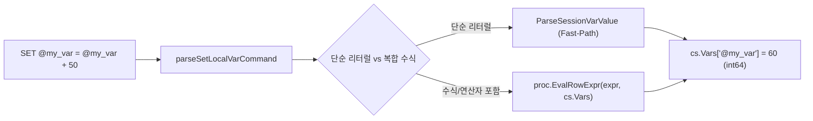

# 엔진 파싱 고도화 V2 계획서: 세션 변수 수식 평가, Postgres 문법 슈가 및 OPENJSON TVF
(`notes/plans/PARSER_ENHANCEMENT_V2_PLAN.ko.md`)

> **문서 상태**: Approved (정식 Sprint 등록 완료)  
> **태스크 ID**:
> - `FIX-SESSION-VAR-EXPR-EVAL-1`: `SET @var = expr` 대화형 세션 변수 수식 평가 결함 수정 (Prio 1)
> - `FEAT-POSTGRES-SYNTAX-SUGAR-1`: PostgreSQL 호환 문법 슈가 지원 (`CREATE TEMP TABLE`, `RETURNING` -> `OUTPUT`) (Prio 2)
> - `FEAT-OPENJSON-TVF-1`: T-SQL `OPENJSON` Table-Valued Function (TVF) 파싱 및 가상 테이블 스캔 엔진 구현 (Prio 2)  
> **마일스톤**: `v0.94.0`  
> **관련 규칙**: `[RULE:RadicalKISS]`, `[RULE:ModularAbstraction]`, `[RULE:PlanPersistence]`, `[RULE:ContinuousBacklog]`, `[RULE:ZeroOracleTampering]`, `[RULE:PipelineVerification]`

---

## 1. 추진 배경 및 개요 (Executive Summary)

LionSQL은 Phase 0~4에 걸친 DDL AST 파서 전환(`ENGINE_AST_PARSER_MIGRATION_PLAN.ko.md`)을 통해 `sqlexec_ddl.go`의 수동 문자열 파싱 10대 함수(-891 LOC)를 완전히 폐지하고 안정화했습니다.
본 V2 계획서는 엔진에 남아 있는 3대 핵심 파싱 및 실행 확장 과제를 체계적으로 해결합니다:

1. **`SET @var = expr` 대화형 세션 변수 수식 평가 결함**:
   - `sqlexec.go:1533`에서 대화형 `SET @var = @var + 50` 실행 시 수식 계산기 대신 `strconv.ParseInt`로 파싱하여 문자열 `"10 + 50"`이 그대로 누적 할당되는 결함을 완치.
2. **PostgreSQL 문법 슈가 지원**:
   - DDL 라우터에 `CREATE TEMP TABLE` / `CREATE TEMPORARY TABLE`을 연결하여 세션 임시 테이블(`#table`)로 직결.
   - DML 파서(`pkg/proc/parser_dml.go`)에서 `RETURNING ...` 절을 파싱하여 T-SQL `OUTPUT inserted.*`로 내부 AST 로워링(Lowering).
3. **`OPENJSON` Table-Valued Function (TVF) 엔진**:
   - `SELECT * FROM OPENJSON(@json [, path])` (기본 3컬럼: `key`, `value`, `type`) 및 `WITH (col type [path])` 명시 스키마 모드를 가상 테이블 팩터로 파이프라인에 통합.

---

## 2. 세부 구현 아키텍처 (Detailed Architecture)

### 2.1 Phase 1: `FIX-SESSION-VAR-EXPR-EVAL-1` (세션 변수 수식 평가 결함 수정)

#### 현행 문제점 (`pkg/engine/sqlexec.go:1533-1550`)
```go
// 현행 결함 코드
for k, v := range cs.Vars {
    expr = strings.ReplaceAll(expr, k, fmt.Sprintf("%v", v))
}
val := parseSessionVarValue(expr) // "10 + 50" -> strconv 실패 -> return "10 + 50" (문자열!)
cs.Vars["@"+varName] = val
```

#### 해결 아키텍처
1. **수식 평가기 통합 (`proc.EvalRowExpr`)**:
   - `cs.Vars`의 현재 세션 변수 맵을 환경 컨텍스트로 전달.
   - 단일 원시 상수/식별자일 때는 빠른 경로(Fast-Path)로 직결하고, 산술 연산자(`+`, `-`, `*`, `/`, `%`)나 함수 호출이 포함된 경우 `proc.EvalRowExpr`를 호출하여 실제 연산 결과(`int64`, `float64`, `string`)를 계산.
   - `SET @my_var = @my_var + 50` 실행 시:
     - `@my_var` = 10 -> `10 + 50` -> 정수 60으로 평가되어 `cs.Vars["@my_var"] = int64(60)`으로 저장됨.



---

### 2.2 Phase 2: `FEAT-POSTGRES-SYNTAX-SUGAR-1` (Postgres 문법 슈가 지원)

#### A. `CREATE TEMP TABLE` DDL 라우터 통합
- **수정 위치**: `pkg/engine/sqlexec.go:1766`
- **구현**:
  ```go
  if sqlutil.HasAnyPrefixKeyword(trimmed, "CREATE TABLE", "CREATE TEMP TABLE", "CREATE TEMPORARY TABLE") {
      return s.execCreateTable(trimmed, start, cs)
  }
  ```
- **임시 테이블 매핑**:
  `CREATE TEMP TABLE foo (...)`가 들어오면 `proc.CreateTableStmt.IsTemporary = true`로 파싱되어 LionSQL 세션 임시 테이블(`#foo`)로 안전하게 격리 생성됨.

#### B. `RETURNING` -> `OUTPUT` AST 로워링
- **수정 위치**: `pkg/proc/parser_dml.go` (`ParseInsert`, `ParseUpdate`, `ParseDelete`)
- **구현**:
  - DML 끝에 `RETURNING <col_list>` 구문 감지.
  - `RETURNING id, name`을 파싱하여 내부 `OutputClause` AST 노드로 변환:
    - `INSERT/UPDATE`: `OUTPUT inserted.id, inserted.name`
    - `DELETE`: `OUTPUT deleted.id, deleted.name`
  - LionSQL 기존 `sqlexec_dml.go`의 `OUTPUT` 레코드 스트리밍 엔진이 그대로 결과를 클라이언트에 반환.

---

### 2.3 Phase 3: `FEAT-OPENJSON-TVF-1` (`OPENJSON` TVF 파서 및 가상 스캔)

#### T-SQL 표준 사양
1. **기본 3컬럼 모드**: `OPENJSON(@json [, '$.path'])`
   - `key`: `NVARCHAR(4000)` (JSON 객체의 키 이름 또는 배열 인덱스 `"0"`, `"1"`, ...)
   - `value`: `NVARCHAR(MAX)` (스칼라 문자열 또는 중첩 JSON 텍스트)
   - `type`: `INT`
     - 0: `null`
     - 1: `string`
     - 2: `number`
     - 3: `boolean`
     - 4: `array`
     - 5: `object`
2. **명시적 스키마 모드**: `OPENJSON(@json) WITH (id INT '$.id', name NVARCHAR(50) '$.name', tags NVARCHAR(MAX) AS JSON)`
   - `WITH (...)`에 명시된 컬럼 정의대로 레코드를 프로젝션.

#### 아키텍처 파이프라인
1. `pkg/proc/parser_select.go` / `pkg/engine/sqlexec_select.go`:
   - `FROM` 절에서 `OPENJSON(...)` 키워드를 감지하여 `OpenJSONTableFactor`로 AST 바인딩.
2. `pkg/engine/sqlexec_openjson.go`:
   - `executeOpenJSON(jsonStr string, path string, withClause []OpenJSONColumnDef)` 가상 테이블 생성기 구현.
   - `STRING_SPLIT`과 동일하게 Volcano 엔진의 가상 튜플 반복자(`VirtualTableCursor`)로 반환.

---

## 3. 작업 분할 구조 (WBS) 및 진행 순서

| 단계 | 태스크 ID | 작업 내용 | 담당 패키지 |
| :---: | :--- | :--- | :--- |
| **Step 1** | `FIX-SESSION-VAR-EXPR-EVAL-1` | `SET @var = expr` 수식 평가기 바인딩 및 산술 연산 보존 | `pkg/engine`, `pkg/proc` |
| **Step 2** | `FEAT-POSTGRES-SYNTAX-SUGAR-1` | `CREATE TEMP TABLE` 라우팅 및 `RETURNING` AST 로워링 | `pkg/engine`, `pkg/proc` |
| **Step 3** | `FEAT-OPENJSON-TVF-1` | `OPENJSON` AST 파서 및 가상 테이블 스캔 엔진 구현 | `pkg/engine`, `pkg/proc` |
| **Step 4** | 검증 및 마일스톤 | 단위 테스트, 통합 테스트, SLT 회귀 검증, 3-Stage Pipeline 커밋 | `test/slt_proc` |

---

## 4. 검증 기준 (Verification Criteria)

1. `SET @i = 10; SET @i = @i + 50; SELECT @i;` 실행 시 반환값이 정수 `60`일 것.
2. `CREATE TEMP TABLE t (a INT); INSERT INTO t VALUES (1); SELECT * FROM t;` 정상 동작.
3. `INSERT INTO users (name) VALUES ('Alice') RETURNING id, name;` 정상 실행 및 결과 반환.
4. `SELECT * FROM OPENJSON('{"name":"Alice","age":30}')` 실행 시 3개 행(`name`, `age`)의 `key`, `value`, `type`이 정확히 반환될 것.
5. `go test -v -race ./pkg/...` 100% 클린 패스.
6. `[RULE:ZeroOracleTampering]`: 기존 1,299개 오라클 파일 무결성 유지.
