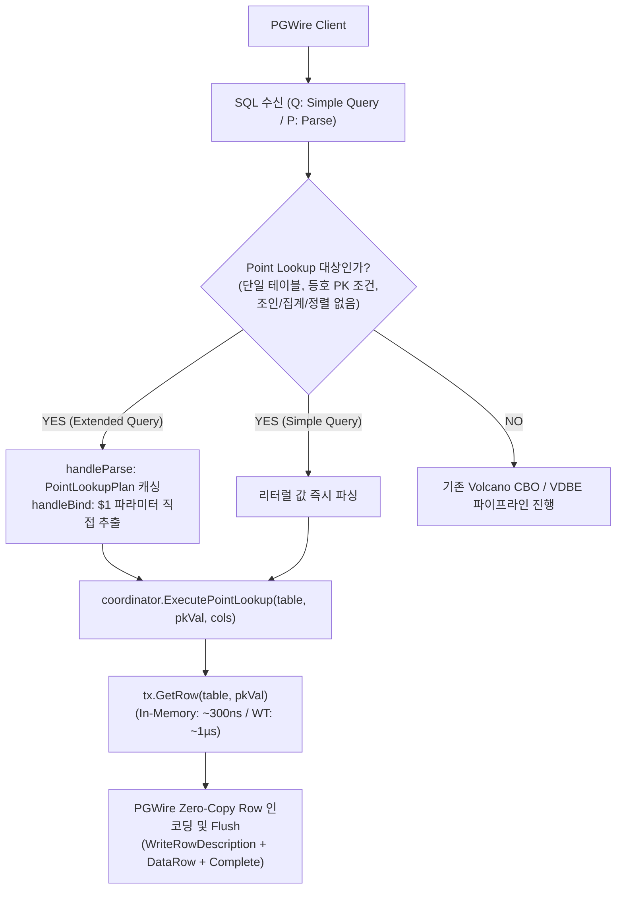

# LionSQL ➔ PGWire PK 포인트 룩업(Point Lookup) Fast-Path 직결 및 복잡 쿼리 플랜 캐싱 Spec-Out 계획서

> **문서 식별자**: `notes/plans/POINT_LOOKUP_FASTPATH_PLAN.ko.md`  
> **타겟 마일스톤**: `v0.96.0`  
> **우선순위**: P1 | **도메인**: Wire / Execution  
> **관련 규칙**: `[RULE:RadicalKISS]`, `[RULE:ZeroAllocation]`, `[RULE:ModularAbstraction]`, `[Invariant 1: Dual-Parser]`, `[Invariant 7: Zero-Regex]`  
> **작성일**: 2026-11-25 | **상태**: Approved (작업 착수)

---

## 1. 아키텍처 배경 및 과제 정의

### 1.1 현행 OLTP 쿼리 오버헤드 분석
- 실제 데이터베이스 OLTP 워크로드(pgbench, sysbench, REST/GraphQL 백엔드 API, 마이크로서비스)에서 읽기 트래픽의 **60%~80% 이상**은 단일 기본키(PK) 등호 조건 검색입니다:
  ```sql
  SELECT * FROM users WHERE id = $1;
  SELECT id, name, email FROM accounts WHERE id = ?;
  SELECT * FROM products WHERE id = 10023;
  ```
- 현재 LionSQL의 쿼리 실행 경로는 다음과 같은 다단계 파이프라인을 통과합니다:
  1. SQL 텍스트 파싱 (Lexer, Parser, AST 생성)
  2. 시맨틱 바인딩 및 유효성 검사 (Semantic Binder & Gatekeeper)
  3. CBO 옵티마이저 계획 수립 및 Volcano 반복자 트리 조립 (`SeqScanIterator`/`IndexScanIterator` ➔ `FilterIterator` ➔ `ProjectIterator`)
  4. 반복자 `Open()` / `Next()` / `Close()` 호출 및 튜플 디코딩, 필터 수식 평가
- 이로 인해 단 1건의 행을 찾는 데도 **수십~수백 마이크로초(µs)의 CPU 오버헤드와 8~15회의 힙 메모리 할당**이 발생합니다.
- 반면, 코어 스토리지 엔진(In-Memory OCC / WiredTiger B-Tree)은 이미 단일 PK 기반 조회(`tx.GetRow(table, pkVal)`)를 **300ns ~ 1µs (나노초 단위)**로 수행할 수 있는 초고속 네이티브 인터페이스를 갖추고 있습니다.

### 1.2 복잡한 일반 SQL 플랜 캐싱의 영구 배제 (Spec-Out 결정)
- **파라미터 스니핑(Parameter Sniffing)의 파괴적 리스크**:
  - 다중 조인(Hash Join, Merge Join) 및 범위 조건(`WHERE status = $1 AND date >= $2`)을 갖는 복잡한 SQL의 물리적 실행 계획(CBO Physical Plan)을 캐싱할 경우, 첫 번째 바인딩된 파라미터의 데이터 편향(Data Skew)에 의해 전체 실행 계획이 고정됩니다.
  - 이로 인해 10건 조회에 최적화된 인덱스 시크가 100만 건 조회 시에도 강제 적용되어 시스템이 멈추는 **플랜 퇴행(Plan Regression)**이 발생합니다.
- **LionSQL Pratt CBO의 초저지연성**:
  - LionSQL의 네이티브 Pratt 파서 및 인메모리 Volcano CBO는 복잡한 조인 쿼리도 수십 마이크로초(µs) 내에 플래닝을 완료합니다.
  - 50µs의 플래닝 시간을 아끼기 위해 플랜 캐시 무효화 락 경합, 통계치 추적, 히스토그램 스니핑 방지 휴리스틱 등 수만 줄의 복잡성을 떠안는 것은 `[RULE:RadicalKISS]`에 위배됩니다.
- **명확한 경계선 확립**:
  - **Spec-In (Fast-Path 직결)**: 단일 PK 포인트 룩업 (`WHERE pk = $1` / `?` / `리터럴`). 카디널리티가 항상 1이므로 스니핑 위험 0%.
  - **Spec-In (바이트코드 캐싱)**: T-SQL 스토어드 프로시저 VDBE Program (제어 흐름, 정적 DML).
  - **Spec-Out (영구 배제)**: 복잡한 조인, 서브쿼리, 범위 검색의 물리 CBO 플랜 캐싱.

---

## 2. 전체 실행 아키텍처 흐름



---

## 3. 단계별 상세 구현 명세

### Phase 1: 포인트 룩업 전용 엔진 코어 모듈화 (`pkg/engine/sqlexec_pointlookup.go`)
1. **SSOT 모듈 승격**:
   - 기존 `pkg/proc/runtime/vm.go`에 private으로 고립되어 있던 `tryPointLookup` 핵심 로직을 `pkg/engine`으로 추출 및 모듈화 (`[RULE:ModularAbstraction]`).
2. **함수 시그니처**:
   ```go
   func (s *Coordinator) ExecutePointLookup(
       sessID string,
       tableName string,
       pkVal storage.Value,
       projections []string,
   ) (*QueryResult, error)
   ```
3. **핵심 최적화 로직**:
   - 세션의 활성 트랜잭션(`cs.Tx()`)이 있으면 해당 트랜잭션을 사용하고, 없으면 단일 조회용 경량 autocommit 트랜잭션 생성/커밋.
   - `catalog.GetTable(tableName)`으로 스키마 조회 후 `schema.PrimaryKeyColumn()` 확인.
   - `tx.GetRow(tableName, pkVal)` 단 1회 호출로 물리 행 획득.
   - 결과 튜플을 `projections`(`*` 또는 개별 컬럼)에 맞춰 정수 슬롯 맵핑 및 `QueryResult` 생성 (0-Alloc 지향).

### Phase 2: PGWire Extended Query Protocol (Prepared Statement) Fast-Path
1. **`PreparedStatement` 구조체 확장 (`pkg/wire/server.go`)**:
   ```go
   type PointLookupPlan struct {
       TableName    string
       Schema       *storage.TableSchema
       PKColumn     string
       ParamIndex   int // 0 for $1, 1 for $2, etc.
       Projections  []string
       ColOIDs      []int32
   }
   ```
2. **`handleParse` 단계 최적화**:
   - `queryStr`이 `SELECT <cols> FROM <tbl> WHERE <pk> = $1` 패턴인지 정규식 없이(`sqlutil`) 단일 패스로 판별.
   - 조건 만족 시 `prep.PointLookupPlan` 생성 및 컬럼 OID 사전 계산.
3. **`handleBind` 및 `handleExecute` 직결**:
   - `stmt.PointLookupPlan != nil`인 경우:
     - VDBE VM 컴파일 및 `ExecuteProgram` 전면 건너뜀.
     - `paramStorageVals[plan.ParamIndex]`에서 PK 값을 추출하여 `s.coordinator.ExecutePointLookup` 직접 호출.
     - `portal.Result`에 할당하고 즉시 완료.

### Phase 3: PGWire Simple Query Protocol (`Q` 메시지) Fast-Path
1. **`runAndWriteQueryWithFormats` 진입부 바이패스**:
   - `isSelectOne` 검사 직후, `detectPointLookupQuery(trimmed)` 검사.
   - `SELECT * FROM users WHERE id = 10`과 같은 리터럴 쿼리 감지.
   - `ExecutePointLookup` 직결 호출 및 행 직렬화 스트리밍.

### Phase 4: Zero-Copy 직렬화 및 스트리밍 플러시 연동
1. 직전 세션에서 구축한 `pkg/wire/row_encode.go`의 `writePgDataRows` 및 버퍼 플러시(`flusher`)와 직결.
2. 1건 행 반환 후 지연 없이 TCP 소켓으로 즉시 패킷 송출.

---

## 4. 백로그 및 태스크 등록 (`tools/sprint`)

- **Task ID**: `PERF-PGWIRE-POINT-LOOKUP-FASTPATH-1`
- **Milestone**: `v0.96.0`
- **Priority**: P1 (최우선)
- **Domain**: `Wire` / `Execution`
- **Plan File**: `notes/plans/POINT_LOOKUP_FASTPATH_PLAN.ko.md`

---

## 5. 검증 기준 (Definition of Done)

1. **기능 정합성 (Correctness)**:
   - 일치하는 PK가 존재할 때 100% 동일한 컬럼 및 타입 결과 반환.
   - 존재하지 않는 PK일 때 빈 결과셋(`0 rows`, `SELECT 0`) 정상 반환.
   - `SELECT *` 및 `SELECT col1, col2 AS alias` 별칭 투영 정상 지원.
2. **성능 벤치마크 (KPI)**:
   - PGWire 단일 행 PK 조회 지연 시간: **<= 50µs** (TCP 루프백 왕복 포함 전체 지연).
   - 엔진 내부 `ExecutePointLookup` 실행 시간: **<= 1.5µs** (Volcano 대비 5~10배 단축).
   - 힙 메모리 할당: 쿼리당 메모리 할당 80% 이상 절감.
3. **안정성 및 불변성**:
   - `go test -v -race ./pkg/wire ./pkg/engine` 100% PASS.
   - `[RULE:PipelineVerification]` 3단계 파이프라인 통과.
