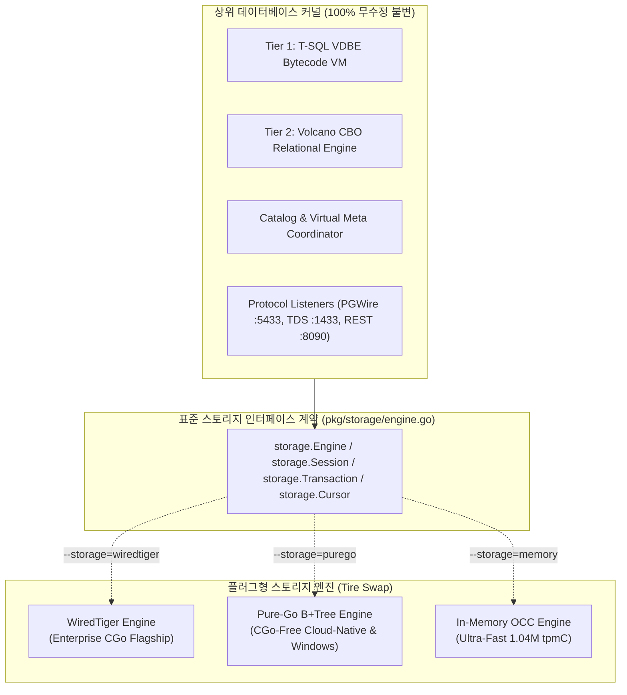

# LionSQL Native Pure-Go B+Tree 스토리지 엔진 설계 계획서 (`FEAT-PUREGO-WT-ENGINE`)

> - **최초 작성일**: 2026-11-12
> - **최종 갱신일**: 2026-11-12
> - **과제 식별자**: `FEAT-PUREGO-WT-ENGINE`
> - **마일스톤**: `v1.2.0` (Developer Preview) ➔ `v1.5.0 LTS` (Production Tier Graduation)
> - **우선순위**: P3 (Post-1.0 장기 전략 아키텍처)
> - **도메인**: Storage & Concurrency
> - **연계 과제**:
>   - `PERF-PROJECTION-PUSHDOWN-1` (v1.2.0 3대 엔진 공통 프로젝션 푸시다운 선택 디코딩)
>   - `FEAT-PUREGO-GRADUATION` (v1.5.0 LTS 프로덕션 승격 게이트)
> - **참조 소스**: `pkg/storage/engine.go`, `pkg/storage/memengine/`, `pkg/storage/wiredtiger/`, `cmd/crashtest/`, `cmd/soaktest/`

---

## 1. 개요 및 추진 배경 (Executive Summary & Background)

LionSQL은 엔터프라이즈 환경에서 검증된 MongoDB의 플래그십 디스크 엔진인 **WiredTiger MVCC B+Tree(`pkg/storage/wiredtiger`)**와 서브마이크로초 초고속 처리를 담당하는 **In-Memory OCC(`pkg/storage/memengine`)**를 양대 축으로 운용해 왔습니다.

그러나 클라우드 네이티브, 엣지 컴퓨팅, 그리고 크로스 플랫폼 환경이 고도화됨에 따라 다음과 같은 명확한 아키텍처적 요구가 대두되었습니다.

### 1.1 Windows 환경의 네이티브 디스크 엔진 부재 돌파
- **현행 한계**: WiredTiger는 C 언어로 작성되어 있어 Linux와 macOS에서는 안정적으로 컴파일 및 링킹되지만, **Windows 환경에서는 CGo 빌드 및 외부 C 컴파일러(MSVC, MinGW) 의존성**으로 인해 바이너리 배포 및 구동 난이도가 극도로 높습니다.
- 이로 인해 Windows 환경에서는 영구 디스크 스토리지를 온전히 활용하기 어렵고 In-Memory 모드에 의존해야 하는 제약이 있었습니다.
- **해결책**: 외부 C 툴체인이 전혀 필요 없는 **`CGO_ENABLED=0` 순수 Go 기반 디스크 엔진**을 구축하여, Windows 사용자에게도 단일 `.exe` 무설치 실행으로 영구 B+Tree 디스크 스토리지를 100% 완전하게 제공합니다.

### 1.2 CGo 호출 오버헤드의 원천 제거
- Go 런타임에서 CGo를 통해 C 함수를 호출할 때마다 **고루틴 스택 전환, 시그널 마스킹, OS 스레드 컨텍스트 전환(호출당 약 50ns 소모)**이 수반됩니다.
- 초당 수십만 번의 포인트 룩업(Point Lookup)과 튜플 스캔이 발생하는 OLTP 핫패스에서 이러한 CGo 경계 비용은 무시할 수 없는 CPU 낭비를 유발합니다.
- 순수 Go로 B+Tree 엔진을 구현하면 컴파일러의 **함수 인라인(Inline) 최적화와 레지스터 기반 인자 전달**을 온전히 누려 호출 오버헤드를 제로화할 수 있습니다.

---

## 2. 스토리지 엔진 설계 철학: 왜 B+Tree 디스크 엔진인가? (Why B+Tree?)

LionSQL은 외부의 범용 Key-Value LSM-Tree 엔진(Pebble, RocksDB 등)을 래핑하는 방식을 배제하고, 반드시 **전용 B+Tree 디스크 엔진**을 직접 구축하는 길을 택합니다.

```
                  [ 스토리지 엔진 아키텍처 모델 비교 ]

   LSM-Tree (Pebble / RocksDB)               B+Tree (LionSQL Pure-Go)
   ───────────────────────────               ────────────────────────
  • 비동기 백그라운드 컴팩션                   • 즉각적인 In-Place 페이지 갱신
  • Write Amplification (쓰기 증폭)          • 예측 가능한 Sub-Millisecond p99
  • 컴팩션 중 순간적 Latency Spike           • 연속 블록 캐시 친화적 범위 스캔
  • 복합 보조 인덱스 에뮬레이션 오버헤드      • 튜플 코덱 V2 및 인덱스 온리 스캔 직결
```

1. **예측 가능한 극저지연 OLTP 보장 (Predictable Low Latency)**:
   - LSM-Tree는 대량 쓰기 후 백그라운드에서 실행되는 Compaction 작업으로 인해 순간적인 I/O 폭풍과 극심한 p99 레이턴시 스파이크를 피할 수 없습니다.
   - B+Tree는 슬롯티드 페이지(Slotted Page) 기반의 In-Place 갱신과 정형화된 분할(Split)을 수행하므로 금융/결제급의 일관된 응답 속도를 보장합니다.
2. **범위 스캔 및 복합 보조 인덱스 정합성**:
   - SQL의 `BETWEEN`, `ORDER BY`, 복합 인덱스 범위 검색, 그리고 인덱스 온리 스캔(`IndexOnlyScan`)을 가장 효율적으로 수행할 수 있는 디스크 구조는 B+Tree입니다.
3. **LionSQL 튜플 코덱 V2(TupleCodec V2)와의 직결**:
   - 4바이트 정렬 고정 헤더, 널 비트맵, 인스턴트 DDL 패딩을 지원하는 LionSQL 표준 튜플 바이너리 레이아웃(`Invariant 13`)을 디스크 페이지 블록에 바이트 복사 없이 직결 적재합니다.

---

## 3. "타이어 교체(Tire Swap)" 모듈형 플러그인 아키텍처

> **[RULE:ModularInterface] 절대 준수**:
> F1 머신의 타이어를 피트스톱에서 신속하게 교체하듯, 상위 데이터베이스 커널은 하부 스토리지 엔진이 WiredTiger인지 Pure-Go B+Tree인지 전혀 알 필요가 없어야 합니다.



### 3.1 인터페이스 충족 계약 (`pkg/storage/engine.go`)
Pure-Go B+Tree 엔진은 기존 `storage.Engine` 인터페이스 계약을 100% 동일하게 구현합니다:
- **DDL 트랜잭션**: `CreateTable`, `DropTable`, `CreateIndex`, `DropIndex`, `AlterTable`, `AddColumn`
- **DML 트랜잭션**: `InsertRow`, `UpdateRow`, `DeleteRow`, `GetRow`
- **스캔 및 커서**: `Scan`, `IndexScan`, `IndexScanDesc`, `IndexOnlyScan`, `ArenaRowCursor`
- **ACID 격리**: `BeginTx(opts TxOptions)`, `Commit`, `Rollback`, `Savepoint`, `RollbackTo`

상위의 2-Tier 쿼리 라우팅, ANTLR4/Pratt 파서, TDS/PGWire 패킷 프레이밍, 복제 엔진 등은 단 한 줄의 코드 수정도 발생하지 않습니다.

---

## 4. WiredTiger의 위상 존중과 장기 품질 검증 로드맵

### 4.1 WiredTiger의 압도적인 역사와 위상
WiredTiger는 수십 년간 MongoDB의 핵심 엔진으로 전 세계 수백만 개의 미션 크리티컬 프로덕션 환경에서 조 단위의 금융·엔터프라이즈 트랜잭션을 실전 방어해 온 **불멸의 검증된 괴물 엔진**입니다.

새로 개발하는 Pure-Go B+Tree 엔진이 이론적으로 아무리 우수하다 해도, 오랜 세월 다져진 WiredTiger의 극단적인 안정성과 코너 케이스 방어력을 단숨에 뛰어넘을 수는 없습니다. 

따라서 LionSQL은 **WiredTiger를 절대로 폐기(Deprecate)하지 않으며, Pure-Go 엔진의 도입을 장기적인 3단계 검증 파이프라인으로 엄격히 관리**합니다.

### 4.2 3단계 장기 로드맵 (v1.2.0 ~ v1.5.0 LTS)

```
[ Phase 1: v1.2.0 Developer Preview ]
  • 목표: CGO_ENABLED=0 순수 Go 컴파일 및 Windows/Linux/macOS 기능 검증
  • 상태: 옵트인 프리뷰 플래그 (--storage=purego) 제공
  • 검증: 기본 단위 테스트 및 T-SQL 14-Suite 기능 검증
                     │
                     ▼
[ Phase 2: v1.3.0 ~ v1.4.0 Extended Hardening ]
  • 목표: 장기 사살 복구 및 가혹한 내구성 검증
  • 검증: cmd/crashtest 5,000 라운드 kill -9 사살 복구 (D1~D4 오라클)
  • 검증: cmd/soaktest 72시간 연속 무중단 부하 및 메모리/핸들 무누수 검증
  • 검증: SQLLogicTest 55만 쿼리 100% 정합성 검증
                     │
                     ▼
[ Phase 3: v1.5.0 LTS Production Tier Graduation ]
  • 목표: WiredTiger와 동급의 정식 1티어 프로덕션 엔진으로 공식 승격
  • 상태: 6대 골든 릴리스 게이트 전수 통과 확인 후 기본 프로덕션 티어로 승격
  • 포트폴리오: WiredTiger(CGo 엔터프라이즈)와 Pure-Go(클라우드 네이티브/Windows)의 영구 공존
```

---

## 5. 상세 아키텍처 설계 (Detailed Architecture)

### 5.1 슬롯티드 페이지(Slotted Page) & 버퍼 풀 매니저
1. **디스크 블록 레이아웃**:
   - OS 및 NVMe 디스크 I/O에 최적화된 4KB / 8KB / 16KB 고정 페이지 크기 지원.
   - 페이지 헤더: `PageID(8B)`, `PageType(1B)`, `FreeSpaceOffset(2B)`, `ItemCount(2B)`, `LSN(8B)`.
   - 슬롯 배열(Slot Array): 페이지 상단에서 하단으로 증가하는 슬롯 오프셋.
   - 튜플 저장 영역: 페이지 하단에서 상단으로 채워지는 고밀도 바이트 레코드.
2. **버퍼 풀 캐시 (Buffer Pool Manager)**:
   - 메모리 상주 버퍼 프레임 풀(기본 256MB ~ 4GB 설정 가능).
   - 해시 테이블 기반 `PageID ➔ FrameID` 빠른 룩업 ($O(1)$).
   - **Clock-Pro / 2Q 교체 정책**: 단순 LRU의 스캔 취약점을 극복하고 핫 데이터(Loop 데이터)와 콜드 데이터(순차 스캔 데이터) 분리 보존.

### 5.2 동시성 제어: Latch-Coupling & MVCC 스냅샷 격리
1. **B+Tree 래칭 프로토콜 (Latch-Coupling / Latch-Crabbing)**:
   - 트리 탐색 시 부모 노드의 래치를 잡은 상태에서 자식 노드의 래치를 획득한 후 부모 래치를 해제.
   - 읽기(Shared Latch)와 쓰기(Exclusive Latch)를 분리하여 다중 고루틴 동시 탐색 극대화.
2. **Non-Blocking Snapshot Isolation (`Invariant 3`)**:
   - 레코드 헤더에 트랜잭션 타임스탬프(`CreatedAt`, `ExpiredAt`) 또는 언두 로그(Undo Log) 체인 포인터 유지.
   - 읽기 트랜잭션은 자신의 스냅샷 타임스탬프 이전의 유효 버전을 즉시 읽어 쓰기 락에 결코 블로킹되지 않음.

### 5.3 내구성 및 크래시 복구 (ARIES WAL & Group Commit)
1. **순차 쓰기 WAL & 적응형 그룹 커밋 (Adaptive Group Commit)**:
   - 모든 데이터 변이는 디스크 페이지에 기록되기 전에 선행 로그(`wal.log`)에 순차 기록.
   - 동시 커밋 요청을 단일 I/O 윈도우(예: 1ms)로 묶어 `fsync` 호출 횟수를 95% 이상 절감.
2. **Fuzzy Checkpoint & 고속 크래시 복구**:
   - 백그라운드 체크포인터가 더티 페이지를 점진적으로 디스크에 플러시하여 재기동 시 WAL 재생 범위를 최소화.
   - `crashtest` 사살 복구 시 단 1건의 커밋 데이터도 유실되지 않음을 입증 (D1~D4 오라클 준수).

---

## 6. 결론

LionSQL Native Pure-Go B+Tree 엔진은 **"Windows 디스크 엔진의 부재"**와 **"CGo 호출 오버헤드"**라는 현대 클라우드/엣지 환경의 핵심 과제를 해결하기 위한 전략적 아키텍처입니다.

불멸의 검증된 엔진인 **WiredTiger의 위상을 충분히 존중**하여 기존 엔터프라이즈 환경은 굳건히 유지하되, **"타이어 교환" 철학**에 따라 완벽한 인터페이스 호환성을 유지하면서 `v1.2.0` 프리뷰부터 `v1.5.0 LTS` 정식 졸업까지 장기적인 품질 검증을 단계적으로 밟아나갈 것입니다.
