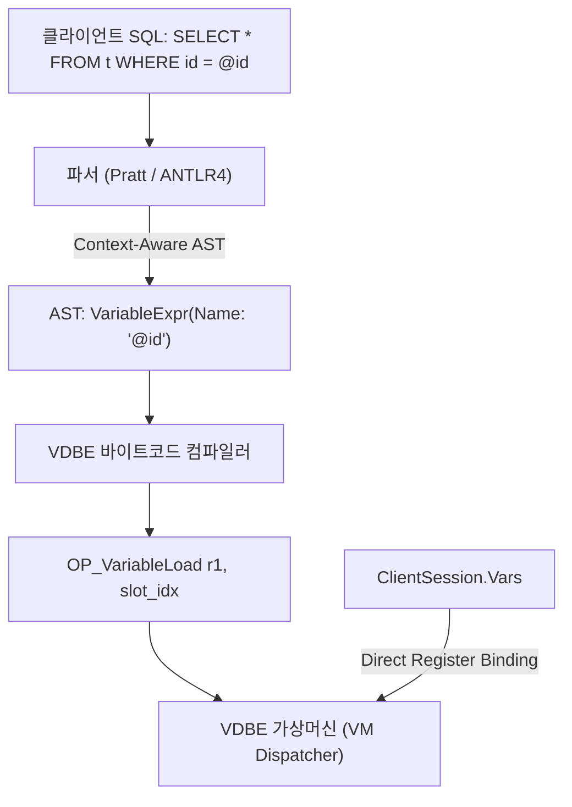

# T-SQL 세션 변수 텍스트 치환 전면 폐지 및 VDBE 레지스터 직접 바인딩 아키텍처 계획서
(`notes/plans/REFACTOR_TSQL_SESSION_VARS_VDBE_PLAN.ko.md`)

> **문서 상태**: Approved (백로그 정식 등록)  
> **태스크 ID**: `REFACTOR-TSQL-SESSION-VARS-VDBE-1`  
> **마일스톤**: `v1.10.0` (Post-1.0 Core Architecture)  
> **관련 규칙**: `[RULE:RadicalKISS]`, `[RULE:ModularAbstraction]`, `[RULE:PlanPersistence]`, `[RULE:ContinuousBacklog]`, `[RULE:ZeroOracleTampering]`

---

## 1. 추진 배경 및 문제 의식 (Problem Statement)

### 1.1 현행 아키텍처의 한계 (`pkg/engine/sqlexec.go:1540-1574`)
현재 LionSQL은 `ClientSession.Vars`에 저장된 T-SQL 세션 변수(`@var`)를 처리할 때, 쿼리가 AST 파서나 바이트코드 컴파일러에 전달되기 전에 **문자열 치환기(`substituteParamOutsideQuotes`)**를 통해 프리프로세싱하고 있습니다.

```go
// pkg/engine/sqlexec.go:1540
// 0.3 Substitute session variables in SQL query if present
rawBeforeVarSub := trimmed
cs.Mu.Lock()
if len(cs.Vars) > 0 {
    ...
    for _, k := range keys {
        v := cs.Vars[k]
        ...
        trimmed = substituteParamOutsideQuotes(trimmed, k, varRep)
    }
}
cs.Mu.Unlock()
```

### 1.2 텍스트 치환으로 인해 발생하는 4대 구조적 결함
1. **L-Value(대입문) 문맥 파괴**:
   - 세션에 이미 `@id = 10`이 존재하는 상태에서 `SELECT @id = user_id FROM users` 또는 `SET @id = 20`이 실행되면, 파싱 전에 `SELECT 10 = user_id`로 치환되어 변수 대입문이 컬럼 비교 표현식으로 왜곡됨.
2. **프로시저 반환 코드 및 OUTPUT 매개변수 파괴**:
   - 세션에 `@rc = 0`이 있을 때 `EXEC @rc = sp_proc`를 호출하면 `EXEC 0 = sp_proc`로 치환되어 문법 에러가 발생함.
   - 이를 회피하기 위해 `rawBeforeVarSub`라는 임시 변수를 두어 `execProcedureCallWithRaw`로 전달하는 취약한 땜질 코드가 양산됨 (`sqlexec.go:1541, 1681`).
3. **플랜 캐시(Plan Cache) 무력화 및 CBO 최적화 부하 폭증**:
   - 동일한 쿼리 템플릿이라도 변수 값에 따라 매번 서로 다른 SQL 텍스트로 치환되므로 파라미터화된 쿼리 계획(Parameterized Plan) 캐시 재사용이 불가능해져, 고빈도 OLTP 환경에서 매번 렉싱/파싱/CBO 비용 산정을 반복하여 CPU가 낭비됨.
4. **타입 정밀도 손실(Type Fidelity Loss) 및 이스케이프 왜곡**:
   - Go 내부 값을 `fmt.Sprintf("%v", val)` 및 따옴표 이스케이프(`''`)로 재직렬화하므로, `DATETIME2` 나노초 정밀도, `VARBINARY` 바이트열, `FLOAT` 부동소수점 오차, 특수 제어 문자 등에서 데이터 손실과 변형이 발생함.

---

## 2. 목표 아키텍처 (Target Architecture)



1. **텍스트 치환 전면 폐지 (Zero Textual Preprocessing)**:
   - `sqlexec.go`의 `0.3 Substitute session variables` 블록과 `substituteParamOutsideQuotes` 호출을 완전히 제거.
   - 쿼리 원형 문자열을 그대로 AST 파서로 전달.
2. **AST 수준의 구문 문맥 보존**:
   - 우변 값 읽기(R-Value): `proc.VariableExpr`
   - 좌변 대입 대상(L-Value): `proc.AssignmentTarget`
   - 프로시저 호출 출력 바인딩: `proc.OutputArgBinding`
3. **VDBE VM 레지스터 직접 바인딩 (Parameter/Variable Slot Binding)**:
   - VDBE 컴파일러가 세션 변수 참조를 식별하고 고유 변수 슬롯 인덱스 할당.
   - 런타임 실행기(`vm_dispatcher.go`)가 `ClientSession.Vars`를 VM 프레임 레지스터 슬롯에 포인터/값으로 직결:
     - `OP_LoadSessionVar rTarget, varName` (R-Value)
     - `OP_StoreSessionVar rSource, varName` (L-Value 대입 시 `cs.Vars[varName] = val` 즉시 반영)
     - `OP_BindOutputParam rTarget, varName` (Call-by-reference OUTPUT 바인딩)

---

## 3. 세부 구현 단계 (Implementation Phases)

### Phase 1: 파서 AST 문맥 분기 강화 (`pkg/proc/`)
- Pratt 파서(`parser.go`) 및 ANTLR4 래퍼에서 `@var` 토큰을 단순 리터럴이 아닌 `VariableExpr` AST 노드로 유지.
- `SELECT @var = col` 구문을 일반 프로젝션이 아닌 `SelectAssignmentStmt` AST로 파싱하여 대입 문맥을 분리.
- `SET @var = expr` 구문의 L-Value 식별자 검증 강화.

### Phase 2: VDBE 바이트코드 옵코드 확장 및 VM 런타임 바인딩 (`pkg/proc/`)
- 옵코드 추가:
  - `OP_LoadSessionVar`: VM 실행 시 `frame.SessionVars[name]`에서 값을 읽어 레지스터로 로드.
  - `OP_StoreSessionVar`: 레지스터의 계산 결과를 `frame.SessionVars[name]`으로 저장하고, 쿼리 종료 시 `ClientSession.Vars`에 동기화.
- Volcano CBO 실행기와의 연동:
  - Volcano 물리 플랜 실행 시 세션 파라미터 컨텍스트(`opts.SessionVars`)를 바인딩하여 필터 평가.

### Phase 3: `sqlexec.go` 텍스트 치환기 및 우회 로직 제거 (`pkg/engine/`)
- `pkg/engine/sqlexec.go:1540-1574` 세션 변수 루프 삭제.
- `rawBeforeVarSub` 및 `execProcedureCallWithRaw` 우회 코드 제거하고 단일 `execProcedureCall`로 통합.
- `substituteParamOutsideQuotes` 호출 지점들을 순차적으로 AST 파라미터 바인딩으로 전환 후 완전 삭제.

### Phase 4: 오라클 회귀 검증 및 성능 벤치마크 (`test/`)
- 기 구축된 1,289개 `.slt` 오라클 테스트 스위트 무결성 검증 (`[RULE:ZeroOracleTampering]`).
- go-mssqldb, mssql-jdbc, pymssql 등 공식 드라이버 기반 세션 변수 및 OUTPUT 파라미터 통합 테스트 100% PASS 확인.
- 플랜 캐시 적중률 벤치마크 측정: 변수 값이 달라지는 동일 쿼리 반복 실행 시 렉싱/파싱 시간 0 소요 검증.

---

## 4. 기대 효과 (Engineering Impact)
1. **신뢰성(Correctness)**: 대입문(`SELECT @a = col`), 프로시저 반환값(`EXEC @rc = proc`), OUTPUT 파라미터 왜곡 버그의 원천적 박멸.
2. **성능(Throughput)**: 플랜 캐시 재사용 활성화 및 문자열 정규식/토큰 스캔 제거로 파라미터화 쿼리 TPS 대폭 향상.
3. **코드 청결성(KISS/DRY)**: `rawBeforeVarSub` 등 임시 우회 플래그와 취약한 문자열 치환 헬퍼 제거로 엔진 코어 단순화.
