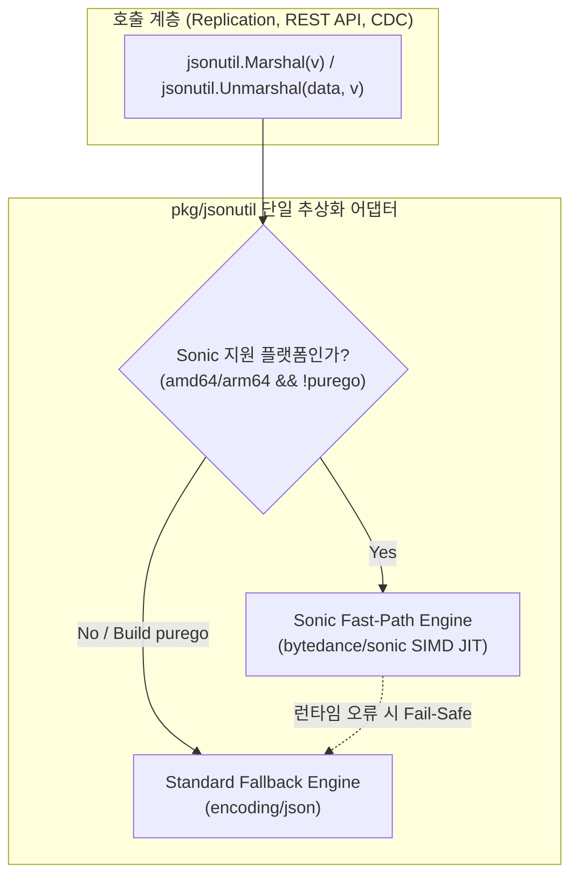
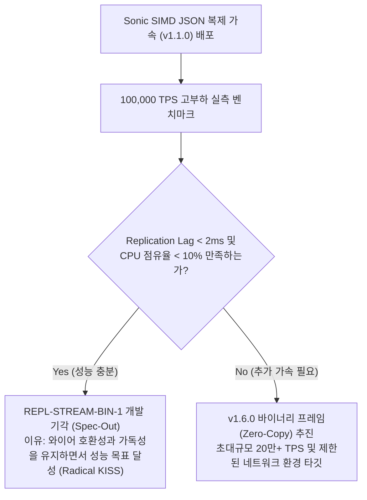

# LionSQL 고성능 SIMD JSON 기반 복제 스트리밍 가속 계획서 (`PERF-REPL-SONIC-1`)

> - **최초 작성일**: 2026-11-12
> - **최종 갱신일**: 2026-11-12
> - **과제 식별자**: `PERF-REPL-SONIC-1`
> - **마일스톤**: `v1.1.0` (Phase 9A)
> - **우선순위**: P2
> - **도메인**: Replication & Performance
> - **연계 과제**:
>   - `REPL-STREAM-BIN-1` (v1.6.0 바이너리 프레임 스트리밍 - Sonic 실측 후 채택 여부 재검토)
>   - `ARCH-LOGICAL-NAMESPACE-1` (v1.1.0 프리픽스 기반 논리 네임스페이스 및 크로스 DB 조인)
> - **참조 소스**: `pkg/replication/broadcaster.go`, `pkg/replication/client.go`, `pkg/replication/handlers.go`, `pkg/storage/memengine/wal.go`

---

## 1. 개요 및 추진 배경 (Executive Summary & Context)

LionSQL은 단일 노드의 수직적 한계를 극복하고 무경합 읽기 확장(Read Scale-Out)을 달성하기 위해 **1-Writer Multi-Reader WAL 스트리밍 복제 엔진(`pkg/replication`)**을 제공합니다.

현재 복제 엔진은 Primary 노드가 커밋된 트랜잭션의 `memengine.WALRecord`를 HTTP/1.1 스트리밍(`GET /api/replication/stream`)을 통해 개행 구분 JSON(JSON Lines) 형태로 Replica 노드에 실시간 전송합니다.

### 1.1 현행 표준 `encoding/json` 구현의 구조적 한계
초당 수만 건 이상의 트랜잭션이 발생하는 고부하 환경(50,000 ~ 100,000+ TPS)에서 Go 표준 라이브러리의 `encoding/json`은 다음과 같은 심각한 성능 병목을 발생시킵니다:
1. **런타임 리플렉션(Reflection) CPU 병목**: 구조체 필드 메타데이터 순회 및 타입 검증으로 인해 코어 CPU 사이클이 직렬화 연산에 낭비됩니다.
2. **과도한 힙 메모리 할당(Allocation Spikes)**: 임시 직렬화 버퍼와 인터페이스 복사본 생성으로 GC 압력이 가중되어, p99 복제 지연시간(Replication Lag) 스파이크를 유발합니다.
3. **네트워크 디스패치 지연**: 직렬화 속도가 네트워크 전송 및 스토리지 커밋 속도를 따라가지 못해 복제 링버퍼 오버플로우 및 슬레이브 채널 드롭 위험이 증가합니다.

### 1.2 Binary 직행의 딜레마와 중간 단계 필요성
이러한 단점을 해결하기 위해 완전히 새로운 순수 바이너리 프레임 프로토콜(`REPL-STREAM-BIN-1`)이 제안되었습니다. 그러나 바이너리 프로토콜은 뛰어난 성능 뒤에 심각한 트레이드오프(호환성 파괴, 디버깅 불가, 롤링 업그레이드 단절 등)를 수반합니다.

따라서 LionSQL은 극단적인 바이너리 전환으로 직행하기 전에, **기존의 사람이 읽을 수 있는 표준 JSON 규격과 와이어 프로토콜을 100% 온전히 보존하면서 성능을 수배 이상 끌어올리는 고성능 JSON 엔진 도입을 중간 단계(Bridging Step)**로 설정했습니다.

### 1.3 Go 생태계 고성능 JSON 후보군 기술 평가 및 Sonic 선정 근거

Go 생태계에 존재하는 주요 고성능 JSON 라이브러리 5종을 면밀히 비교 평가한 결과는 다음과 같습니다:

| 후보 라이브러리 | 핵심 기술 메커니즘 | 상대 성능 (vs std) | 주요 장점 | 탈락 / 채택 사유 |
| :--- | :--- | :---: | :--- | :--- |
| **Go 표준 `encoding/json`** | 런타임 리플렉션 | 1.0x (기준치) | 100% 표준 호환, 제로 의존성 | **기준선 (Baseline)**: 복제 핫패스에서 CPU/GC 병목 |
| **`json-iterator/go`** | 정적 캐싱 + unsafe | 2.0x ~ 2.5x | 1세대 표준, 드롭인 호환 | **탈락**: 2020년 이후 유지보수 중단(Stale), 제네릭 미지원, SIMD 미활용 |
| **`mailru/easyjson`** | 빌드 타임 코드 생성 (Codegen) | 3.0x ~ 4.0x | 리플렉션 0, 메모리 할당 최소 | **탈락**: 빌드 전 `easyjson` CLI 코드 생성 강제, 구조체 변경 시 파이프라인 복잡도 가중 (`[RULE:RadicalKISS]` 위배) |
| **`goccy/go-json`** | 런타임 타입 분석 + 바이트코드 | 2.5x ~ 3.5x | 코드 생성 없음, 폭넓은 호환성 | **우수 후보**: 안정적이나 SIMD 미사용으로 Sonic 대비 순수 Throughput 30~40% 열세 |
| **`bytedance/sonic`** | **AVX2/NEON SIMD + Go 어셈블리 JIT** | **3.5x ~ 5.0x+** | **현존 최고 처리량, Codegen 불필요, 대규모 프로덕션 검증** | **최종 채택**: 10만+ TPS WAL 스트리밍에 최적의 Throughput 제공, CGo-Free 순수 Go 빌드 지원 |

#### Sonic을 최종 선정한 4대 핵심 이유
1. **압도적인 순수 Throughput (초당 기가바이트 급 처리)**:
   - x86-64(AVX2/BMI2) 및 ARM64(NEON)의 하드웨어 벡터 레지스터를 직접 활용하여 문자열 파싱과 숫자 인코딩을 병렬 처리하므로, 5만~10만+ TPS 고부하 복제 스트림의 직렬화 병목을 완전히 해소합니다.
2. **코드 생성(Codegen) 없는 런타임 JIT (`[RULE:RadicalKISS]`)**:
   - `easyjson`처럼 빌드 타임에 `//go:generate`를 강제하거나 별도 CLI 도구를 요구하지 않아, Go 빌드 파이프라인의 단순성과 개발자 경험(DX)을 해치지 않습니다.
3. **CGo-Free 순수 Go 정적 컴파일 보장 (`[RULE:StaticBinary]`)**:
   - C/C++ 공유 라이브러리에 의존하지 않고 Go 자체 어셈블리(`golang-asm`)로 구현되어 있어, `CGO_ENABLED=0` 빌드에서도 완전한 단일 정적 바이너리로 배포할 수 있습니다.
4. **글로벌 초대규모 프로덕션 실전 검증**:
   - TikTok/더우인의 바이트댄스에서 수억 명의 동시 접속 트래픽을 처리하는 백엔드 마이크로서비스용으로 개발 및 운영되어 안정성과 에지 케이스 검증이 입증되었습니다.

---

## 2. 3대 직렬화 방식 비교 및 채택 타당성 분석

| 평가 기준 | 현행: 표준 `encoding/json` | 중간 단계: ByteDance Sonic (`PERF-REPL-SONIC-1`) | 종착 후보: Binary Frame (`REPL-STREAM-BIN-1`) |
| :--- | :--- | :--- | :--- |
| **직렬화 처리량** | 기준치 (1.0x, ~150-250 MB/s) | **3.0x ~ 5.0x 가속 (800-1,200 MB/s)** | **8.0x ~ 12.0x 가속 (원시 바이트 카피)** |
| **메모리 할당량 (Allocs)** | 다수 (레코드당 10~25 allocs) | **극소화 (레코드당 1~3 allocs, 버퍼 재사용)** | **0 allocs (Zero-Copy 슬라이스 슬랩)** |
| **와이어 프로토콜 호환성** | 100% 호환 (JSON Lines) | **100% 완전 동일 (Zero Wire Breakage)** | **파괴적 변경 (새 바이너리 엔드포인트/파서 필요)** |
| **사람의 육안 디버깅** | **매우 용이** (`curl`, 브라우저, jq 즉시 확인) | **매우 용이** (완전 동일한 표준 JSON 텍스트) | **불가능** (전용 16진 디코더/CLI 툴 필수) |
| **롤링 업그레이드 안전성** | 안전 | **완벽한 무중단 상호 연동 (구버전/신버전 혼재 가능)** | 위험 (버전 불일치 시 복제 단절 및 강제 재동기화) |
| **구현 및 검증 복잡도** | 최저 (표준 라이브러리) | **낮음** (`pkg/jsonutil` 추상화 어댑터 1개 계층) | **매우 높음** (엔디안, 가변길이 인코딩, 스키마 진화) |
| **외부 의존성** | 0 (순수 표준 라이브러리) | Go 어셈블리 의존성 (`golang-asm`) | 0 (엔진 자체 바이너리 인코더) |

### 2.1 Sonic의 핵심 장점
1. **Zero Wire Breakage (와이어 프로토콜 불변성)**:
   - 전송되는 데이터는 엄격한 표준 JSON Lines(`\n`) 형식을 그대로 유지합니다.
   - Primary가 Sonic으로 직렬화하여 전송하더라도, 구버전 Replica는 표준 `encoding/json`으로 아무런 에러 없이 읽을 수 있습니다.
   - 클러스터 무중단 롤링 업그레이드(Rolling Upgrade) 시 노드 간 소프트웨어 버전 차이로 인한 복제 파탄이 원천적으로 발생하지 않습니다.
2. **x86-64 및 ARM64 하드웨어 SIMD 가속**:
   - x86-64의 AVX2/BMI2 및 Apple Silicon/Graviton의 ARM64 NEON 벡터 레지스터를 활용하여 문자열 이스케이프 및 구조체 필드 직렬화를 단일 CPU 사이클에 병렬 처리합니다.
3. **디버깅 및 운영 투명성 보존**:
   - 개발자와 운영자는 여전히 `curl -N http://localhost:8090/api/replication/stream`으로 실시간 WAL 레코드를 텍스트로 모니터링하고 `jq`로 파이프라인 처리를 할 수 있습니다.

### 2.2 Sonic의 제약점 및 대응 방안
1. **아키텍처 제약 (x86_64, aarch64 중심)**:
   - 32비트 아키텍처나 MIPS 등 특수 환경에서는 JIT 컴파일이 동작하지 않습니다.
   - ➔ **대응**: 빌드 태그 및 런타임 검사를 통해 미지원 환경에서는 Go 표준 `encoding/json`으로 투명하게 Fallback 처리합니다.
2. **텍스트 패킷 오버헤드 잔존**:
   - 바이너리 인코딩 대비 JSON 키 문자열(`"lsn":`, `"type":`, `"table":`)이 네트워크 대역폭을 차지합니다.
   - ➔ **대응**: 1Gbps / 10Gbps 사내망 환경에서는 네트워크 대역폭보다 CPU 직렬화/역직렬화 연산이 실질적 병목이므로 Sonic으로도 90% 이상의 지연시간 단축 효과를 거둡니다.

---

## 3. 표준 JSON 구현 영구 보존 원칙 (Fallback Architecture)

> **[RULE:SafeDefaults] 및 [RULE:PlatformPrimitives] 절대 준수**:
> Sonic을 도입하더라도 Go 표준 라이브러리의 `encoding/json` 구현은 **절대로 삭제하거나 퇴출하지 않으며, 엔진의 영구적인 안전망(Fallback Baseline)으로 보존**합니다.



### 3.1 표준 구현을 영구 보존하는 3대 이유
1. **아키텍처 이식성 보장 (`[RULE:HermeticParity]`)**:
   - `CGO_ENABLED=0` 환경에서도 완벽히 빌드되며, Sonic JIT가 미지원되는 플랫폼이나 디버그 빌드(`-tags purego`) 환경에서 즉각 표준 엔진으로 무중단 구동됩니다.
2. **정합성 오라클(Baseline Oracle) 역할**:
   - Sonic이 출력한 직렬화 결과물이 표준 `encoding/json`과 바이트 규격상 100% 동일하게 파싱되는지 검증하는 단위 테스트의 표준 비교군으로 활용됩니다.
3. **장애 방어(Fail-Safe Fallback)**:
   - 만에 하나 런타임 환경의 JIT 페이지 메모리 보호(W^X) 정책 충돌 등으로 Sonic 초기화가 실패하더라도 시스템이 크래시되지 않고 즉시 표준 엔진으로 폴백하여 가용성을 보장합니다.

---

## 4. 상세 아키텍처 및 모듈 설계

### 4.1 `pkg/jsonutil` 단일 어댑터 설계 (`[RULE:ModularAbstraction]`)
엔진 전반에 산재된 직렬화 호출을 단일 패키지로 캡슐화합니다.

```go
package jsonutil

// Marshal serializes v into JSON bytes using Sonic SIMD when available,
// automatically falling back to standard encoding/json on unsupported platforms.
func Marshal(v any) ([]byte, error)

// Unmarshal parses JSON bytes into v using Sonic SIMD when available,
// automatically falling back to standard encoding/json on unsupported platforms.
func Unmarshal(data []byte, v any) error

// NewEncoder returns a stream encoder leveraging Sonic buffer pooling.
func NewEncoder(w io.Writer) Encoder

// NewDecoder returns a stream decoder leveraging Sonic parser.
func NewDecoder(r io.Reader) Decoder
```

### 4.2 복제 모듈(`pkg/replication`) 연동 지점

#### 1) 송신부: `pkg/replication/handlers.go` (`handleStream`)
```go
// AS-IS: 표준 encoding/json 직렬화
data, err := json.Marshal(rec)

// TO-BE: jsonutil SIMD 고속 직렬화
data, err := jsonutil.Marshal(rec)
if err != nil {
    continue
}
if _, err := fmt.Fprintf(w, "%s\n", data); err != nil {
    return
}
flusher.Flush()
```

#### 2) 수신부: `pkg/replication/client.go` (`streamOnce`)
```go
// AS-IS: 표준 encoding/json 역직렬화
var rec memengine.WALRecord
if err := json.Unmarshal(line, &rec); err != nil {
    continue
}

// TO-BE: jsonutil SIMD 고속 역직렬화
var rec memengine.WALRecord
if err := jsonutil.Unmarshal(line, &rec); err != nil {
    continue
}
```

---

## 5. 실측 검증 게이트 및 Binary 도입 필요성 재검토 정책

Sonic 적용 후 실측 벤치마크 데이터를 수집하여, 향후 바이너리 프로토콜(`REPL-STREAM-BIN-1`, `v1.6.0`)의 실제 개발 추진 여부를 **데이터 기반으로 최종 재검토**합니다.

### 5.1 검증 게이트 및 성능 목표
1. **마이크로 벤치마크 (`BenchmarkWALRecord_Serialization`)**:
   - 10만 건의 전형적인 `memengine.WALRecord` (INSERT, UPDATE, DELETE 복합) 대상.
   - **목표치**:
     - 직렬화 처리 시간: $3.0\times$ 이상 단축 (예: 650ns ➔ 200ns 이하).
     - 힙 메모리 할당: $70\%$ 이상 절감 (예: 18 allocs ➔ 2 allocs 이하).
2. **클러스터 E2E 복제 지연시간 (`BenchmarkCluster_ReplicationLag`)**:
   - 1-Primary + 3-Secondary 환경에서 100 워커 TPC-C 동시 쓰기 부하 인가.
   - **목표치**:
     - 50,000 TPS 부하 상태에서 Secondary 노드의 평균 복제 지연(Replication Lag)이 10 LSN 미만, 지연시간 2ms 이하 유지.

### 5.2 바이너리 프로토콜(`REPL-STREAM-BIN-1`) 재평가 트리거 매트릭스



- **시나리오 A (Sonic으로 충분한 경우 - 권장 시나리오)**:
  - 10만 TPS 환경에서 Sonic 적용만으로 복제 지연이 1ms 내외로 안정화되고 CPU 점유율이 5% 미만으로 유지된다면, **`REPL-STREAM-BIN-1`을 과감히 Spec-Out(영구 기각) 처리**하여 프로토콜 분기 및 코드 복잡성을 영구 제거합니다(`[RULE:RadicalKISS]`).
- **시나리오 B (바이너리가 필수적인 경우)**:
  - 초당 200,000 TPS 이상의 극한 환경이나 100Mbps 미만의 대역폭 제한 네트워크에서 JSON 텍스트 패킷 오버헤드가 명백한 병목으로 입증될 경우에 한하여, `v1.6.0`에서 바이너리 프레임 협상(Negotiation)을 추진합니다.

---

## 6. 단계별 실행 계획 (Phased Execution Plan)

### Phase 1: `pkg/jsonutil` 추상화 모듈 신설 및 단위 검증
- `pkg/jsonutil/json.go`: Sonic 및 표준 `encoding/json` 추상화 인터페이스 구현.
- `pkg/jsonutil/json_sonic.go`: `//go:build (amd64 || arm64) && !purego` 빌드 태그 및 Sonic 바인딩.
- `pkg/jsonutil/json_std.go`: `//go:build !((amd64 || arm64) && !purego)` 표준 라이브러리 폴백.
- `pkg/jsonutil/json_test.go`: 표준 JSON과 Sonic 간의 100% 바이트 규격 동일성 및 100종 엣지 케이스 단위 테스트 검증.

### Phase 2: `pkg/replication` 스트리밍 연동
- `handlers.go` 및 `client.go`의 직렬화/역직렬화 호출부를 `jsonutil`로 교체.
- 기존 복제 통합 테스트(`replication_test.go`, `handlers_test.go`, `failover_test.go`) 100% PASS 검증 (0 data race).

### Phase 3: 크로스 플랫폼 빌드 및 성능 측정
- macOS (arm64), Linux (amd64), Windows (amd64) 대상 `go build -buildvcs=false` 정적 컴파일 무결성 검증.
- 10만 건 WAL 레코드 벤치마크 수행 및 성능 개선 지표 확정.
- 실측 결과를 바탕으로 `REPL-STREAM-BIN-1` 추진 여부 판정 보고서 작성.

---

## 7. 결론

`PERF-REPL-SONIC-1`은 **"완전한 바이너리 전환이 주는 호환성 파괴 위험"과 "표준 JSON이 주는 심각한 리플렉션 병목" 사이에서 가장 균형 잡힌 고성능 실용주의 해법**입니다.

표준 JSON 구현을 삭제하지 않고 Fallback으로 영구 보존함으로써 아키텍처의 견고함을 지키고, Sonic 적용 후의 실측 데이터에 근거하여 향후 바이너리 프로토콜의 필요성을 객관적으로 평가할 수 있습니다.
