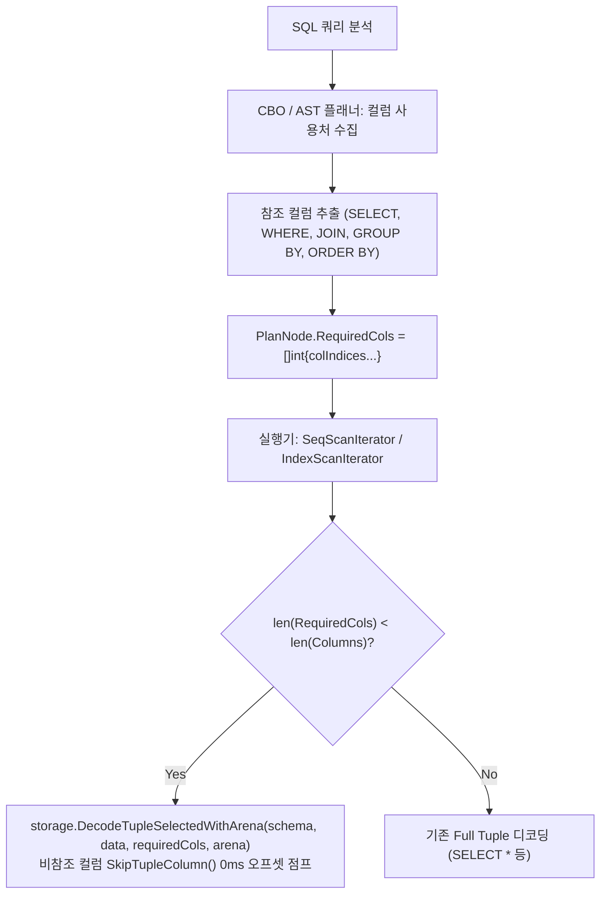

# [PERF-STORAGE-PROJECTION-PUSHDOWN-1] Storage Projection Pushdown 및 불필요 컬럼 디코딩 생략 (Column Pruning) 플랜

- **작성일**: 2026-11-24
- **상태**: IN_PROGRESS
- **태스크 ID**: `PERF-STORAGE-PROJECTION-PUSHDOWN-1` (Priority: P1, Target: v0.95.0)
- **대상 패키지**: `pkg/planner`, `pkg/execution`, `pkg/storage`

> **규칙 준수**:
> - `[RULE:PlanPersistence]`: 설계 및 구현 명세를 물리 파일로 영구 보존.
> - `[RULE:RadicalKISS]`: 불필요한 추상화 레이어를 배제하고, 기존 `storage.DecodeTupleSelectedWithArena` 및 `SkipTupleColumn` 직접 연계.
> - `[RULE:ZeroAllocation]`: 비참조 컬럼의 힙 메모리 할당 0 바이트 달성.
> - `[RULE:PipelineVerification]`: 3단계 파이프라인 (Build ➔ Test `-race` ➔ Commit).
> - `[RULE:StyleIntegrity]`: 장식용 이모지 일체 배제.

---

## 1. 배경 및 문제점 분석

1. **와이드 테이블(Wide Table) 풀-디코딩 병목**:
   - 현재 LionSQL의 테이블 스캔(`SeqScanIterator`, `IndexScanIterator`)은 쿼리에서 실제로 몇 개의 컬럼만 요구하든 상관없이 테이블의 모든 컬럼을 디코딩하거나, 전체 컬럼 크기의 `Values []any` 슬라이스를 할당함.
   - 예: 30개 컬럼을 가진 테이블에서 `SELECT id, name FROM users WHERE age > 20` 쿼리를 실행할 때, 필요한 컬럼은 3개(id, name, age)뿐이지만 나머지 27개 컬럼(대형 문자열, 날짜, LOB 등)까지 불필요하게 힙에 디코딩/할당되어 CPU 캐시 미스와 GC 부하를 초래함.
2. **스토리지 프리미티브 미연결 상태**:
   - LionSQL의 V2 튜플 코덱(`pkg/storage/tuple.go`)에는 이미 `SkipTupleColumn`을 통해 바이트 오프셋만 점프하고 메모리 할당 없이 필요한 컬럼만 추출하는 `DecodeTupleSelectedWithArena`가 구현되어 있으나, 플래너와 실행기 스캔 노드가 이를 호출하도록 연결되어 있지 않음.

---

## 2. 핵심 아키텍처 및 해결 방안

### 2.1 플래너 계층: 테이블별 참조 컬럼 인덱스 수집
- `pkg/planner/pushdown.go` 및 `planner.go`:
- 단일 쿼리 트리에서 특정 테이블(또는 Alias)이 참조하는 모든 컬럼의 인덱스 집합을 수집:
  1. `Projections`: `SELECT` 프로젝션에 사용된 컬럼
  2. `Filter`: `WHERE` 조건절에 사용된 컬럼
  3. `Joins`: `JOIN ON` 조인 키에 사용된 컬럼
  4. `GroupBy / OrderBy`: 집계 및 정렬 키에 사용된 컬럼
- 와일드카드(`SELECT *`)가 아니고 참조 컬럼 수가 전체 컬럼 수보다 적을 때, 오름차순 정렬된 `RequiredCols []int`를 생성하여 스캔 노드(`NodeSeqScan`, `NodeIndexScan`)에 주입.

### 2.2 실행기 계층: `ScanIterator` 선택적 디코딩 연결
- `pkg/execution/scan.go`:
- `SeqScanIterator` 및 `IndexScanIterator`에 `requiredCols []int` 및 `hasProjectionPushdown bool` 설정 메서드 추가.
- `dest.Tuples` 구성 시:
  - `hasProjectionPushdown && len(requiredCols) < len(schema.Columns)`인 경우:
    - `storage.DecodeTupleSelectedWithArena(schema, rawData, s.requiredCols, arena)` 호출.
    - 비선택 컬럼은 파싱 및 힙 할당 없이 즉시 스킵.

### 2.3 플래너 계층: 동치류 기반 전이적 조건 추론 (Transitive Predicate Inference)
- `pkg/planner/pushdown.go`:
- `InferTransitivePredicates(q *QueryInfo, pushdownRes *PushDownResult, ctx *PushdownContext)` 구현:
  1. **동치류(Equivalence Class) 그래프 구축**:
     - `WHERE` 및 INNER `JOIN ON`의 등가 조인 조건(`A.col = B.col`)을 Disjoint-Set/BFS로 연결하여 동일 동치류 그룹화.
  2. **상수 및 범위 조건 전이**:
     - 동치류 내 특정 컬럼에 걸린 단항 조건(`col = const`, `col > const`, `col >= const`, `col < const`, `col <= const`, `col IN (...)`, `col BETWEEN ...`, `col IS NOT NULL`)을 추출.
     - 동치류에 속한 다른 테이블의 동등 컬럼으로 치환하여 새로운 조건을 합성하고, 해당 테이블의 푸시다운 리스트(`PrimaryConds`, `JoinConds`)에 주입.
  3. **효과**:
     - 조인 대상 테이블에 명시되지 않은 필터가 사전에 주입되어, 조인 전 스토리지 스캔 단계에서 불필요한 행을 대량 필터링하거나 인덱스 포인트 룩업(Index Seek)으로 전환.

---

## 3. 세부 작업 단계 (Action Items)

1. **Phase 1: 플래너 참조 컬럼 분석기 구현 (`pkg/planner/pushdown.go`)**
   - `CollectReferencedColumnIndices(schema *storage.TableSchema, alias string, q *RelQuery) []int` 함수 구현.
   - `PlanNode.RequiredCols []int` 필드 추가 및 전파.

2. **Phase 2: 실행기 `ScanIterator` 및 `builder.go` 배선**
   - `pkg/execution/builder.go`: 스캔 노드 생성 시 `SetRequiredCols(node.RequiredCols)` 호출.
   - `pkg/execution/scan.go`: `cursor.RawTuple()` 또는 바이너리 데이터로부터 `DecodeTupleSelectedWithArena` 호출 경로 구축.

3. **Phase 3: 벤치마크 및 회귀 검증**
   - `pkg/execution/scan_bench_test.go` 작성 (와이드 테이블 30컬럼 중 3컬럼 SELECT vs 30컬럼 SELECT).
   - 기존 SQLLogicTest, Core Unit Test, TPC-C 100% 통과 검증.
