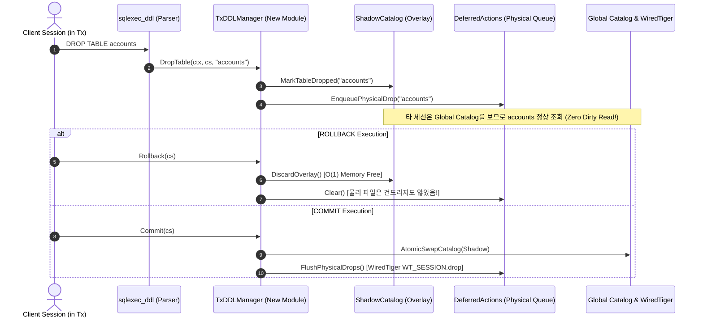

# 트랜잭셔널 DDL 전담 모듈화 및 섀도 카탈로그 격리 아키텍처 계획서
(`TRANSACTIONAL_DDL_MODULARIZATION_PLAN.ko.md`)

> - **문서 버전**: v1.0.0
> - **최초 작성일**: 2026-11-14
> - **최종 갱신일**: 2026-11-14
> - **과제 식별 코드**: `REFACTOR-TRANSACTIONAL-DDL-ISOLATION-1` (결함 3)
> - **대상 마일스톤**: `v1.10.0` (Post-1.0 실무 운영 안정화 제2그룹)
> - **신규 패키지**: `pkg/catalog/txddl` (또는 `pkg/engine/txddl`)
> - **연계 규칙**: `[RULE:AtomicSaves]`, `[RULE:ConflictPrevention]`, `[RULE:ModularAbstraction]`, `[RULE:RadicalKISS]`, `[RULE:PlanPersistence]`, `[RULE:ContinuousBacklog]`
> - **연계 문서**: [`notes/plans/ACID_CORE_INTEGRITY_STABILIZATION_PLAN.ko.md`](ACID_CORE_INTEGRITY_STABILIZATION_PLAN.ko.md), [`notes/PHYSICAL_TABLE_FORMAT.ko.md`](../PHYSICAL_TABLE_FORMAT.ko.md)

---

## 1. 개요 및 배경 (Executive Summary)

LionSQL은 T-SQL 및 PostgreSQL 표준에 따라 트랜잭션 블록(`BEGIN TRANSACTION` ... `COMMIT` / `ROLLBACK`) 내부에서의 DDL 실행(Transactional DDL)을 지원합니다.  
그러나 현재 구현(`FEAT-TRANSACTIONAL-DDL-1`)은 2,300줄 규모의 `sqlexec_ddl.go` 내부 곳곳에 스토리지 물리 조작, 톰스톤 리네임, 세션 Undo 스택 조작이 하드코딩되어 결합도(Spaghetti Coupling)가 매우 높고, **Dirty DDL Read** 및 **불완전 롤백 위험**을 내포하고 있습니다.

본 계획은 DDL의 트랜잭션 생명주기를 전담하는 독립 모듈(`pkg/catalog/txddl`)을 신설하고, **Shadow Catalog(Copy-on-Write 오버레이)**와 **Deferred Action Queue(지연 물리 작업 큐)** 아키텍처를 도입하여 시스템 복잡도를 획기적으로 낮추고 엔터프라이즈급 격리성을 확립하는 것을 목표로 합니다.

---

## 2. 현재 구현의 한계 및 문제 진단 (Root Cause Analysis)

### 2.1 현재 구조의 3대 결함
1. **관심사의 극심한 혼재 (Violating SRP & Modular Abstraction)**:
   - `sqlexec_ddl.go` 안에 SQL AST 파싱, 유효성 검사, 스토리지 엔진 물리 호출(`s.engine.DropTable`), 세션 힙 Undo 로그 푸시(`cs.PushDDLUndo`)가 뒤섞여 있어 유지보수가 극도로 어렵습니다.
2. **Dirty DDL Read (미커밋 DDL 타 세션 노출)**:
   - 트랜잭션 A가 `DROP TABLE t`를 실행하면, 커밋 전임에도 스토리지에서 즉시 `_tombstone_txID_t`로 물리 리네임되거나 카탈로그에서 제거됩니다.
   - 이로 인해 동시 실행 중인 타 세션 B가 테이블 `t`에 접근하면 `table not found` 오류가 발생하는 치명적인 격리성 파괴(Dirty Read)가 발생합니다.
3. **복구 실패 시 톰스톤 잔착 (Tombstone Leakage)**:
   - 롤백 도중 I/O 에러나 패닉이 발생하면 톰스톤 테이블이 복구되지 못하고 디스크에 댕글링 파일로 영구 잔존합니다.

---

## 3. 전담 모듈화 아키텍처 설계 (`pkg/catalog/txddl`)

### 3.1 아키텍처 개요 다이어그램



### 3.2 핵심 컴포넌트 명세

#### 1) `ShadowCatalog` (Copy-on-Write 카탈로그 오버레이)
- 트랜잭션이 활성화된 세션에 한하여 전역 카탈로그의 읽기 전용 스냅샷을 래핑하는 가상 오버레이 계층입니다.
- **격리 보장**: 트랜잭션 내부의 스키마 변경(`CREATE`, `ALTER`, `DROP`)은 섀도 카탈로그 메모리 맵에만 기록됩니다.
- **타 세션 보호**: 타 세션은 원본 전역 카탈로그(`s.catalog`)를 참조하므로, 트랜잭션이 커밋되기 전까지 어떠한 DDL 변경도 외부에 노출되지 않습니다 (Dirty DDL Read 원천 차단).
- **$O(1)$ 롤백**: 트랜잭션 롤백 시 섀도 카탈로그 포인터만 가비지 컬렉션에 넘기면 복구 완료 ($O(1)$ 원복).

#### 2) `DeferredActionQueue` (지연 물리 작업 큐)
- 물리적 디스크 삭제나 스토리지 리소스 해제(`WT_SESSION.drop`)를 트랜잭션 커밋 시점까지 지연 실행합니다.
- `DROP TABLE`: 즉시 디스크 파일을 지우거나 이름을 바꾸지 않고 큐에만 등록합니다.
  - **ROLLBACK 시**: 물리 파일을 전혀 건드리지 않았으므로 톰스톤 복구 작업 자체가 불필요합니다 (사일런트 유실 위험 0%).
  - **COMMIT 시**: 트랜잭션이 완전히 확정된 후 백그라운드에서 안전하게 `WT_SESSION.drop`을 일괄 수행합니다.

#### 3) `TxDDLManager` 통합 파사드 인터페이스
`sqlexec_ddl.go`가 소비하는 간결하고 선언적인 인터페이스입니다:

```go
package txddl

type Manager interface {
    // 트랜잭션 컨텍스트 바인딩
    Begin(sessionID string) (*TxContext, error)
    Commit(ctx context.Context, cs *engine.ClientSession) error
    Rollback(ctx context.Context, cs *engine.ClientSession) error

    // 선언적 DDL 액션 (sqlexec_ddl에서 호출)
    CreateTable(ctx context.Context, cs *engine.ClientSession, schema *storage.TableSchema) error
    DropTable(ctx context.Context, cs *engine.ClientSession, tableName string) error
    AlterTable(ctx context.Context, cs *engine.ClientSession, tableName string, mut SchemaMutation) error
    CreateIndex(ctx context.Context, cs *engine.ClientSession, tableName string, idx *storage.IndexDef) error
    DropIndex(ctx context.Context, cs *engine.ClientSession, tableName string, indexName string) error
}
```

---

## 4. 단계별 구현 계획 (Phased Implementation Plan)

### 제1단계: 독립 패키지 및 섀도 카탈로그 엔진 구축 (`pkg/catalog/txddl`)
- `ShadowCatalog` 구조체 구현: 전역 `catalog.Catalog`를 감싸고, `overlayTables map[string]*storage.TableSchema`, `droppedTables map[string]bool` 관리.
- CoW(Copy-on-Write) 스키마 복제 및 조회 라우팅(`GetTable`, `ListTables`) 단위 테스트 작성.

### 제2단계: 지연 물리 액션 큐 (`DeferredActionQueue`) 구축
- `DeferredAction` 인터페이스 및 액션 타입(`ActionDropTablePhysical`, `ActionDropIndexPhysical`) 정의.
- 롤백 시 무비용 폐기, 커밋 시 순차 일괄 실행 파이프라인 검증.

### 제3단계: `sqlexec_ddl.go` 전면 리팩토링 및 분기문 소탕
- `sqlexec_ddl.go` 내의 `cs.PushDDLUndo()`, `_tombstone_` 생성, 수동 롤백 코드를 전면 삭제 (`[RULE:RadicalKISS]`).
- 모든 DDL 실행부를 `s.txDDLMgr.CreateTable()`, `s.txDDLMgr.DropTable()` 단일 호출로 통합.

### 제4단계: 동시성 격리 및 카탈로그 무결성 회귀 테스트
- `pkg/catalog/txddl/isolation_regression_test.go`:
  - 세션 A가 트랜잭션 내에서 `DROP TABLE` 실행 중일 때, 세션 B가 정상적으로 해당 테이블을 조회(SELECT)할 수 있음을 검증 (Dirty Read 차단).
  - 세션 A가 `ROLLBACK` 했을 때 디스크 잔여 톰스톤이 0건임을 검증.
  - `-race` 조건 하에서 다중 고루틴 동시 DDL 100% PASS 검증.

---

## 5. TODO 세부 작업 체크리스트 (TODO Dashboard)

- [ ] **[TODO-TXDDL-01]** 신규 패키지 `pkg/catalog/txddl` 디렉터리 및 인터페이스 정의
- [ ] **[TODO-TXDDL-02]** `ShadowCatalog` CoW 스키마 오버레이 구현 및 단위 테스트 (`shadow_test.go`)
- [ ] **[TODO-TXDDL-03]** `DeferredActionQueue` 지연 물리 작업 큐 구현 (`deferred_queue_test.go`)
- [ ] **[TODO-TXDDL-04]** `Coordinator` 및 `ClientSession`에 `TxDDLManager` 주입 및 생명주기 바인딩
- [ ] **[TODO-TXDDL-05]** `sqlexec_ddl.go`의 기존 수동 Undo/Tombstone 코드 전면 소탕 및 모듈 직결
- [ ] **[TODO-TXDDL-06]** Dirty DDL Read 차단 및 동시성 격리 회귀 테스트 100% 통과 입증
- [ ] **[TODO-TXDDL-07]** `CHANGELOG.md` 및 `TASKS.md` 완료 마킹 및 도큐먼트 동기화
