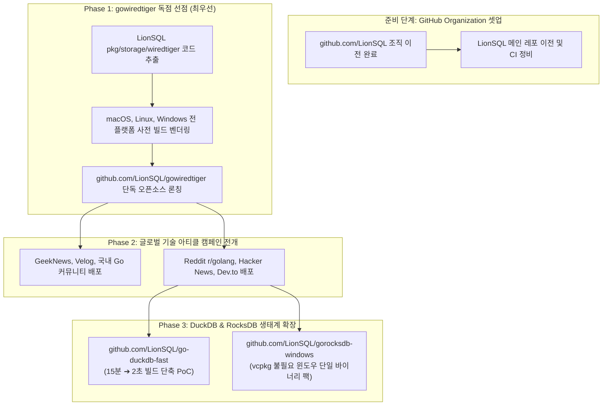

# Windows Cgo 독립 패키지 생태계 구축 및 LionSQL Organization 이전 연계 계획
> **문서 ID**: `PLAN-WINDOWS-CGO-STANDALONE-ECOSYSTEM-1`  
> **생성일자**: 2026-11-21  
> **마일스톤**: `Post-1.0` (LionSQL 1.0-GA 릴리스 및 github.com/LionSQL 이전 시 재검토)  
> **상태**: `PENDING` (1.0-GA 릴리스 이후 재검토 대기)  
> **책임**: LionSQL Core & Storage Architecture Team  
> **연관 문서**: 
> - [`doc/WIREDTIGER_WINDOWS_MSVC_DLL_CGO_GUIDE.ko.md`](../../doc/WIREDTIGER_WINDOWS_MSVC_DLL_CGO_GUIDE.ko.md)
> - [`articles/how-to-link-msvc-c-libraries-with-go-cgo-windows/README.ko.md`](../../articles/how-to-link-msvc-c-libraries-with-go-cgo-windows/README.ko.md)
> - [`articles/how-to-link-msvc-c-libraries-with-go-cgo-windows/README.md`](../../articles/how-to-link-msvc-c-libraries-with-go-cgo-windows/README.md)

---

## 1. 배경 및 추진 목적

LionSQL은 WiredTiger 11.3.1의 Windows 포팅 과정에서 **[MSVC `/MT` 동적 DLL 빌드 + MinGW `dlltool` GNU 임포트 라이브러리 브릿지 + `//go:embed` & Win32 `SetDllDirectoryW` Self-Extracting 런타임 로더]**라는 독보적인 아키텍처를 완성했습니다.

이 아키텍처는 Go 개발자가 Windows 환경에서 Cgo를 다룰 때 직면하는 3대 난제(MinGW GCC 강제, MSVC CRT 링킹 충돌, 외부 DLL 의존성 수동 관리)를 완전히 해결합니다.

현재 글로벌 오픈소스 생태계에서는 WiredTiger, RocksDB, DuckDB 3대 핵심 C/C++ 엔진에 대해 다음과 같은 만성적 문제점들이 존재합니다:
1. **WiredTiger**: 최신 v11을 지원하는 Go 라이브러리가 전 세계에 전무(블루오션).
2. **DuckDB**: 공식 `go-duckdb`가 MinGW 억지 컴파일로 인해 빌드 타임이 10~15분 소요되고 CI 메모리 부족(OOM) 빈발.
3. **RocksDB**: `gorocksdb`가 윈도우 지원을 사실상 포기하고 사용자에게 vcpkg 수동 설치를 강제.

본 계획은 **`github.com/LionSQL` GitHub Organization 이전**과 발맞추어, LionSQL 내부에서 검증된 Cgo 제로-인스톨 단일 바이너리 기술을 3대 라이브러리 독립 패키지로 오픈소스화하고 기술 아티클을 전 세계에 배포하여, LionSQL의 기술적 리더십을 확립하고 대규모 깃허브 스타와 커뮤니티 트래픽을 유입시키는 로드맵을 정의합니다.

---

## 2. 단계별 추진 로드맵

---

## 3. 세부 실행 계획

### Phase 1: `github.com/LionSQL/gowiredtiger` 독립 패키지 론칭 (최우선 과제)
- **목표**: WiredTiger 최신 v11.3.1을 전 플랫폼(macOS Apple Silicon/Intel, Linux ARM64/AMD64, Windows AMD64)에서 단일 바이너리로 2초 만에 구동하는 전 세계 유일의 Go 표준 패키지 선점.
- **주요 산출물**:
  1. 단독 저장소 생성: `github.com/LionSQL/gowiredtiger`
  2. 라이브러리 인터페이스:
     - `Engine`, `Session`, `Cursor`, `Transaction`의 관용적(Idiomatic) Go 래퍼
     - Zero-Copy 바이트 슬라이스 읽기/쓰기 지원
  3. 전 플랫폼 크로스 컴파일 바이너리 벤더링:
     - `lib/darwin_arm64/libwiredtiger.a`
     - `lib/darwin_amd64/libwiredtiger.a`
     - `lib/linux_amd64/libwiredtiger.a`
     - `lib/linux_arm64/libwiredtiger.a`
     - `lib/windows_amd64/wiredtiger.dll` (2.27 MB, MSVC `/MT`)
     - `lib/windows_amd64/libwiredtiger.dll.a` (19 KB, MinGW Cgo 바인딩)
  4. 단일 실행 바이너리 Self-Extracting 로더 (`dll_loader_windows.go`, `dll_embed_windows.go`) 탑재
  5. 리드미 브랜딩: *"Maintained by LionSQL Core Engineering Team"* 및 LionSQL 링크 배너 부착.

### Phase 2: 글로벌 아티클 배포 및 바이럴 캠페인
- **목표**: Reddit, Hacker News, GeekNews 메인 상단을 공략하여 전 세계 Go 개발자들의 주목을 끌고 패키지 및 LionSQL 레포지토리 유입 유도.
- **실행 채널**:
  1. **국내 (GeekNews / Velog)**:
     - 기고문: [`articles/how-to-link-msvc-c-libraries-with-go-cgo-windows/README.ko.md`](../../articles/how-to-link-msvc-c-libraries-with-go-cgo-windows/README.ko.md)
     - 타이틀: *Go 개발자를 위한 Windows Cgo 지옥 탈출기: MSVC 전용 C 라이브러리를 MinGW 충돌 없이 단일 실행 파일(.exe)로 패키징하는 완벽 가이드*
  2. **글로벌 (Reddit `r/golang` / Hacker News)**:
     - 기고문: [`articles/how-to-link-msvc-c-libraries-with-go-cgo-windows/README.md`](../../articles/how-to-link-msvc-c-libraries-with-go-cgo-windows/README.md)
     - 타이틀: *How we solved the Go Cgo Windows nightmare: Linking MSVC C libraries with zero external DLLs (Show HN / r/golang)*
  3. **Golang Weekly 투고**: 기사 발행 후 Golang Weekly 큐레이션 제출.

### Phase 3: `go-duckdb-fast` (빌드 타임 99% 단축 대안 패키지)
- **목표**: DuckDB 공식 MSVC `duckdb.dll`을 활용해, 기존 `go-duckdb`의 15분 Amalgamation 컴파일 지옥을 2초로 단축.
- **실행 방안**:
  1. DuckDB 공식 릴리스의 `duckdb.dll`과 `duckdb.h` 확보.
  2. 동일한 파이프라인으로 `libduckdb.dll.a` 생성 및 `//go:embed` 셀프 익스트랙터 바인딩.
  3. `database/sql` 드라이버를 그대로 노출하여 기존 `go-duckdb` 사용자가 `import` 경로만 바꾸면 2초 만에 단일 바이너리로 빌드되도록 제공.
  4. 업스트림 `go-duckdb` 레포지토리에 RFC/PR로 공식 제안하여 생태계 기여.

### Phase 4: `gorocksdb-windows` (RocksDB 윈도우 단일 바이너리 팩)
- **목표**: Meta RocksDB를 Windows 환경에서 vcpkg 설치 없이 `go build` 가능하도록 지원.
- **실행 방안**:
  1. RocksDB MSVC DLL 빌드 및 `librocksdb.dll.a` 생성.
  2. `gorocksdb`와 호환되는 제로-인스톨 윈도우 어댑터 모듈 배포.

---

## 4. 아키텍처 불변식 준수

1. **[RULE:PlatformPrimitives]**: 모든 Windows 빌드 및 자동화 파이프라인은 네이티브 PowerShell(`pwsh`)과 Ninja를 기본 표준으로 채택한다.
2. **[RULE:StaticBinary]**: 배포되는 Go 산출물은 어떤 경우에도 사용자에게 별도 DLL 설치나 전역 `%PATH%` 조작을 요구하지 않는 Self-Extracting 단일 실행 바이너리 철학을 100% 준수한다.
3. **[RULE:StyleIntegrity]**: 모든 저장소, 문서, 커밋 메시지, 릴리스 노트에서 불필요한 장식용 이모지를 배제하고 일관된 엔지니어링 톤을 유지한다.

---

## 5. 성공 지표 (KPIs)

1. **GitHub Stars**: `LionSQL` 및 `gowiredtiger` 합산 1,000+ Stars 달성.
2. **커뮤니티 트래픽**: Reddit r/golang Upvote 100+, GeekNews Top 1위 랭크.
3. **빌드 안정성**: Windows Server 2022 GitHub Actions 러너에서 100% Hermetic Pass 유지.
