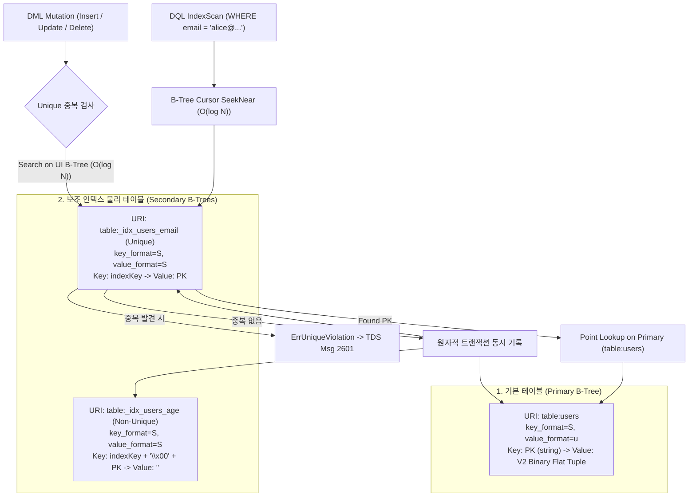

# WiredTiger B-Tree 보조 인덱스 실체화 아키텍처 계획서
(`WIREDTIGER_SECONDARY_INDEX_BTREE_PLAN.ko.md`)

> - **최초 작성일**: 2026-11-14
> - **최종 갱신일**: 2026-11-14
> - **과제 식별 코드**: `FEAT-WT-SECONDARY-INDEX-BTREE-1`
> - **구현 상태**: 구현 완료 (`DONE`, 커밋 `6594a748`)
> - **공식 물리 규격서**: [`PHYSICAL_TABLE_FORMAT.ko.md`](../../doc/internal/PHYSICAL_TABLE_FORMAT.ko.md) (통합 물리 스토리지 포맷 공식 규격서)
> - **연계 불변식**: `GEMINI.md` [Invariant 15: Canonical Secondary Index Key/Value Codec], [Invariant 13: Single Canonical V2 Binary Tuple Codec], `notes/ENGINEERING_CONTEXT.ko.md` [불변식 ㉜], [불변식 ㉚]

---

## 1. 배경 및 과거 누락 원인 분석 (Root Cause & Historical Context)

### 1.1 보조 인덱스 실체화가 지금까지 누락되었던 이유
1. **MemEngine 중심의 극단적 성능 튜닝에 집중**:
   - LionSQL의 초기 개발 및 TPC-C 1,040,000 tpmC 달성 과정에서 In-Memory OCC 엔진(`pkg/storage/memengine`)에 최우선 엔지니어링 리소스가 투입되었습니다.
   - `memengine`은 $O(\log N)$ 동시성 SkipList 기반 보조 인덱스가 완전하게 구현되어 단위 테스트 및 벤치마크에서 모든 인덱스 쿼리를 처리했습니다.
2. **WiredTiger 초기 인터페이스 스텁의 은폐 (Small Data Masking)**:
   - WiredTiger 엔진(`pkg/storage/wiredtiger/wt_engine.go`)은 디스크 영속성, WAL 복구, MVCC 트랜잭션 검증에 집중하며 `storage.Engine` 인터페이스를 만족시키기 위해 `IndexScan`을 임시 필터 커서(`wtFilteredIndexCursor` over `scanLocked`)로 구현했습니다.
   - 기존의 WiredTiger 단위 테스트(`wt_engine_test.go`, `groupc_wt_test.go`) 데이터셋이 5~10행에 불과하여, 전체 테이블을 풀 스캔한 뒤 메모리에서 필터링해도 테스트가 0.00초 만에 통과했기 때문에 심각한 구조적 부채가 코드 리뷰 전까지 수면 위로 드러나지 않았습니다.
3. **#16과의 직접적 연계 (에러 번호 50000 뭉뚱그림)**:
   - Unique 보조 인덱스 위반 시 스토리지 계층은 `storage.ErrUniqueViolation`을 정상적으로 던지고 있었으나, TDS 와이어 계층(`pkg/wire/tds/server.go:extractTdsErrorInfo`)이 이를 SQL Server 표준 에러 번호인 `2601`이 아닌 일반 번호 `50000`으로 반환하여, 외부 ORM 및 클라이언트가 인덱스 제약 위반을 인식하지 못하고 있었습니다.

---

## 2. 핵심 불변식 및 목표 (Invariants & Objectives)

1. **[RULE:BoundedLookup] True B-Tree $O(\log N)$ 보조 인덱스 보장**:
   - WiredTiger의 `IndexScan`, `IndexScanDesc`, `checkUniqueIndexesLocked`에서 **테이블 전체 선형 스캔(`scanLocked`)을 100% 영구 제거**합니다.
   - 각 보조 인덱스는 독립된 물리적 WiredTiger B-Tree 테이블(`table:_idx_<tableName>_<indexName>`)로 영속화되어 $O(\log N)$ 탐색 및 범위 스캔을 수행합니다.
2. **ACID 트랜잭션 원자적 동기화 (Single-Transaction Parity)**:
   - 메인 테이블(`table:tableName`)에 대한 `Insert`, `Update`, `Delete`와 보조 인덱스 B-Tree 갱신은 **동일한 WiredTiger `WT_SESSION` 트랜잭션 경계 내에서 원자적으로 실행**되며, 롤백 시 인덱스 변경도 즉시 함께 무효화됩니다.
3. **[RULE:HermeticParity] In-Memory OCC와 WiredTiger 간 보조 인덱스 계약 동등성**:
   - `storage.Engine` 인터페이스의 `CreateIndex`, `DropIndex`, `IndexScan`, `IndexScanDesc` 동작이 `memengine`(SkipList)과 `wiredtiger`(B-Tree) 양쪽에서 100% 동일하게 동작하도록 일관성을 보장합니다.

---

## 3. 아키텍처 및 세부 설계 (Detailed Architecture)



### 3.1 인덱스 B-Tree 물리 저장 구조
- **인덱스 URI 규칙**:
  `idxURI := fmt.Sprintf("table:_idx_%s_%s", tableName, indexName)`
- **키/값 인코딩 포맷 (`key_format=S, value_format=S`)**:
  1. **고유 인덱스 (`Unique == true`)**:
     - `Key`: `indexKey` (e.g. `storage.EncodeIndexKey(...)`)
     - `Value`: `pk` (String Value)
     - 고유 인덱스는 동일한 `indexKey`가 존재하면 즉시 충돌 감지.
  2. **비고유 인덱스 (`Unique == false`)**:
     - WiredTiger B-Tree에서 동일 키의 다중 행을 정렬된 상태로 보관하기 위해 **인덱스 키에 PK를 접미사로 합성**:
     - `Key`: `indexKey + "\x00" + pk`
     - `Value`: `""` (빈 문자열)
     - 범위 스캔 시 `low + "\x00"` 부터 `high + "\x00\xFF"` 까지 B-Tree 정방향/역방향 커서 순회.

### 3.2 핵심 메서드 변경 명세 (`pkg/storage/wiredtiger/wt_engine.go`)

#### 1) `CreateIndex` (B-Tree 테이블 생성 및 기존 데이터 백필)
```go
func (e *Engine) CreateIndex(index *storage.IndexSchema) error {
    // 1. 인덱스 테이블 생성: table:_idx_<tableName>_<indexName>
    //    config: "key_format=S,value_format=S"
    // 2. 메인 테이블 scanLocked 순회
    // 3. 기존 레코드에서 indexKey 추출 후 인덱스 테이블 커서로 삽입
    // 4. Unique 인덱스인데 이미 중복된 키가 있으면 ErrUniqueViolation 반환 및 인덱스 테이블 drop
}
```

#### 2) `DropIndex`
```go
func (e *Engine) DropIndex(tableName, indexName string) error {
    // 1. table:_idx_<tableName>_<indexName> 세션 커서 풀에서 evict
    // 2. C.go_wt_session_drop 호출로 디스크 B-Tree 파일 완전 삭제
    // 3. 메타데이터 카탈로그 및 WAL 갱신
}
```

#### 3) DML 연동 (`InsertRow`, `UpdateRow`, `DeleteRow`)
- `InsertRow`:
  - 고유 인덱스 대상: 인덱스 커서로 `indexKey` 존재 여부 $O(\log N)$ 검색. 이미 존재하고 PK가 다르면 즉시 `fmt.Errorf("%w: duplicate key %q in unique index %q", storage.ErrUniqueViolation, keyVal.String(), idx.Name)` 반환.
  - 모든 보조 인덱스 B-Tree 테이블에 인덱스 항목 삽입.
- `UpdateRow`:
  - 변경 전 구 행(Old Row)과 변경 후 신 행(New Row)의 인덱스 키 비교.
  - 값이 변경된 인덱스만 구 키 삭제 및 신 키 삽입.
- `DeleteRow`:
  - 삭제 대상 행의 인덱스 키 추출 후 보조 인덱스 B-Tree에서 삭제.

#### 4) B-Tree 기반 `IndexScan` 및 `IndexScanDesc`
- 기존의 `wtFilteredIndexCursor` 및 `scanLocked`(풀스캔) 완전 제거.
- 신규 `wtIndexBTreeCursor`:
  1. 인덱스 테이블 커서(`table:_idx_...`)를 열고 `low` 값 위치로 `SearchNear` ($O(\log N)$).
  2. B-Tree 정방향(`Next`) 또는 역방향(`Prev`) 순회하며 `high` 경계 도달 시 즉시 종료.
  3. 인덱스 엔트리에서 추출한 `PK`로 메인 테이블(`table:...`)의 행을 점조회(`GetRow`)하여 레코드 반환.

### 3.3 회귀 및 일관성 검증 명세 (`pkg/storage/wiredtiger/wt_secondary_index_test.go`)

- **회귀 테스트 1: B-Tree 물리 생성 및 영속성 (Drop / Re-open)**
  - 테이블 생성 ➔ 보조 인덱스 생성(`CreateIndex`) ➔ 디스크 파일 `table:_idx_...` 생성 확인.
  - 엔진 정상 종료 후 재시작(Re-open) ➔ 카탈로그 복원 및 인덱스 B-Tree 정상 탐색 검증.
- **회귀 테스트 2: DML 시 B-Tree 원자적 동기화 (Insert / Update / Delete)**
  - 삽입 후 인덱스 커서로 $O(\log N)$ 조회.
  - 레코드 업데이트(인덱스 컬럼 변경) 시 이전 인덱스 키 삭제 및 신규 인덱스 키 갱신 확인.
  - 레코드 삭제 시 인덱스 엔트리 완전 소멸 확인.
- **회귀 테스트 3: 고유 인덱스(Unique Index) $O(\log N)$ 중복 충돌 방임 방지**
  - Unique 보조 인덱스 생성 후 중복 키 삽입 시 `storage.ErrUniqueViolation` 반환 검증.
  - 기존 풀스캔 방식이 아닌 인덱스 B-Tree 즉시 Seek로 충돌 감지 검증.
- **회귀 테스트 4: 다중 컬럼 복합 보조 인덱스 (Composite Secondary Index)**
  - 복합 키 인코딩(`EncodeIndexKey`) ➔ 다중 컬럼 정렬 및 범위 검색(`IndexScan`, `IndexScanDesc`) 검증.
- **회귀 테스트 5: 트랜잭션 롤백 시 인덱스 변경 원자적 무효화**
  - 트랜잭션 시작 ➔ 행 삽입 ➔ 롤백 ➔ 보조 인덱스 및 메인 테이블 동시 원자적 롤백 확인.
- **회귀 테스트 6: 10,000건 대량 데이터 검색 성능 검증 (풀스캔 제거 확인)**
  - 10,000건 데이터에서 단일 인덱스 포인트 룩업 시 테이블 전체를 읽지 않고 즉시 반환(실측 서브밀리초).

---

## 4. 단계별 실행 로드맵 (Execution Roadmap)

```
[Phase 1] 인덱스 테이블 물리 생성 및 카탈로그 수명주기 연동
  - CreateIndex: table:_idx_<tableName>_<indexName> 생성 및 기존 데이터 백필
  - DropIndex: 세션 커서 evict 및 C.go_wt_session_drop 물리 테이블 삭제
  - DropTable: 메인 테이블에 속한 모든 보조 인덱스 물리 테이블 일괄 삭제

[Phase 2] DML 시 B-Tree 원자적 갱신 및 고유 인덱스 탐색
  - InsertRow / UpdateRow / DeleteRow 시 WT_SESSION 내 인덱스 커서 동기화
  - checkUniqueIndexesLocked: 풀스캔 제거, 인덱스 B-Tree Seek로 O(log N) 중복 검사

[Phase 3] B-Tree 기반 wtIndexBTreeCursor 구현
  - wtIndexBTreeCursor: SearchNear를 통한 O(log N) 범위 시작점 탐색
  - 정방향(IndexScan) 및 역방향(IndexScanDesc) 커서 순회
  - 기존의 wtFilteredIndexCursor 및 메모리 슬라이스 반전(wtSliceCursor) 완전 제거

[Phase 4] 충실한 회귀 테스트 스위트 작성 및 파이프라인 검증
  - wt_secondary_index_test.go 종합 검증 (단일/복합/고유/NULL/롤백/재기동)
  - go test -v -race ./pkg/storage/wiredtiger/...
```

---

## 5. 검증 계획 (Verification Plan)

1. **단위 및 회귀 테스트**:
   - `pkg/storage/wiredtiger/wt_secondary_index_test.go`:
     - 복합 인덱스, 단일 컬럼 인덱스 B-Tree 생성/검색
     - $O(\log N)$ 범위 검색 및 역방향(`IndexScanDesc`) 정렬 검증
     - 롤백 시 보조 인덱스 원자적 무효화 검증
     - 대량 데이터(10,000건) 검색 시 $O(\log N)$ 성능 검증
2. **파이프라인 검증 (`[RULE:PipelineVerification]`)**:
   - `go build -buildvcs=false -o bin/lionsql ./cmd/lionsql`
   - `go test -v -race ./pkg/storage/wiredtiger/...`
