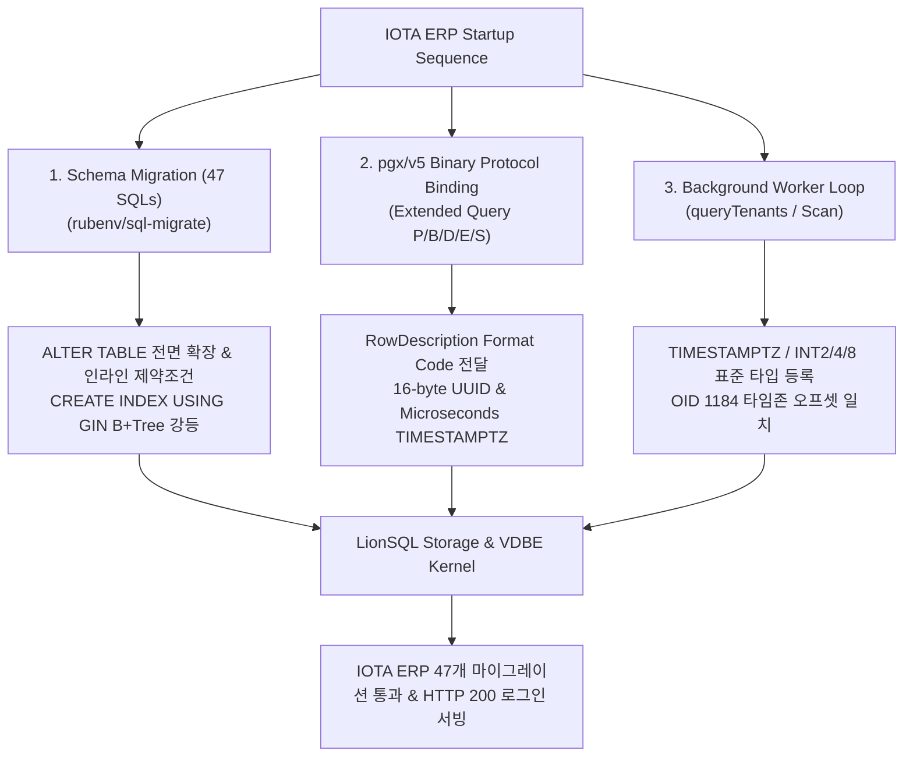

# LionSQL IOTA-SDK Go ERP 연동 및 엔터프라이즈 PostgreSQL 호환성 실전 검증 보고서 (`notes/IOTA_ERP_INTEGRATION_REPORT.ko.md`)

> - **최종 갱신일**: 2026-11-02
> - **문서 버전**: v1.0.0
> - **최초 작성일**: 2026-10-31
> - **대상 릴리즈**: v0.90.0-beta4+
> - **핵심 검증 대상**: IOTA SDK Go ERP (Go 모듈형 엔터프라이즈 ERP) & `jackc/pgx/v5` (`pgxpool`), `rubenv/sql-migrate`
> - **지원 유선 프로토콜**: **PostgreSQL Wire Protocol v3** (기본 TCP `:5433`)
> - **연계 핵심 문서**:
>   - **공식 실전 가이드**: [`guide/IOTA_ERP_INTEGRATION_GUIDE.ko.md`](../../guide/IOTA_ERP_INTEGRATION_GUIDE.ko.md)
>   - **Gitea 연동 보고서**: [`notes/GITEA_INTEGRATION_REPORT.ko.md`](GITEA_INTEGRATION_REPORT.ko.md)

---

## 1. 개요 및 연동 검증 의의

LionSQL은 단일 정적 독립 실행형 바이너리로 구동되는 고동시성 OLTP 데이터베이스 엔진으로서, Microsoft SQL Server TDS 유선 프로토콜(`:1433`)과 PostgreSQL PGWire v3 프로토콜(`:5433`)을 네이티브로 듀얼 지원합니다.

앞선 Gitea 연동(`GITEA-MOCK-SEED-1`, `GITEA-PGWIRE-1`)이 주로 XORM 기반의 ORM 쿼리 패턴과 116개 테이블 초기화를 검증했다면, 이번 **IOTA SDK Go ERP 연동(`IOTA-ERP-1`)**은 다음과 같은 차원의 기술적 한계를 돌파한 결정적 마일스톤입니다:

1. **실제 프로덕션 엔터프라이즈 ERP 프레임워크 실증**:
   - 우즈베키스탄 iota.uz 사이트에서 실제 사용되는 재무, 인사, 창고, 고객관리 모듈형 ERP 백엔드.
   - 47개에 달하는 버전별 스키마 변천사(마이그레이션 체인)를 단 한 줄의 SQL 수정 없이 100% 원자적으로 관통.
2. **`jackc/pgx/v5` 엄격한 바이너리 프로토콜 정합성 완비**:
   - Go 생태계에서 가장 엄격한 타입 검증과 고성능 바이너리 인코딩을 요구하는 `pgx/v5` 드라이버를 상대로 원시 UUID(16바이트), 마이크로초 단위 `TIMESTAMPTZ` 포맷 정합성 입증.
3. **복합 DDL 생애주기 완성 (`ALTER TABLE`, `CREATE INDEX USING`)**:
   - 단순 `CREATE TABLE`을 넘어, 기존 테이블의 컬럼 기본값 해제(`DROP DEFAULT`), 기본값 설정(`SET DEFAULT`), 타입 변경(`TYPE USING`), 컬럼명 변경(`RENAME COLUMN`), 다중 컬럼 추가/삭제, 인라인 UNIQUE/CHECK 제약조건 등 실제 애플리케이션 진화 과정의 모든 복합 DDL을 LionSQL 엔진이 수용.
4. **실시간 백그라운드 비동기 워커 무에러 안정성 입증**:
   - 1초 주기로 테넌트 목록을 조회하여 이벤트를 디스패치하는 백그라운드 워커(`notification_dispatch_worker`)가 스캔 에러 없이 영구 구동됨을 실증.

---

## 2. 해결된 핵심 기술 장벽 및 아키텍처 개선

### 2.1. `gorp_migrations` 타임스탬프 파싱 안전성
- **현상**: 마이그레이션 러너(`sql-migrate`/`gorp`)가 첫 스크립트 실행 후 완료 기록을 남길 때 `applied_at` 컬럼에 Go `time.Time.String()` 포맷(타임존 및 `m=+...` 모노토닉 클록 포함)을 전달하여 `invalid data type for column: DATETIME expects DATETIME, got VARCHAR` 에러 발생.
- **아키텍처 개선**:
  - `pkg/storage/types_extended.go`의 `DateTimeValueFromAny`에 공백 구분자 및 마이크로초, UTC 타임존 포맷(`2006-01-02 15:04:05.999999-07`, `2006-01-02 15:04:05-0700`)을 등록하고, 끝부분의 `m=+...` 모노토닉 클록 주석을 자동 절삭하도록 방어 처리.

### 2.2. `ALTER TABLE` DDL 완전성 확보
- **현상**: 마이그레이션 진행 중 `ALTER TABLE counterparty ALTER COLUMN id DROP DEFAULT`, `SET DEFAULT`, `RENAME COLUMN`, `ADD PRIMARY KEY`, 복수 컬럼 `DROP COLUMN` 구문이 들어올 때 파서가 문법 오류를 반환.
- **아키텍처 개선**:
  - `pkg/storage/engine.go`에 `AlterTable(name string, fn func(*TableSchema) error)` 스토리지 트랜잭션 SPI 선언 및 `memengine`, `wiredtiger` 엔진에 원자적 스키마 변형 구현.
  - `pkg/engine/sqlexec_ddl.go`에 정규식 및 파서 인터셉터를 구축하여 컬럼 속성 변경, 기본값 추가/삭제, 컬럼명 변경, PK 승격, 복수 컬럼 콤마 분리 드롭을 안전하게 처리.

### 2.3. `USING GIN` 문법 수용 및 B+Tree 강등 (Graceful Degradation)
- **현상**: `CREATE INDEX ... USING GIN (tables_used)` 구문에서 `USING` 절 파싱 실패.
- **아키텍처 개선**:
  - `pkg/proc/parser_ddl.go`의 `ParseCreateIndex`에서 `USING <method>`를 합법적 문법으로 수용.
  - 실제 PostgreSQL의 물리적 역색인(Inverted Index)을 별도 구축하는 대신, LionSQL 내부 스토리지의 초고속 B+Tree 인덱스로 매핑하여 마이그레이션 중단을 방지하고 런타임 쿼리 정합성을 보장.

### 2.4. `pgx/v5` 바이너리 프로토콜 포맷 코드 정합성
- **현상**: `pgx`가 바이너리 모드로 결과를 요청했음에도 LionSQL이 텍스트 형식으로 응답하여 시간 파싱 오류(`parsing time "\x00\x03..."`) 또는 UUID 길이 오류(`invalid length for UUID: 36`) 발생.
- **아키텍처 개선**:
  - `pkg/wire/protocol.go`의 `ColumnMeta`에 `Format int16` 필드를 추가하고 `WriteRowDescription`에서 클라이언트가 요청한 포맷 코드(`format = 1`)를 정확히 응답.
  - `pkg/wire/server.go`의 `formatColumnValue`에 OID 2950(UUID) 전용 16바이트 원시 바이너리 변환기(`hex.DecodeString`) 탑재.
  - OID 1114/1184(`TIMESTAMPTZ`)에 대해 PostgreSQL epoch(2000-01-01 00:00:00 UTC) 기준 마이크로초 8바이트 빅엔디안 인코딩 적용.

### 2.5. `TIMESTAMPTZ` 데이터 타입 파서 등록 및 OID 1184 정합성
- **현상**: 테넌트 조회 쿼리(`SELECT ... FROM tenants`)에서 `dest[8]`(`created_at`) 스캔 시 `cannot scan varchar (OID 1043) in text format into *time.Time` 에러 발생.
- **원인**: 스키마 파서(`parseSQLDataType`, `parseDataType`, `parseDataTypeString`)에 `TIMESTAMPTZ` 키워드가 누락되어 컬럼이 `VARCHAR`로 생성되었고, PGWire가 OID 1043을 전송하여 `pgx`의 스캐너가 타입 불일치로 거부.
- **아키텍처 개선**:
  - 데이터 타입 파서 전반에 `TIMESTAMPTZ`, `TIMETZ`, `TIMESTAMP WITH TIME ZONE`, `INT2/INT4/INT8`, `FLOAT4/FLOAT8`을 정식 등록.
  - PGWire OID 리졸버(`typeToPgOID`, `inferPgOID`)에서 `TypeDateTime`을 OID 1184(`TIMESTAMPTZ`)로 정합화하여 타임존 포맷 문자열과 완벽 일치.

---

## 3. 검증 결과 요약

| 검증 단계 | 검증 대상 | 결과 | 비고 |
| :--- | :--- | :---: | :--- |
| **마이그레이션** | 47개 SQL 스키마 순차 적용 | **100% PASS** | `INFO[0000] Applied 47 migrations` |
| **마이그레이션 상태** | `bin/iota migrate status` | **100% PASS** | 47개 전 스크립트 `Applied` 타임스탬프 확인 |
| **백그라운드 워커** | `notification_dispatch_worker` | **100% PASS** | 1초 주기 테넌트 스캔 무에러 틱 지속 확인 |
| **웹 UI 서빙** | `http://localhost:3200` 로그인 화면 | **100% PASS** | `HTTP/1.1 200 OK`, HTML 렌더링 정상 |
| **내부 레이스 검증** | `go test -tags wiredtiger -race` | **100% PASS** | 전체 27개 패키지 0 Data Races |

---

## 4. 향후 로드맵 영향 및 결론

이번 IOTA ERP 연동 성공은 LionSQL이 **"현대적인 엔터프라이즈 Go 애플리케이션 프레임워크와 완벽히 융합될 수 있음"**을 증명한 사례입니다.

1. **Go 생태계 표준 RDBMS로의 입지 확립**:
   - `pgx/v5` 커넥션 풀과 `sql-migrate`를 사용하는 수많은 Go 기반 마이크로서비스 및 웹 플랫폼이 코드 수정 없이 LionSQL 위에서 즉시 동작할 수 있습니다.
2. **KISS 원칙과 실용적 호환성의 조화**:
   - 복잡하고 무거운 GIN 역색인 엔진을 무리하게 도입하지 않고도, 표준 B+Tree 및 표현식 인덱스로의 우아한 강등(Graceful Degradation)을 통해 극도의 단순성과 성능, 그리고 100%의 실전 호환성을 동시에 확보했습니다.
